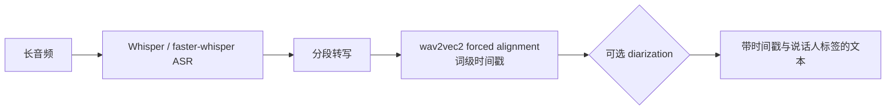

# WhisperX（长音频转写与对齐）

## 1. 身份

`WhisperX` 是基于 Whisper 的长音频转写工具链，重点是批处理转写、词级时间戳、forced alignment，并可接入说话人 diarization。

### 1.1. 流程示意（概念级）



## 2. 什么时候用

- 需要把长会议、访谈、播客转成带时间戳文本。
- 需要词级时间戳，用于字幕、切句、错误定位或训练样本对齐。
- 需要和 [[方向/AI语音/工具/pyannote.audio（说话人分割工具库）]] 拼出“谁在什么时候说了什么”。

## 3. 边界

- 它是 ASR / alignment 工具，不是语音增强模型。
- 中文、方言、强噪声场景仍要抽样核对错字和时间戳漂移。

## 4. 安装方式

```bash
python -m venv .venv
source .venv/bin/activate  # Windows: .venv\Scripts\activate
python -m pip install whisperx
```

还需要准备 `ffmpeg`；部分环境还会需要 Rust / 编译工具链。GPU 版先装匹配 CUDA 的 PyTorch，再装 WhisperX。

## 5. 内网迁移

```bash
# 联网机
python -m pip download -d wheelhouse whisperx

# 内网机
python -m pip install --no-index --find-links wheelhouse whisperx
```

模型权重要单独处理：设置 `HF_HOME`，联网机预下载 Whisper / faster-whisper、wav2vec2 对齐模型和 pyannote diarization 模型，再把 `HF_HOME` 拷到内网。Windows 内网不稳定时，优先用 WSL2 / Linux 环境。

## 6. 外部入口

- [WhisperX repository](https://github.com/m-bain/whisperX)

## 7. 相关对象

- [[方向/AI语音/模型/Whisper]]
- [[方向/AI语音/MOC - ASR]]
- [[方向/AI语音/工具/pyannote.audio（说话人分割工具库）]]
