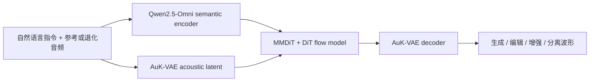

# AuK

## 0. 背景

**问题现场**：语音生成、内容/声学/副语言编辑、语音增强与分离等任务此前分散在各自专用系统中，需要统一基座；同期统一音频模型多走"理解 + 生成"或"编辑专用"路线。

**AuK 的切入点**：一套「自然语言指令 + 可选参考音频 -> 目标波形」的统一接口：约 1.5B rectified-flow MMDiT+DiT 主干，冻结 Qwen2.5-Omni 提供语义条件、自研 AuK-VAE 提供声学表示，不含 ASR/理解侧，专注生成与编辑。

## 1. 身份

AuK 是腾讯混元 2026-09-09 开源的统一语音基座模型（AuK Technical Report: An Open-Source Foundational Model for Speech Generation and Editing）：用一套「自然语言指令 + 可选参考音频 -> 目标波形」的接口，覆盖语音生成、内容/声学/副语言编辑、语音增强与分离五大任务族。

和 [[方向/AI语音/模型/FireRedAudio|FireRedAudio]] 这类「理解 + 生成」统一模型不同，AuK 不含 ASR / 音频理解侧，专注生成与编辑；主干是约 1.5B 参数的 rectified-flow Transformer（MMDiT + DiT），语义条件来自冻结的 [[Qwen2.5-Omni|Qwen2.5-Omni]]，声学表示来自自研 AuK-VAE。代码与权重 MIT 协议开源，另有 4 步蒸馏版 AuK-Flash。

## 2. 核心信息

- **主干**：约 1.5B 参数，30 层 = 10 个双流 MMDiT block + 20 个单流 DiT block；hidden 1536、24 头、SwiGLU FFN；RoPE + [[方向/AI语音/知识/基础概念/Conv Position Embedding（卷积位置嵌入）|卷积位置嵌入]]（沿用 F5-TTS 设计）、QK-Norm + zero-init AdaLN。
- **双流条件**：语义流 = Qwen2.5-Omni 各层 hidden states 经 LayerNorm 后可学习加权求和（指令文本直接进 LLM，参考音频走其 audio encoder）；声学流 = AuK-VAE latent。
- **AuK-VAE**：flow-augmented audio VAE，24 kHz 波形 -> 64 维 50 Hz latent（480× 下采样）；非因果 encoder，因果 decoder 遵循 BigVGAN 设计（SnakeBeta、AMP、3 帧 look-ahead）；训练时附加 4 层 residual coupling normalizing flow 正则化 latent。生成器约 0.16B 参数（论文未明示；由 HF 权重 `vae.safetensors` 637 MB、fp32 存储反推 ≈1.6 亿，与 config.yaml 结构逐块估算 ~160M 吻合，待核）；flow 仅训练期存在、推理时丢弃。
- **模块边界**：MLLM 与 VAE 训练和推理时均冻结，只更新主干与 layer-fusion 参数；checkpoint 只含 diffusion transformer + layer-fusion 权重，Qwen2.5-Omni（开源实现用 3B 版）与 VAE 单独加载。参数量口径：「1.5B」仅指主干；完整推理系统 = 主干 ~1.5B + Qwen2.5-Omni-3B + AuK-VAE ~0.16B ≈ 4.7B（主干权重 fp32 落盘 6.122 GB、VAE 637 MB）。
- **任务面**：zero-shot TTS（transcript-free）、Instruct TTS、内容编辑（替换/插入/删除）、歌词编辑、pitch/speed/volume 声学编辑、情绪/音色/去口音/非语言事件（39 类）/耳语转换等副语言编辑、语音增强（支持「选择性增强」——指令指名去什么才去什么）、语音分离、目标说话人提取（按说话顺序/响度/时间戳指定）、音乐分离。
- **开放状态**：论文、GitHub 代码、HF / ModelScope 权重（AuK + AuK-Flash）与在线 demo 均已公开，MIT 协议。

## 3. 核心机制

### 3.1. 总体数据流

```text
自然语言指令 + 可选参考音频
  -> [Prompt Enhancer] 任务路由 / 参数校验 / 指令改写 / 时长估计（自由文本入口，可绕过）
  -> 语义条件：Qwen2.5-Omni hidden states 可学习层融合 -> c_sem
  -> 声学条件：AuK-VAE Encoder -> 50 Hz / 64-d latent
  -> 双流 MMDiT（语义/声学流各自残差 + joint attention）
  -> 单流 DiT 预测 flow velocity
  -> 确定性 ODE solver 从高斯噪声积分（按估计时长定 latent 长度）
  -> AuK-VAE Decoder -> 24 kHz waveform
```
![[Pasted image 20260924165153.png]]

把这条链路压缩成机制公式：设 $c_{\mathrm{sem}}$ 为 Qwen2.5-Omni 产生的语义条件，$c_{\mathrm{ac}}$ 为 AuK-VAE 产生的声学条件，$z_0$ 为初始噪声 latent，$z_1$ 为目标声学 latent，$v_\theta$ 为 flow 速度场，$\hat{a}$ 为解码波形。

$$
c_{\mathrm{sem}}=G_{\mathrm{sem}}(\text{text},\text{reference}),
\qquad
c_{\mathrm{ac}}=E_{\mathrm{AuK}}(\text{reference})
$$

$$
\frac{d z_t}{d t}=v_\theta(z_t,t,c_{\mathrm{sem}},c_{\mathrm{ac}}),
\qquad
\hat{a}=D_{\mathrm{AuK}}(z_1)
$$

其中 $G_{\mathrm{sem}}$ 为语义条件提取器，$E_{\mathrm{AuK}}$ 为声学编码器，$D_{\mathrm{AuK}}$ 为声学解码器，$z_t$ 为 ODE 在时间 $t$ 的 latent 状态。双流 MMDiT 负责融合两类条件，单流 DiT 负责在联合条件下预测速度场。

代码视角的完整架构图（`CFMEdit` 编排层 = 时间采样 / condition dropout / flow MSE / ODE+CFG 采样；`Flux2Edit` 主干 = 10 双流 MMDiT + 20 单流 DiT，注入 `CFMEdit.transformer`）：

![[AuK-CFMEdit-arch.png]]

（矢量版：[[AuK-CFMEdit-arch.svg]]，右键 → 在新标签页打开可无损缩放）

### 3.2. 双流-单流混合主干的设计动机

论文（§3.4、图 4）只明说「MMDiT 交换双流信息但保留各自残差通路，单流统一精炼，同一骨架兼容纯文本生成与参考音频编辑」，未给消融。结构逻辑上的出发点：

- **噪声地位不对称**：语义流是干净条件（MLLM hidden states）；声学流混着干净参考 latent 与带噪目标 latent，且只有它是 flow 时间 $t$ 的作用对象。双流各自持有 QKV / 残差 / AdaLN 调制，噪声不污染条件表示，条件也不干扰去噪动力学；同时 RoPE 后拼接做联合注意力，保证指令语义与参考音色逐层双向交换。
- **分工贵而精、精炼廉而深**：双流块每层近两倍参数，只放前 $M=10$ 层完成模态对齐；融合建立后由 $N=20$ 层单流在联合表示上深度精炼速度场，输出只取 target 位置，参数/算力效率最高。
- **对任务配置宽容**：声学流有无参考 latent 两种形态（Instruct TTS 只有噪声 target）都能走同一套权重，是五大任务族共用一套骨架的前提。

注意：10+20 的配比与「为何不用纯单流拼接（F5-TTS 式）」论文均无消融，属设计论证而非实证结论；结构上直接继承 FLUX/SD3 的 MMDiT 先例。
![[Pasted image 20260924165301.png]]
### 3.3. AuK-VAE：flow-augmented 潜空间

设 $a$ 为输入波形，$E_\phi$ 为 VAE 编码器，$(\boldsymbol{\mu},\log\boldsymbol{\sigma}^2)$ 为编码器输出，$\boldsymbol{\epsilon}\sim\mathcal{N}(\mathbf{0},\mathbf{I})$ 为标准高斯噪声，$\mathbf{z}$ 为重参数化后的原始声学 latent，$\mathcal{F}_\psi$ 为可逆 flow，$\mathbf{z}_p$ 为 flow 变换后的 latent，$D_\theta$ 为波形解码器：

$$
(\boldsymbol{\mu},\log\boldsymbol{\sigma}^2)=E_\phi(a),\qquad
\mathbf{z}=\boldsymbol{\mu}+\boldsymbol{\sigma}\odot\boldsymbol{\epsilon},\qquad
\mathbf{z}_p=\mathcal{F}_\psi(\mathbf{z}),\qquad
\hat{a}=D_\theta(\mathbf{z})
$$

解码器使用原始 $\mathbf{z}$ 重建波形，flow 只把后验变换为更接近标准高斯的 $\mathbf{z}_p$，用于训练期的 KL 正则。令 $\mathcal{L}_{\mathrm{rec}}$ 为重建损失，$\mathcal{L}_{\mathrm{KL}}$ 为变换后后验与标准高斯先验之间的 KL，$\lambda_{\mathrm{rec}}$ 和 $\lambda_{\mathrm{KL}}$ 为损失权重，则 VAE 的核心目标可写为：

$$
\mathcal{L}_{\mathrm{VAE}}
=\lambda_{\mathrm{rec}}\mathcal{L}_{\mathrm{rec}}(a,\hat{a})
+\lambda_{\mathrm{KL}}
D_{\mathrm{KL}}
\left(q_\phi(\mathbf{z}_p\mid a)\,\middle\|\,\mathcal{N}(\mathbf{0},\mathbf{I})\right)
$$

先回答「为什么 latent 要以高斯建模」：高斯不是因为真实 latent 服从高斯（显然不是），而是它一人分饰三角——（1）**可解析的 KL 锚点**：对角高斯后验对标准高斯先验的 KL 有闭式解 $\frac{1}{2}\sum_i(\mu_i^2+\sigma_i^2-\log\sigma_i^2-1)$，配合重参数化 $\mathbf{z}=\boldsymbol{\mu}+\boldsymbol{\sigma}\odot\boldsymbol{\epsilon}$ 可直接反向传播，不需要采样估计或判别器；（2）**率失真意义下的率项**：约束瓶颈信息容量、把数值尺度钉在 0/1 附近，同时让潜空间连续紧致（相邻 latent 解码出相似音频，无洞无飞地）；（3）**下游 flow 的规整终点**：注意 flow matching 理论上能把噪声搬运到任意分布，「latent 必须是高斯」并不成立——真正的诉求是目标分布越各向同性、无长尾，主干要学的速度场越平滑，越少 NFE 就能积准。

VAE 设计沿用 MiniMax-Speech（arXiv 2505.07916）的 flow-augmented audio VAE。它针对的是标准 VAE 的两难：KL 项 $D_{\mathrm{KL}}(q(\mathbf{z}|\mathbf{x})\,\|\,\mathcal{N}(\mathbf{0},\mathbf{I}))$ 权重调大，潜空间规整但重建发糊；权重调小，重建好但聚合后验 $q(\mathbf{z})=\mathbb{E}_{\mathbf{x}}[q(\mathbf{z}|\mathbf{x})]$ 偏离高斯、潜变量挤在低维流形上、空间里到处是采样会掉进去的「洞」——而主干恰恰假设 $\mathbf{z}_0\sim\mathcal{N}(\mathbf{0},\mathbf{I})$ 到 $\mathbf{z}_1$ 之间存在一条可学的传输路径。

「augmented」指在潜变量与高斯先验之间插入一个可逆变换：编码器给出 $\mathbf{z}=\boldsymbol{\mu}+\boldsymbol{\epsilon}\odot\boldsymbol{\sigma}$ 后先过 flow $\mathbf{z}_p=\mathcal{F}(\mathbf{z})$，KL 改为约束变换后的变量 $D_{\mathrm{KL}}(q_\phi(\mathbf{z}_p|\mathbf{x})\,\|\,\mathcal{N}(\mathbf{0},\mathbf{I}))$。flow 可逆且有表达力，能替潜空间吸收掉全部非高斯结构（论证见 [[方向/AI语音/知识/基础概念/Normalizing Flow（归一化流）#2.3. 为什么「可逆 + 有表达力」就能吸收任意非高斯结构|NF §2.3]]），于是解码器继续用原始 $\mathbf{z}$、保住重建信息，而「必须像高斯」这条约束落在一个可以被扭曲的变量上，两者不再互掐。AuK 的 flow 是 4 层 residual coupling layer 夹通道翻转：coupling 把通道切成 $(\mathbf{a},\mathbf{b})$，输出 $\mathbf{b}'=\mathbf{b}\odot\exp(\mathbf{s}(\mathbf{a}))+\mathbf{t}(\mathbf{a})$、$\mathbf{a}$ 原样通过——逆变换可直接写出，Jacobian 为三角阵故 log-det 就是 $\sum\mathbf{s}(\mathbf{a})$，开销近乎为零。

关键性质是 **flow 只在 VAE 训练时存在，推理时整个丢掉**：论文明确声学条件与波形重建都在原始 $\mathbf{z}$ 空间进行。训练时靠 flow 把 $q(\mathbf{z}_p)$ 拉成高斯、让 $\mathbf{z}$ 自由长成重建友好的形状；推理时直接在 $\mathbf{z}$ 空间从 $\mathcal{N}(\mathbf{0},\mathbf{I})$ 起采样，由主干用流匹配把噪声运到 $q(\mathbf{z}_1)$。这对 AuK 尤其重要，因为 $\mathbf{z}$ 一物两用——既是参考音频的声学条件 $\mathbf{c}_{\mathrm{ac}}=\mathbf{z}_{\mathrm{ref}}$（编辑任务要逐位比对），又是流匹配的预测目标 $\mathbf{z}_1$（要求速度场可稳定回归）——一个被 KL 压坏或空洞遍地的潜空间会同时拖累两者。

**编码器（非因果，质量优先）**：conv k=3 -> 12 通道 -> 6 个下采样块（strides $(2,2,2,3,4,5)$，通道 $12\to768$，每块 = 步长卷积[kernel=2×stride，消棋盘格伪影] + 6 个残差单元[k=3，dilation $(1,2,4,8,16,32)$ 递增撑感受野] + LeakyReLU）-> conv k=3 -> 128 通道（64 维 $\boldsymbol{\mu}$ + 64 维 $\log\boldsymbol{\sigma}$），全程 weight normalization。非因果是因为编码只跑离线（参考音频、训练数据构造），用满上下文换最高重建质量。

**解码器（BigVGAN 式，因果，流式留路）**:3 帧 look-ahead conv k=7 -> 1536 通道，此后全部因果 -> 6 个转置卷积块（strides $(5,4,3,2,2,2)$，通道 $1536\to24$）-> 每块接抗锯齿 AMP 模块（残差分支 kernel $\{3,7,11\}$ × dilation $\{1,3,5\}$，压上采样混叠伪影）-> 逐通道 SnakeBeta 激活（周期归纳偏置，利于谐波重建）+ 因果 conv k=7 -> 波形。解码器在生成热路径上，只留 3 帧（60ms）前瞻，为流式输出留路。

把这条结构写成数据流公式：设 $U_i$ 为第 $i$ 个转置卷积上采样块，$A_i$ 为其后的 AMP 抗锯齿模块，$S_i$ 为 SnakeBeta 激活，$h_0$ 为输入 latent 经首层卷积得到的特征，则

$$
h_i=S_i\!\left(A_i\!\left(U_i(h_{i-1})\right)\right),quad i=1,\ldots,6,
\qquad
\hat{a}=\operatorname{Conv}_{\mathrm{causal}}(h_6)
$$

其中六个 $U_i$ 的时间步长依次为 $(5,4,3,2,2,2)$；除首层允许 3 帧（60 ms）look-ahead 外，其余卷积保持因果，因此解码器可以流式生成波形。

**训练配方**(DAC 式):$\mathcal{L}_{\mathrm{VAE}}=15\,\mathcal{L}_{\mathrm{mel}}+1\,\mathcal{L}_{\mathrm{adv}}+2\,\mathcal{L}_{\mathrm{feat}}+5\,\mathcal{L}_{\mathrm{KL}}$——多尺度 log-mel L1(7 组窗长 $\{32\dots2048\}$ × hop $\{8\dots512\}$ × mel-bin $\{5\dots320\}$)+ LS-GAN(MPD 周期 $\{2,3,5,7,11\}$ + 多尺度 CQT 判别器，对数频率分辨率照顾音乐/音高，配套三域训练）+ 判别器中间层 feature matching + flow 变换后验的 KL。约 300 万小时、speech:music:audio = 6:3:1、1.28 秒切片、124 万步。

### 3.4. 生成建模

- 走 [[方向/AI语音/知识/基础概念/Flow Matching（流匹配）|rectified-flow]] 路线：训练用 flow MSE，时间采样偏向低 $t$（$u \sim \mathcal{N}(-0.8, 0.8^2)$）。
- 分层 condition dropout：声学条件 0.3、全无条件 0.2；zero-shot 参考音频 50% 概率随机裁剪至 ≥3 秒。
- 推理：AuK 基础版 32 [[方向/AI语音/评估/NFE（函数评估次数）|NFE]]、CFG 2.0、Euler solver；AuK-Flash 固定 4 步、无 CFG。

### 3.5. AuK-Flash 蒸馏

两阶段：先 trajectory consistency distillation 初始化（500 updates），再 [[方向/AI语音/知识/基础概念/Decoupled DMD（解耦分布匹配蒸馏）|Task-Routed Decoupled DMD]]（2500 student updates；CA 分支用 APG 替代 CFG 防过饱和；分离任务被路由到监督式 clean-prediction 目标、不参与 DMD，以防分离能力退化）。同硬件下相对 32-NFE teacher 达成 4.5× 墙钟加速，bf16。

### 3.5.1. 推理入口：Prompt Enhancer 与时长估计

自由文本请求先过 Prompt Enhancer（PE）：有音频时先 ASR 取转写与语种，再由 LLM 判定目标任务、抽取参数与控制量；参数按训练时见过的范围校验，口语化的语速/响度/音高描述被映射到支持的离散档位，不支持的请求在声学推理前直接拒绝；最后用任务模板渲染成贴近训练分布的指令，用户给的合成文本与替换内容原样保留。符合规范格式的指令可绕过 PE 直接喂给模型。

PE 还负责音频预处理（首尾静音、重采样、电平归一）并估计输出时长——这一步直接决定生成 latent 的长度（50 Hz）。$T_{\mathrm{out}}$ 按任务分支：零样本 TTS 与内容编辑按目标/源文本的 UTF-8 字节长度比缩放输入时长 $T_{\mathrm{in}} \cdot B(x_{\mathrm{target}})/B(x_{\mathrm{source}})$，其中零样本的 $x_{\mathrm{source}}$ 由模型内部转写参考音频得到（这正是 transcript-free 的接口收益，用户无需提供参考转写）；变速编辑直接 $T_{\mathrm{in}}/s$；情绪编辑乘一个从训练数据估出的系数 $\kappa_e T_{\mathrm{in}}$，非语言编辑加一个估出的偏移 $T_{\mathrm{in}} + \Delta_{\mathrm{nv}}$；指令 TTS 先用语言相关的字节速率系数估基线 $\widehat{T}_{\mathrm{base}} = \rho_\ell B(x_{\mathrm{target}})$，再由 LLM 按目标风格和文本微调；保时长操作直接用 $T_{\mathrm{in}}$。

### 3.6. 语义编码器为何选 Qwen2.5-Omni

论文只写「AuK uses Qwen2.5-Omni as its semantic encoder」，**未给理由、无消融**；以下为据报告结构、仓库与模型事实的判断，非论文口径。

报告里两代 Qwen-Omni 是分角色的：Qwen3-Omni 只被 §2.1 / §2.3 引用（离线数据打标——Instruct TTS 的自由描述与结构化属性、音色描述），Qwen2.5-Omni 出现在 §1 / §3.2 / §4.3.2（架构与训练）。同一篇论文里打标用 3、编码器用 2.5，不是不知道有 Qwen3-Omni。

- **尺寸档位对不上**：Qwen3-Omni 开源的三档（Instruct / Thinking / Captioner）均为 30B-A3B MoE（约 35.3B 总参、权重约 60 GB），而 AuK 主干只有 1.5B。语义编码器每次推理都要跑（指令走其 LLM、参考音频走其 audio encoder），30B 编码器配 1.5B 主干会直接吃掉 AuK-Flash 4.5× 加速的意义。Qwen2.5-Omni 有 3B dense 档，仓库默认加载的正是 `Qwen2.5-Omni-3B`。
- **冻结编码器要的是稳定，不是更强**：$c_{\mathrm{sem}}=\sum_\ell w_\ell\cdot\operatorname{LayerNorm}(\mathbf{h}^{(\ell)})$ 里的 $w_\ell$ 训练后固定、推理不再更新，条件分布在训练与推理之间必须一致；MoE 路由会让 hidden states 随输入抖动更大，dense 的逐层表示更可预测。
- **换编码器要重跑整条链**：层数、hidden 维度、逐层语义分布全变 → layer fusion 重学，60 万步预训练与两阶段后训练全部重验，而收益只落在一个不参与生成的模块上。
- **次要**：Qwen3-Omni 拆成 Instruct / Thinking / Captioner 三个变体，Thinking 会先产思维链 token，对「只要逐层 hidden」的用途是额外负担。
- **时间线不是理由**：Qwen3-Omni 于 2025-09 开源，AuK 2026-09 发布，相隔一年。

团队的选点逻辑另有一处佐证：风格一致性奖励模型用 Qwen2.5-Omni-**7B**（要判断力），语义编码器用 **3B**（每次推理都要跑）。

### 3.7. 架构示意（概念级）

> [!note] 架构示意（概念级）
> 按本页已有输入—中间表示—输出链路整理，不替代论文结构图。



## 4. 训练策略

- **数据规模**：约 30.3 亿 instruction–audio 实例、195 万小时有效监督，覆盖五大任务族；VAE 另用约 300 万小时（speech:music:audio = 6:3:1）训练。
- **监督构造**：零样本 TTS 走 cross-utterance——同一说话人的 $n$ 条语音枚举全部 $C_n^2$ 个无序对，每对中两条各当一次 acoustic prompt 和一次合成目标，得 $n(n-1)$ 条双向实例；每条只含 prompt 波形与目标文本，prompt 转写从不给出（transcript-free 的来源）。论文称相比传统的「同一条录音切成 prompt + target」，跨句构造逼模型把说话人不变特征与语句特有因素（韵律、录音条件）分开，表现力和说话人相似度都更好。声学编辑则用确定性 DSP 造对：5 档语速（0.5/0.75/1.25/1.5/2.0×，变调保时长的 time-stretch）、6 档响度（±5/±10/±15 dB 波形增益）、6 档音高（±1/±2/±3 半音，变时保长的 pitch shift），每条变换配源音频与写明属性、幅度的指令，并做校验与峰值保护防削波。
- **合成数据管线**：Qwen3-Omni 打标、Qwen3-TTS-CustomVoice + IndexTTS2 合成情绪数据、[[方向/AI语音/模型/CosyVoice|CosyVoice2]] + [[方向/AI语音/模型/OmniVoice|OmniVoice]] 造 de-accent 对、F5-TTS 做 masked infilling、Qwen3-ForcedAligner 对齐、YingMusic-Singer-Plus 合成歌词编辑目标；音色编辑沿用 X-VC 语料（SeedVC-Small 构建）。音乐侧先做 stem 分离，再转写伴奏与歌词比对、剔除文本大量重叠的歌曲，压掉伴奏里的残留人声。
- **统一预训练**：阶段一仅生成任务 50k 步 warm-up；阶段二生成+编辑联合 600k 步。五族混合比例：生成 28.10% / 内容编辑 23.02% / 增强分离 23.17% / 副语言编辑 21.75% / 声学编辑 3.96%。按长度分桶动态批：每卡上限 10,000 个 50 Hz latent 帧或 24 条/微批，全局批上限 6,144 条，约合每优化步 14 小时音频。256 GPU、ZeRO-2、bf16、AdamW lr 1e-4、EMA 0.9999。
- **后训练**：① 编辑偏好优化——人工三级评分（818 组 / 9080 候选），Flow-DPO + LiPO listwise，仅 104 步；② 生成 RL——Flow-GRPO + MixGRPO（低 SNR 区 6 步随机窗口），zero-shot 用 ASR + 说话人相似度奖励（区分容忍/严格错误率防 reward hacking），Instruct TTS 用基于 Qwen2.5-Omni-7B 训练的风格一致性奖励模型。RL 从编辑偏好 checkpoint 起训，每 prompt 采 G=16 个候选，rollout 用 500 步采样（CFG 2.0、[[方向/AI语音/知识/基础概念/Sway Sampling（摇摆采样）|sway]] −1.0），共 500 步更新；AdamW lr 5e-5、梯度裁剪 1.0，KL 系数从 0.12 起朝目标 KL 1e-3 在 [0.08, 0.5] 内自适应。
- **涌现迁移**（§7.4）：耳语数据只有「普通 -> 耳语」编辑对，但能直接以文本生成耳语；de-accent 监督仅覆盖中文方言，却能去除印度/日本口音英语——编辑对中学到的变换可迁移到生成与未见口音。

## 5. 测试基准与性能

官方自报口径（均为论文/仓库数字，待第三方复测）：

- **AuK-VAE 重建**：speech（Seed-TTS-Eval）[[方向/AI语音/评估/PESQ|PESQ]] 4.143、audio（AudioSet）3.833、music（MUSDB18-HQ）3.884，三域均超 MiniMax-H3-AudioVAE、Stable-Audio-3-SAME-L、MMAudio-VAE 等对照。
- **Zero-shot TTS**（Seed-TTS-Eval）：AuK 平均 [[方向/AI语音/评估/WER（词错误率）|WER]] 2.65% / SIM 0.795 双指标第一（[[方向/AI语音/模型/Qwen3-TTS|Qwen3-TTS]] 3.07/0.745、Seed-TTS 3.65/0.778）；AuK-Flash 2.85/0.790。
- **InstructTTSEval**：中文 DSD 83.37%（超 Qwen3-TTS-VD 2.27 pt）；英文 AuK-Flash 82.40% 与 Qwen3-TTS-VD 并列最佳。
- **语音编辑**：MMAE-Speech 上 AuK IFR 48.23 / CR 88.11 最高（对比 Step-Audio-EditX +4.71/+10.84 pt），EMR 最高是 Flash 的 13.85%（Ming-UniAudio 7.04%）；SpeechEditBench 上 AuK 内容 91.83、韵律 71.33、声学 37.07 三项最佳，副语言由 Flash 39.25 最佳；Ming-Freeform-Audio-Edit 语义编辑 Full 设定中文 WER 10.46→3.09（vs [[方向/AI语音/模型/Ming-UniAudio|Ming-UniAudio]]）。
- **增强/分离**：[[方向/AI语音/评估/DNS Challenge（深度噪声抑制挑战）|DNS Challenge]] dWER 2.66%（超 [[方向/AI语音/模型/RE-USE|RE-USE]] 0.65 pt）；[[方向/AI语音/评估/CHiME（语音分离与识别挑战赛）|CHiME-4]] Flash WER 7.84% 最低；Libri2Mix WER 9.12% 最低；VCTK-SR 含 2 kHz 带限外推在内 8 项退化中 Flash 六项指标最佳。
- **总体口径**：生成与通用指令编辑领先，信号级恢复任务有竞争力；full 模型语言准确性/编辑保真更强，Flash 感知质量（[[方向/AI语音/评估/UTMOS|UTMOS]]/DNSMOS）常常更好。

## 6. 边界

- 训练数据为中英双语；whisper 数据仅普通话；de-accent 监督仅覆盖 13 类中文方言/口音（论文称对印度/日本口音英语的迁移只是定性观察）。其他语言覆盖来源未说明。
- 预训练 utterance 1–35 秒；ComfyUI 集成限制源+目标共 30 秒。
- 官方声明的核心局限：原生自由格式指令跟随不完整——曾用 Audio-Oscar 的 agent 数据管线做 free-form 编辑 SFT，指令多样性提升但泛化不鲁棒，达到能力上限仍依赖 Prompt Enhancer 做任务路由与改写。
- 具备 [[方向/AI语音/知识/基础概念/Zero-shot Voice Cloning（零样本声音克隆）|zero-shot voice cloning]] 与歌词/内容改写能力，只应作为研究/授权场景工具。
- 实现依赖：Prompt Enhancer 需要 OpenAI 兼容 LLM 与可选云 ASR（本地回退 SenseVoiceSmall）；Qwen3-Omni 暂不支持作为 `--qwen_path`。

## 7. 技术脉络

AuK 不是从单一前身长出，而是把五条成熟技术线组装到一个指令接口下；架构创新预算近零，增量集中在任务形式化、数据构造与规模化调通。

**生态位**：同期统一音频模型分「理解 + 生成」（Audio-Omni、[[方向/AI语音/模型/Ming-UniAudio|Ming-UniAudio]]、[[方向/AI语音/模型/FireRedAudio|FireRedAudio]]）与「编辑专用」（[[方向/AI语音/模型/CosyEdit|CosyEdit]]、Step-Audio-EditX）两支；AuK 选「生成 + 编辑 + 增强分离」、不含理解侧。思想前驱：[[方向/AI语音/模型/CosyEdit|CosyEdit]]（从 zero-shot TTS 解锁编辑）与 [[方向/AI语音/模型/Qwen3-TTS|Qwen3-TTS]] 系（免转录克隆、指令控制）。

- **语义条件 ← Omni 系 MLLM**：冻结 [[Qwen2.5-Omni|Qwen2.5-Omni]] 做指令 + 音频联合编码；Qwen3-Omni 用于数据打标。层融合加权属 [[方向/AI语音/知识/基础概念/ELMo（深层上下文化词表示）|ELMo]]/SSL 特征选择一脉。
- **AuK-VAE 的来源组合**：解码器采用 BigVGAN 式的 AMP 抗锯齿与 SnakeBeta 结构；潜变量正则采用 MiniMax-Speech 式 Flow-VAE，把 KL 约束施加到可逆 flow 变换后的 latent。两条路线分别负责波形重建质量与潜空间规整，不应合并称为“BigVGAN-Flow-VAE”。
- **主干 ← 图像扩散 Transformer 血统**:DiT（扩散主干 Transformer 化、AdaLN）-> SD3（MMDiT 双流块）-> FLUX/FLUX.2（双流 + 单流混合）,F5-TTS 把 DiT 搬进 TTS 并贡献 [[方向/AI语音/知识/基础概念/Conv Position Embedding（卷积位置嵌入）|卷积位置嵌入]]（源自 wav2vec 2.0），加 RoPE / RMSNorm / SwiGLU / QK-Norm 标准件。
- **生成与加速 ← flow 一脉**:Flow Matching / [[方向/AI语音/知识/基础概念/CFM Theorem（条件流匹配等价定理）|CFM]] -> rectified flow 直线路径；蒸馏走一致性蒸馏（Consistency Models 系）-> [[方向/AI语音/知识/基础概念/Decoupled DMD（解耦分布匹配蒸馏）|Decoupled DMD]]（Z-Image 验证）+ APG 替代 CFG，对照过 CausVid / MeanFlow。
- **后训练 ← RLHF 技术栈的 flow 化**:DPO -> Diffusion-DPO -> flow-DPO;LiPO 解决三级序数偏好的利用；GRPO -> Flow-GRPO -> MixGRPO（混合 ODE-SDE 采样窗口）。

**数据管线站在开源语音生态上**:195 万小时监督大量由其他开源模型合成——Qwen3-TTS-CustomVoice + IndexTTS2（情绪）、[[方向/AI语音/模型/CosyVoice|CosyVoice2]] + OmniVoice（去口音）、F5-TTS（掩码填充）、Qwen3-ForcedAligner（对齐）、YingMusic-Singer-Plus（歌词）、Audio-Oscar（自由指令尝试，失败并如实报告）。任务族覆盖率本质是这些专用工具能力的并集再蒸馏。

**评测零自建主榜**:Seed-TTS-Eval、InstructTTSEval、MMAE-Speech、SpeechEditBench、Ming-Freeform-Audio-Edit、DNS / CHiME-4 / Libri2Mix、MUSDB18-HQ 全部借用；唯一自建是 VCTK-SR（8 种退化）。

一句话：**AuK = Qwen2.5-Omni 的语义理解 × MiniMax-Speech 式 flow-VAE × FLUX 式混合主干 × rectified-flow / DMD 蒸馏 × DPO/GRPO 后训练栈，用「开源模型互相造数据」把五个任务族灌进一个接口**。

## 8. 相关对象

- [[工程/AuK 微调方案]]：下游微调 AuK 的方案设计（模块边界、数据构造、训练配置、双轴评测、防遗忘与重蒸馏顺序）。
- [[方向/AI语音/MOC - 音频大模型]]：AuK 属于统一音频模型路线中「生成 + 编辑」一支（不含理解侧）。
- [[方向/AI语音/MOC - TTS]]：zero-shot / Instruct TTS 任务入口。
- [[方向/AI语音/模型/FireRedAudio]]：同期统一音频模型对照——FireRedAudio 统一「理解 + 生成」，AuK 统一「生成 + 编辑 + 增强分离」。
- [[方向/AI语音/模型/Ming-UniAudio]]：统一理解/生成/自由编辑的近邻，Ming-Freeform-Audio-Edit 上的主要对照。
- [[Qwen2.5-Omni]]：AuK 的冻结语义条件编码器（开源实现用 3B 版）。
- [[方向/AI语音/模型/Qwen3-TTS]]：zero-shot / Instruct TTS 主要 baseline；其 CustomVoice 版用于合成 AuK 情绪训练数据。
- [[方向/AI语音/模型/CosyVoice]] / [[方向/AI语音/模型/OmniVoice]]：AuK de-accent 训练数据对的合成工具。
- [[方向/AI语音/模型/MaskGCT]] / [[方向/AI语音/模型/XTTS-v2]] / [[方向/AI语音/模型/Confucius4-TTS]]：免转录（transcript-free）zero-shot 克隆路线的先行与同期代表；AuK 的免转录接口属于同一趋势，差异化在 n×(n−1) 枚举配对的数据构造与生成/编辑/分离的任务统一。
- [[方向/AI语音/模型/RE-USE]]：DNS 增强任务的主要对照。
- [[方向/AI语音/模型/Stable Audio 3]] / [[方向/AI语音/模型/MMAudio]]：AuK-VAE 重建质量的对照对象。
- [[方向/AI语音/模型/Qwen-Audio-VAE]]：同期另一条音频 VAE 路线（speech / music / sound 统一连续 latent），可作 AuK-VAE 的同类对照。
- [[方向/AI语音/知识/基础概念/Flow Matching（流匹配）]]：AuK 生成侧的 rectified-flow 采样路线。
- [[方向/AI语音/知识/基础概念/T-Grid Rollout（显式时间网格 Rollout）]]：AuK 生成 RL（Flow-GRPO + MixGRPO）的 rollout 机制，本地 GRPO 实现以此对齐论文配方。
- [[方向/AI语音/知识/基础概念/Normalizing Flow（归一化流）]]：AuK-VAE 潜空间正则器所用的范式（residual coupling，训练后即弃）。
- [[方向/大模型/模型结构/DiT（Diffusion Transformer）]]：主干为 MMDiT + DiT 混合结构。
- [[方向/AI语音/知识/基础概念/SS（语音分离）]] / [[方向/AI语音/知识/基础概念/TSE（目标说话人提取）]] / [[方向/AI语音/知识/基础概念/SR（语音恢复）]]：AuK 增强分离任务族对应的概念入口。

## 9. 关键来源

- [AuK Technical Report: An Open-Source Foundational Model for Speech Generation and Editing](https://arxiv.org/abs/2609.08936)
  - 内容定位：技术报告，定义双流条件（Qwen2.5-Omni + AuK-VAE）、MMDiT/DiT 主干、五大任务族、训练配方与全部评测数字。
  - 用途：判断架构、能力边界与训练策略；本文数字的一手出处。
  - 发表日期：2026-09-08（arXiv v1）
  - 核验日期：2026-09-10
- [Tencent-Hunyuan/AuK（GitHub）](https://github.com/Tencent-Hunyuan/AuK)
  - 内容定位：官方代码、Quick Start、ComfyUI 集成、Prompt Enhancer 依赖说明与 MIT 许可证。
  - 用途：确认开放状态、模块加载边界（checkpoint 仅含 DiT + layer-fusion）、运行依赖。
  - 发布日期：2026-09-09（仓库 News）
  - 核验日期：2026-09-10
- [tencent/AuK（Hugging Face）](https://huggingface.co/tencent/AuK) / [tencent/AuK-Flash](https://huggingface.co/tencent/AuK-Flash)
  - 内容定位：官方权重页（另有 [ModelScope 镜像](https://modelscope.cn/models/Tencent-Hunyuan/AuK) 与 [HF demo](https://huggingface.co/spaces/tencent/AuK)、[项目页](https://auk-project.github.io/)）。
  - 用途：确认权重公开与下载入口。
  - 核验日期：2026-09-10

## 10. 待验证

- 第三方复测 Seed-TTS-Eval、MMAE-Speech、SpeechEditBench、Ming-Freeform-Audio-Edit 与 DNS/Libri2Mix 数字的一致性。
- Prompt Enhancer 在实际部署中的路由错误率；绕过 PE 直接给规范化指令的能力下限。
- AuK-VAE 相对 codec token / 其他连续 latent 在编辑保真与说话人保持上的独立贡献（缺消融的一手确认）。
- 语义编码器选型论文未给理由，也无编码器型号或层融合设计的消融；换更强编码器（如 Qwen3-Omni）的实际增益未知。
- 「AuK」缩写含义来源未说明；论文未标注权重许可证（MIT 仅见 GitHub）。
- 中英以外语言（尤其小语种）生成与编辑能力。
