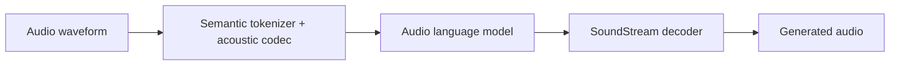

# AudioLM

## 0. 背景

- **范式确立**："音频离散化 → LM 建模"成为 2023+ 语音 AI 的主干——SELM（token-LM 增强）、SpeechGPT / Moshi（对话）、UniSE / SenSE / L3-SE（增强 LM 化）全部沿此线。
- **语义 + 声学分层**：w2v-BERT 语义 token + SoundStream 声学 token 的组合成为后续标准参考。
- **下游增强的启示**：SELM 用 SSL + k-means token 做"噪声 token → 干净 token"映射，是 AudioLM 分层思想在增强域的移植。

## 1. 身份

`AudioLM`（A Language Modeling Approach to Audio Generation）是 Google（Borsos 等，IEEE/ACM TASLP 2023，arXiv:2209.03143）提出的**文本无关纯音频语言模型**：把音频离散化为**语义 token + 声学 token** 两级表示，交给语言模型做长程连贯、高保真的生成（语音延续、钢琴续奏、音效）——"codec token 神经语言模型"路线的源头（[[方向/AI语音/模型/Moshi|Moshi]] / SpeechGPT 对话线、[[方向/AI语音/模型/SELM|SELM]] 增强线都沿此）。

边界：不是语音增强模型（SELM 才是把该思想用于 SE 的工作）；不需要文本（无监督音频 LM，对比 TTS 的文本条件）；它确立的是"音频 = token 序列 → LM 建模"的范式，而非某个具体任务。

## 2. 核心机制

```text
audio waveform
  -> 语义 token：w2v-BERT 中间表示 VQ 量化（保"说什么"、长程结构）
  -> 声学 token：SoundStream 残差量化（保"怎么说"：说话人 / 音色 / 细节）
  -> 语义 LM（自回归，长程连贯）
  -> 声学 LM（以语义 token 为条件，细节填充）
  -> SoundStream decoder -> waveform
```

- **两级 token 分层**：语义 token 负责内容与长程结构，声学 token 负责保真细节——后来的 SLM 普遍沿用"SSL 表示（语义）+ codec（声学）"双 token 结构。
- **层次化 LM**：先训语义 LM，再训以语义为条件的声学 LM——比单级 token LM 更好地平衡连贯性与保真度。
- **文本解耦**：证明无需文本即可做长程音频建模（对比 SpeechGPT 类需要文本对齐）。

设 $a$ 为输入波形，$s$ 为语义 token 序列，$q$ 为声学 token 序列，$E_{sem}$ 为语义 tokenizer，$E_{ac}$ 为 SoundStream tokenizer，$G_{sem}$ 与 $G_{ac}$ 为两级语言模型，$D_{ac}$ 为声学解码器：

$$
s=E_{sem}(a),\qquad q=E_{ac}(a),\qquad
\hat{s}=G_{sem}(s_{<t}),\qquad
\hat{q}=G_{ac}(\hat{s},q_{<t}),\qquad
\hat{a}=D_{ac}(\hat{q})
$$

### 2.1. 架构示意（概念级）

> [!note] 架构示意（概念级）
> 按本页已有输入—中间表示—输出链路整理，不替代论文结构图。



## 3. 边界 / 局限

- 自回归采样慢；codec 音质上限（SoundStream 后来被 EnCodec / DAC 类取代，见 [[方向/AI语音/知识/技术路线/语音生成 tokenizer codec 技术路线|tokenizer codec 技术路线]]）。
- 无文本条件下语义一致性依赖语义 token 质量。
- 生成式幻觉风险——在低 SNR 增强场景尤其有害（对照 URGENT 的"预测式仍占优"结论）。

## 4. 关键来源

- [AudioLM: A Language Modeling Approach to Audio Generation（arXiv:2209.03143）](https://arxiv.org/abs/2209.03143)
  - 内容定位：原始论文，IEEE/ACM TASLP 2023。
  - 用途：两级 token 机制、层次化 LM 与实验设置。
  - 核验日期：2026-08-10

## 5. 相关对象

- [[方向/AI语音/模型/SELM|SELM]]：AudioLM 思想在语音增强上的移植（token-LM SE 早期范式）。
- [[方向/AI语音/模型/Moshi|Moshi]] / SpeechGPT：codec token LM 的对话线（全双工）。
- [[方向/AI语音/模型/UniSE（Unified Speech Enhancement）|UniSE]]、[[方向/AI语音/模型/SenSE|SenSE]]、[[方向/AI语音/模型/L3-SE|L3-SE]]：增强的"语言模型化"线。
- [[方向/AI语音/知识/基础概念/NAC（神经音频 Codec）|NAC]]：声学 token 的 codec 基础（SoundStream 同族）。
- [[方向/AI语音/知识/技术路线/语音生成 tokenizer codec 技术路线|语音生成 tokenizer codec 技术路线]]：tokenizer / codec 全景。
- [[方向/AI语音/知识/基础概念/SSL 编码器|SSL 编码器]]：语义 token 的来源（w2v-BERT / HuBERT）。

## 6. 待验证

- w2v-BERT 语义 token vs HuBERT k-means（SELM 所用）在实际增强中的差异。
- AudioLM 分层（语义 → 声学）在生成式增强中的幻觉行为（对照 SELM 系评测）。
