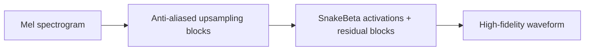

# BigVGAN

## 0. 背景

**问题现场**：需要一个大规模训练的 GAN vocoder，把 mel spectrogram 转成 waveform，并在不同说话人、语言、录音条件和生成模型输出上都有较强泛化。

**前序路线的缺口**：HiFi-GAN 风格 generator 存在高频伪影与 OOD 泛化不足的问题。

**BigVGAN 的切入点**：在 HiFi-GAN 风格 generator 基础上引入 periodic activation（SnakeBeta）与 anti-aliased representation（AMP 模块），缓解高频伪影并提升 OOD 泛化。

## 1. 身份

`BigVGAN` 是 NVIDIA 提出的通用神经声码器（neural vocoder），论文题目是 *BigVGAN: A Universal Neural Vocoder with Large-Scale Training*。它把 mel spectrogram 转成 waveform，目标是让一个大规模训练的 GAN vocoder 在不同说话人、语言、录音条件和生成模型输出上都有较强泛化。

边界：BigVGAN 不是完整 TTS 模型，也不是 audio codec。它通常接在 acoustic model / flow model / token-to-mel 模块之后，负责最后的 `mel -> waveform` 合成。

## 2. 核心信息

- **模型定位**：GAN vocoder；输入 mel spectrogram，输出音频波形。
- **核心结构**：在 HiFi-GAN 风格 generator 基础上引入 periodic activation 和 anti-aliased representation，缓解高频伪影并提升 OOD 泛化。
- **BigVGAN-v2**：官方 repo 2024-07 发布 v2，加入 fused CUDA inference kernel、改进 discriminator / loss、更大更多样训练数据，并支持最高 44 kHz 与 512x upsampling。
- **最终 v2 checkpoint**：官方 release v2.4 更新 5M step pretrained checkpoints，并标注为 BigVGAN-v2 checkpoints 的 final release。
- **常用工程形态**：通过 Hugging Face Hub 直接 `from_pretrained` 加载，也可以在本地训练/微调；快速推理可开启自定义 CUDA kernel。

## 3. 核心机制

```text
text / speech condition
  -> acoustic model / flow model / token-to-mel model
  -> mel spectrogram
  -> BigVGAN generator
  -> waveform
```

BigVGAN 的关键不是“GAN 更大”本身，而是把声码器做成更通用的波形生成器：generator 负责从 mel 条件恢复周期性声源、瞬态和高频细节，discriminator / multi-scale spectral losses 约束波形自然度和频谱一致性。

设 $\mathbf{m}$ 为输入 mel spectrogram，$\mathbf{a}$ 为真实波形，$G_\theta$ 为 BigVGAN generator，$\hat{\mathbf{a}}$ 为生成波形，则整体映射为：

$$
\hat{\mathbf{a}}=G_\theta(\mathbf{m})
$$

生成器内部先把 mel 特征投影为 $\mathbf{h}_0$，再经过 $K$ 个上采样块；$U_i$ 表示第 $i$ 个上采样卷积，$A_i$ 表示 anti-aliased multi-periodicity（AMP）模块，$S_i$ 表示 SnakeBeta 激活：

$$
\mathbf{h}_i=S_i\!\left(A_i\!\left(U_i(\mathbf{h}_{i-1})\right)\right),\quad i=1,\ldots,K,
\qquad
\hat{\mathbf{a}}=\operatorname{Conv}_{\mathrm{out}}(\mathbf{h}_K)
$$

训练时令 $D_\psi$ 表示判别器集合，$\mathcal{L}_{\mathrm{adv}}$ 为对抗损失，$\mathcal{L}_{\mathrm{spec}}$ 为多尺度频谱损失，生成器通过重建与真实波形之间的频谱约束保持音质：

$$
\min_\theta\;\mathcal{L}_{\mathrm{adv}}(G_\theta,D_\psi)
 +\lambda_{\mathrm{spec}}\mathcal{L}_{\mathrm{spec}}(\mathbf{a},\hat{\mathbf{a}})
$$

### 3.1. 架构示意（概念级）

> [!note] 架构示意（概念级）
> 按本页已有输入—中间表示—输出链路整理，不替代论文结构图。



## 4. 使用判断

- 看**TTS 输出头**：BigVGAN 适合接 F5-TTS、CosyVoice、语音增强里的 flow/mel 生成模块，作为 `mel -> waveform` 的最后一段。
- 看**采样率和 mel 参数**：vocoder 必须匹配训练时的 sampling rate、mel band、fmax、hop / upsampling ratio；不能随便替换不同配置。
- 看**实时部署**：BigVGAN-v2 的 fused CUDA kernel 可以明显提速，但需要 nvcc / ninja / CUDA 版本匹配。
- 看**泛化风险**：如果上游 mel 分布和训练数据差太远，vocoder 可能产生金属音、爆音、高频伪影或说话人漂移。

## 5. 测试基准与性能

以下结果整理自 [BigVGAN arXiv 论文](https://arxiv.org/abs/2206.04658) Table 2、Table 7–10。↓ 表示越低越好，↑ 表示越高越好。

#### 5.1.1. LibriTTS 主观与客观指标

| 模型 | 参数量 | M-STFT↓ | PESQ↑ | MCD↓ | Periodicity↓ | V/UV F1↑ | MOS↑ | SMOS↑ |
|---|---:|---:|---:|---:|---:|---:|---:|---:|
| HiFi-GAN V1 | — | 1.0017 | 2.947 | 0.6603 | 0.1565 | 0.9300 | 4.08±0.09 | 4.15±0.09 |
| BigVGAN-base | 14M | 0.8788 | 3.519 | 0.4564 | 0.1287 | 0.9459 | 4.10±0.09 | 4.20±0.08 |
| BigVGAN | 112M | 0.7997 | 4.027 | 0.3745 | 0.1018 | 0.9598 | 4.11±0.09 | 4.26±0.08 |
| Ground truth | — | — | — | — | — | — | 4.40±0.06 | 4.44±0.06 |

#### 5.1.2. Unseen / OOD 测试

| 数据集 | 模型 | MAE↓ | M-STFT↓ | PESQ↑ | MCD↓ | Periodicity↓ | V/UV F1↑ |
|---|---|---:|---:|---:|---:|---:|---:|
| LibriTTS dev-clean | BigVGAN-base | 0.1546 | 0.8569 | 3.574 | 0.4180 | 0.1298 | 0.9475 |
| LibriTTS dev-clean | BigVGAN | 0.0931 | 0.7796 | 4.053 | 0.3392 | 0.1013 | 0.9610 |
| LibriTTS dev-other | BigVGAN-base | 0.1625 | 0.9006 | 3.464 | 0.4947 | 0.1276 | 0.9442 |
| LibriTTS dev-other | BigVGAN | 0.0986 | 0.8197 | 4.001 | 0.4097 | 0.1023 | 0.9586 |
| VCTK | BigVGAN-base | 0.1527 | 0.8677 | 3.443 | 0.4526 | 0.1047 | 0.9586 |
| VCTK | BigVGAN | 0.0925 | 0.7684 | 4.001 | 0.3557 | 0.0833 | 0.9672 |
| LJSpeech | BigVGAN-base | 0.1747 | 0.9121 | 3.741 | 0.8626 | 0.1164 | 0.9548 |
| LJSpeech | BigVGAN | 0.1102 | 0.8554 | 4.112 | 0.7164 | 0.0957 | 0.9642 |

原始论文 v1 的 BigVGAN 结果与官方 README 中 BigVGAN-v2 的 checkpoint / speed benchmark 不是同一实验口径；后者仍保留作为工程部署参考。

## 6. 相关对象

- [[方向/AI语音/知识/基础概念/Vocoder（声码器）]]：BigVGAN 属于 GAN vocoder 路线。
- [[方向/AI语音/MOC - TTS]]：TTS 链路里常见的输出侧 waveform synthesis 模块。
- [[方向/AI语音/知识/基础概念/Spectrogram（声谱图）]]：BigVGAN 的主要输入是 mel spectrogram。
- [[方向/AI语音/模型/F5-TTS]]：常见的 flow-matching TTS 上游，输出 mel 后可接 BigVGAN。
- [[方向/AI语音/模型/CosyVoice]]：TTS 系统对照，通常也需要 vocoder / waveform decoder 输出音频。
- [[方向/AI语音/数据集/LibriTTS]]：原始论文和官方 checkpoint 表中使用的重要训练/评测语料。
- [[方向/AI语音/数据集/VCTK]]：官方早期 22 kHz checkpoint 表中列出的训练语料之一。

## 7. 来源

- [BigVGAN: A Universal Neural Vocoder with Large-Scale Training（arXiv:2206.04658）](https://arxiv.org/abs/2206.04658)
  - 内容定位：原始论文入口，记录 BigVGAN 的通用神经声码器定位、large-scale training、periodic activation 和 anti-aliased representation。
  - 用途：确认模型身份、发表时间、核心机制和 ICLR 2023 论文线索。
  - 核验日期：2026-09-16
- [NVIDIA/BigVGAN（GitHub）](https://github.com/NVIDIA/BigVGAN)
  - 内容定位：官方 PyTorch 实现，记录 BigVGAN-v2、v2.4 final checkpoints、CUDA kernel、Hugging Face Hub 推理、训练/微调和 benchmark 表。
  - 用途：确认代码、权重、工程入口、版本线和部署注意事项。
  - 核验日期：2026-09-16
- [nvidia/bigvgan_v2_24khz_100band_256x（Hugging Face）](https://huggingface.co/nvidia/bigvgan_v2_24khz_100band_256x)
  - 内容定位：NVIDIA 发布的 BigVGAN-v2 24 kHz / 100-band / 256x checkpoint model card，标注 MIT license、audio-to-audio、neural-vocoder 和 Hub 使用方式。
  - 用途：确认权重开放、许可证和常用 checkpoint 配置。
  - 核验日期：2026-09-16

## 8. 待实验与结构决策

- BigVGAN-v2 不同 checkpoint（22 kHz / 24 kHz / 44 kHz、80/100/128 mel band、256x/512x）在本地 TTS 链路里的最佳匹配。
- 与 Vocos、HiFi-GAN、HIFT、codec decoder 在中文、方言、长文本、强情绪和语音增强输出上的听感差异。
- CUDA fused kernel 在本机 CUDA / PyTorch 版本下是否数值一致、是否真的提升端到端延迟。
- **结构决策**：暂不单独补建 HiFi-GAN、Snake periodic activation、alias-free activation、Vocos 等对象；当前 BigVGAN 页与 [[方向/AI语音/MOC - TTS]] 已足够支撑路线导航，等相邻对象被多篇笔记或本地实验反复引用时再拆页。
