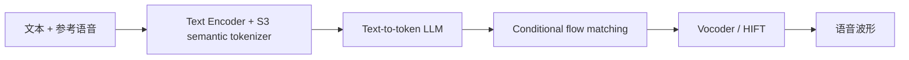

# CosyVoice

## 0. 背景

**问题现场**：需要可扩展的多语言 zero-shot TTS / voice cloning，且 speech token 应贴近文本内容与副语言信息，而不是只服务波形重建。

**CosyVoice 的切入点**：supervised semantic tokens + text-to-token LLM 自回归生成 + flow matching token-to-speech 的三段式路线，后续版本依次解决流式延迟（v2）与 in-the-wild 覆盖（v3）。

## 1. 身份

`CosyVoice` 是 FunAudioLLM / QwenAudio 体系里的多语言 TTS / zero-shot voice cloning 模型家族。核心路线是：把文本先交给 text-to-token LLM 生成 supervised semantic speech tokens，再用 token-to-speech flow matching / vocoder 生成波形。

边界：CosyVoice 不是单个 tokenizer，也不是传统 acoustic model。[[方向/AI语音/模型/S3 Tokenizer|S3 Tokenizer]] 是它的底层 supervised semantic speech tokenizer；CosyVoice 家族还包括 text-speech LM、flow matching 声学生成模块和 vocoder / HIFT 输出模块。

## 2. 版本脉络

- **CosyVoice v1（2024）**：提出 supervised semantic tokens：在多语言 ASR encoder 中插入 VQ 得到语义 speech tokens；系统由 text encoder、speech tokenizer、text-to-token LLM 和 conditional flow matching model 组成，用于 scalable multilingual zero-shot TTS。
- **CosyVoice 2（2024-12）**：面向流式 TTS 和交互延迟优化；引入 [[方向/AI语音/知识/基础概念/FSQ（有限标量量化）|FSQ]] 改善 speech token codebook utilization，使用 Qwen2.5-0.5B 作为 text-speech LM，并统一 streaming / non-streaming 训练。
- **CosyVoice 3（2025）**：面向 in-the-wild speech generation；新的 supervised multi-task speech tokenizer 覆盖 ASR、emotion、language ID、audio event、speaker analysis；训练数据扩到约 1M 小时，模型从 0.5B 扩到 1.5B，覆盖 9 种语言和 18+ 中文方言/口音。

## 3. 关键机制

- **supervised semantic tokens**：用 ASR / 多任务监督约束 speech tokens，使 token 更贴近文本内容和副语言信息，而不是只服务波形重建。
- **LLM text-to-token**：把 TTS 改写成自回归 token 生成问题，文本作为 prompt 生成 speech token 序列。
- **flow matching token-to-speech**：以 speech tokens、说话人 embedding / prompt 和 mask speech features 等为条件生成 mel / acoustic features。
- **streaming synthesis**：CosyVoice 2 用 streaming LM 和 chunk-aware flow matching 支持低延迟生成。
- **post-training**：CosyVoice 3 引入可微 reward model 做 post-training，优化内容一致性、说话人相似度和韵律自然度。

### 3.1. 架构示意（概念级）

> [!note] 架构示意（概念级）
> 按本页已有输入—中间表示—输出链路整理，不替代论文结构图。

## 4. 测试基准与性能

**常用评测口径**：zero-shot voice cloning、内容一致性（CER/WER）、说话人相似度（SS）、自然度（NMOS/MOS）、指令控制（MOS-I）、流式延迟 / RTF。

**CosyVoice 2 代表结果**：SEED test-zh CER 1.45% / SS 0.806，test-en WER 2.57% / SS 0.736，test-hard WER 6.83% / SS 0.776；论文消融显示从 v1 到 v2 的关键增益来自 LLM 初始化、去除 speaker embedding 依赖和 FSQ tokenizer。

**CosyVoice 3 代表定位**：论文摘要称相对 CosyVoice 2 在 content consistency、speaker similarity、prosody naturalness 上提升；官方仓库 README 称 Fun-CosyVoice 3.0 支持 9 种常用语言、18+ 中文方言/口音，并支持多语言/跨语言 zero-shot voice cloning。

## 5. 使用判断

- 看**开源 TTS / voice cloning baseline**：优先比较 CosyVoice 2 / CosyVoice 3 与 [[方向/AI语音/模型/Qwen3-TTS|Qwen3-TTS]]、[[方向/AI语音/模型/Spark-TTS|Spark-TTS]]、F5-TTS、IndexTTS。
- 看**tokenizer 路线**：重点看 [[方向/AI语音/模型/S3 Tokenizer|S3 Tokenizer]] 与 [[方向/AI语音/模型/BiCodec|BiCodec]]、[[方向/AI语音/模型/X-Codec2|X-Codec2]]、Qwen3-TTS 12Hz tokenizer 的差异。
- 看**实时 Agent**：CosyVoice 2 的 streaming 设计更值得关注；CosyVoice 3 更偏 in-the-wild multilingual quality 和 post-training。
- 看**方言/多语言**：CosyVoice 3 的覆盖面更大，但具体目标方言仍需听样本和跑同口径 CER/WER/SS。

## 6. 关键来源

- [FunAudioLLM / QwenAudio CosyVoice GitHub](https://github.com/FunAudioLLM/CosyVoice)
  - 内容定位：官方代码仓库，提供 CosyVoice v1/v2/v3 的 inference、training、deployment 入口，并说明 Fun-CosyVoice 3.0 的语言和方言覆盖。
  - 用途：确认工程入口、开源状态和最新版模型线。
  - 核验日期：2026-08-18
- [CosyVoice: A Scalable Multilingual Zero-shot Text-to-speech Synthesizer based on Supervised Semantic Tokens](https://arxiv.org/abs/2407.05407)
  - 内容定位：CosyVoice v1 论文，提出 supervised semantic tokens、text-to-token LLM 和 conditional flow matching TTS 架构。
  - 用途：确认 CosyVoice 原始架构和 S3 Tokenizer 定位。
  - 核验日期：2026-08-18
- [CosyVoice 2: Scalable Streaming Speech Synthesis with Large Language Models](https://arxiv.org/abs/2412.10117)
  - 内容定位：CosyVoice 2 论文，记录 FSQ tokenizer、Qwen2.5-0.5B text-speech LM、streaming/non-streaming 统一训练和 SEED 指标。
  - 用途：确认 CosyVoice 2 的流式化和性能口径。
  - 核验日期：2026-08-18
- [CosyVoice 3: Towards In-the-wild Speech Generation via Scaling-up and Post-training](https://arxiv.org/abs/2505.17589)
  - 内容定位：CosyVoice 3 论文，记录 supervised multi-task speech tokenizer、reward post-training、1M 小时数据、1.5B 参数、9 语种 + 18 方言覆盖。
  - 用途：确认 CosyVoice 3 的版本升级方向。
  - 核验日期：2026-08-18

## 7. 相关对象

- [[方向/AI语音/MOC - TTS]]：CosyVoice 属于 TTS / voice cloning 主线。
- [[方向/AI语音/模型/S3 Tokenizer]]：CosyVoice 的 supervised semantic speech tokenizer。
- [[方向/AI语音/知识/基础概念/FSQ（有限标量量化）]]：CosyVoice 2 speech tokenizer 的量化器路线。
- [[方向/AI语音/模型/Qwen3-TTS]]：同属开源 / 云端 TTS 重点对比对象。
- [[方向/AI语音/模型/Spark-TTS]]：同属 LLM-based TTS，但使用 [[方向/AI语音/模型/BiCodec|BiCodec]] 单流解耦 token。
- [[方向/AI语音/评估/可控 TTS 与声音克隆评估框架]]：评估 CosyVoice 的声音克隆、方言、风格和长文本稳定性。
- [[方向/AI语音/知识/技术路线/语音生成 tokenizer codec 技术路线]]：CosyVoice 是 supervised semantic tokenizer + flow/vocoder 路线代表。

## 8. 待验证

- CosyVoice 3 开源权重、许可证和训练脚本状态是否满足目标项目用途。
- CosyVoice 2/3 在本地 GPU 上的真实 RTF、首包延迟、显存占用和长文本稳定性。
- CosyVoice 3 的 18+ 中文方言在实际业务文本上的发音稳定性和口音自然度。
- CosyVoice 2 / 3 与 Qwen3-TTS、Spark-TTS、F5-TTS、IndexTTS 的中文同口径 CER/WER、SS、MOS 和主观偏好对比。
