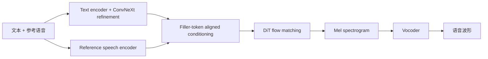

# F5-TTS

## 0. 背景

**问题现场**：zero-shot TTS 需要免去 duration model、text encoder 和音素对齐的简化生成路线，同时保持推理效率。

**前序路线的缺口**：E2 TTS 的纯 filler token 隐式对齐方案收敛慢、鲁棒性低。

**F5-TTS 的切入点**：完全非自回归的 DiT + flow matching，改进为 ConvNeXt V2 精修文本表示，并引入可无重训套用的推理期 Sway Sampling 提升同等 NFE 下的质量。

## 1. 身份

`F5-TTS`（arXiv:2410.06885，v1 2024-10-09 / v3 2025-05-20）是**完全非自回归的 flow matching TTS**，骨干是 Diffusion Transformer（DiT）。它在 E2 TTS 的路线（无 duration model、无 text encoder、无音素对齐）上做了两处关键改进：**ConvNeXt V2 精修文本表示**、**推理期 Sway Sampling**。作者：Yushen Chen、Zhikang Niu、Ziyang Ma、Keqi Deng、Chunhui Wang、Jian Zhao、Kai Yu、Xie Chen。

边界：

- **它是 TTS，不是 voice conversion**。输入参考音频 + 目标文本，输出目标文本的语音；音色来自参考音频，内容来自文本。voice conversion 是源语音换音色，见 [[方向/AI语音/模型/X-VC|X-VC]]。
- **它不是 codec-LM 路线**。不在离散 token 上做自回归，而是在连续 mel 上做 flow matching 去噪。与 [[方向/AI语音/模型/CosyVoice|CosyVoice]]、[[方向/AI语音/模型/Spark-TTS|Spark-TTS]] 这类 token 路线是两条线。
- **Cross-Lingual F5-TTS（arXiv:2509.14579）不是本对象**。那是经 MMS 强制对齐实现免转录的**并列**工作，不是 F5-TTS 的版本。判断某个模型「是不是 F5-TTS 改造」时要区分这两者。
- **授权是双轨的**：代码 MIT，**预训练权重 CC-BY-NC**（受 Emilia 训练数据约束）。见第 5 节。

## 2. 核心信息

- **规模**：base 335.8M 参数；论文复现的 E2 TTS 为 333.2M。
- **音频配方**：100 维 log mel-filterbank、24 kHz、hop length 256。这套配方被下游广泛沿用（[[方向/AI语音/模型/SenSE|SenSE]]、BigVGAN 官方权重同为 24 kHz，整条链路免适配）。
- **训练语料**：Emilia，保留约 9.5 万小时中英文（摘要口径写 "public 100K hours multilingual dataset"）。
- **训练预算**：base 1.2M updates、batch 307,200 audio frames（0.91 小时）、8×A100 80G 跑一周以上；AdamW，peak LR 7.5e-5，20K update warmup，max grad norm 1。
- **推理成本**：10 秒语音在 RTX 3090 上 RTF 0.15（16 NFE）/ 0.31（32 NFE）——摘要引用的 0.15 即 16 NFE 口径。
- **开源形态**：代码 MIT，权重在 Hugging Face / ModelScope / Wisemodel 发布。HF `SWivid/F5-TTS` 已 946,804 次下载、1200 likes。
- **checkpoint**：`F5TTS_Base`（model_1200000，原始版）、`F5TTS_Base_bigvgan`、`F5TTS_v1_Base`（model_1250000，2025-03-12 发布的 v1 base）、`F5TTS_v1_Base_no_zero_init`。
- **语言**：官方没有给正式语言列表。checkpoint 名 `Emilia-ZH-EN` 指向中英；论文摘要声明 code-switching 能力；更多语言走 SHARED.md 的自定义推理。

## 3. 核心机制

```text
参考音频 + 参考文本 + 目标文本
  -> 文本侧：字符序列 + 正弦位置编码 -> ConvNeXt V2 精修文本表示
  -> 文本用 filler token 补到与语音等长
  -> text / speech 特征沿特征维 concat，作为条件 c
  -> DiT 上的 flow matching 去噪（从高斯噪声积分到干净 mel）
  -> 100 维 24 kHz mel -> vocoder -> 波形
```

分步与公式（未公开的部分已标注）：

- **filler token 隐式对齐**：F5-TTS 不预测音素时长，而是把文本 token 序列**用占位符补到与 mel 帧数等长**，让模型自己在去噪过程中把每个字符"摊"到正确的时间跨度上：

设 $c_1,\ldots,c_M$ 为文本 token，$\langle F\rangle$ 为 filler token，$M$ 为文本 token 数，$N$ 为目标 mel 帧数，$z$ 为补齐后的条件序列。

$$
z = (c_1, \dots, c_M, \underbrace{\langle F \rangle, \dots, \langle F \rangle}_{N-M})
$$

  $M$ 为字符数、$N$ 为 mel 帧数。推理时的时长由 $y_{\text{gen}}$ 与 $y_{\text{ref}}$ 的长度比推导，**没有 duration predictor**。这是 E2 TTS 首创、F5-TTS 继承的核心简化，也是 [[方向/AI语音/模型/SenSE|SenSE]] 直接沿用的部分。

- **ConvNeXt V2 精修文本表示**：原始 E2 TTS 的纯 filler token 方案"收敛慢、鲁棒性低"，F5-TTS 在字符序列（加绝对正弦位置编码后）过一个 ConvNeXt V2 堆栈，给文本**独立的建模空间**，再去和语音特征 concat。base 配置为 4 层、512/1024 embedding/FFN；small 为 `512, 4, 2`。靠卷积的局部性和时间平移不变性承担对齐职责。

- **flow matching 目标**：干净 mel 记为 $x_1$、高斯噪声记为 $x_0$，线性插值路径上的条件流匹配（与 [[方向/AI语音/知识/基础概念/Flow Matching（流匹配）|Flow Matching]] 同框架；[[方向/AI语音/模型/SenSE|SenSE]] 记录的"F5-TTS 同款流匹配 MSE 目标"即此）：

$$
x_t = (1 - t)\, x_0 + t\, x_1, \quad t \sim \mathcal{U}[0, 1]
$$

$$
\mathcal{L} = \mathbb{E}_{t,\, x_0,\, x_1} \left[ \left\| v_\theta(x_t, t, c) - (x_1 - x_0) \right\|^2 \right]
$$

  训练时 $t$ 均匀采样。

- **[[方向/AI语音/知识/基础概念/Sway Sampling（摇摆采样）|Sway Sampling]]（推理期，不改训练、不用重训）**：将等距推理时间网格中的点 $u$ 单调重映射为 $t$：

$$
f_{\text{sway}}(u; s) = u + s\left( \cos\!\left( \tfrac{\pi}{2} u \right) - 1 + u \right), \qquad s \in \left[ -1,\; \tfrac{2}{\pi - 2} \right]
$$

  $s < 0$ 向左偏、$s > 0$ 向右偏、$s = 0$ 退化为均匀采样；**默认取 $s = -1$**。意义在于：把采样步往去噪前段倾斜能在同等 NFE 下提质量。论文明确说这个技巧**可以无重训地套用到任何 flow matching 模型上**——这是它被反复引用的原因。

### 3.1. 架构示意（概念级）

> [!note] 架构示意（概念级）
> 按本页已有输入—中间表示—输出链路整理，不替代论文结构图。



## 4. 测试基准与性能

**Seed-TTS-eval（WER % ↓ / SIM-o ↑，来源：论文 Table 2）**

| 模型 | test-zh WER | test-zh SIM | test-en WER | test-en SIM |
| --- | --- | --- | --- | --- |
| Ground Truth | 1.26 | 0.76 | 2.06 | 0.73 |
| Vocoder Resynthesized | 1.27 | 0.72 | 2.09 | 0.70 |
| Seed-TTSDiT | 1.178* | 0.809* | 1.733* | 0.790* |
| MaskGCT | 2.273* | 0.774* | 2.623* | 0.717* |
| F5-TTS（32 NFE） | **1.56** | 0.76 | **1.83** | 0.67 |
| F5-TTS（16 NFE） | 1.74 | 0.75 | 1.89 | 0.67 |
| E2 TTS（32 NFE） | 1.97 | 0.73 | 2.19 | 0.71 |
| CosyVoice | 3.10 | 0.75 | 3.39 | 0.64 |
| FireRedTTS | 1.51 | 0.63 | 3.82 | 0.46 |

（* 为基线论文自报分数。）

- **中文 WER 逼近 ground truth**：32 NFE 下 test-zh 1.56 vs GT 1.26（CosyVoice 3.10、E2 TTS 1.97）；但 SIM 0.76 只与 GT 持平，且低于 Seed-TTSDiT 的 0.809*。
- **英文相似度是短板**：test-en SIM 0.67，低于 GT 0.73、E2 TTS 0.71、Seed-TTSDiT 0.790*。
- **难句集（ELLA-V 100 句，WER %）**：F5-TTS 4.40，优于 CosyVoice 8.30*、E2 TTS 8.58、StyleTTS 2 4.83*，但略逊 E1 TTSDMD 4.29*。错误构成：Sub. 1.81 / Del. 2.40 / Ins. 0.18——**删除错误是主要来源**，是长文本/静音段处理的常见失效点。
- **LibriSpeech-PC test-clean**：F5-TTS 16 NFE 2.53 / 0.66，32 NFE 2.42 / 0.66；E2 TTS 2.95 / 0.69。
- **Sway Sampling 的增益（Table 5）**：加上后 base model test-en 16/32 NFE = 1.88 / 1.87，test-zh = 1.61 / 1.58；不加 SS 时 test-en 为 1.93。
- **NFE 与 RTF 的取舍**：16 NFE → RTF 0.15，32 NFE → RTF 0.31（10 秒语音，RTX 3090）。32 NFE 换来的 WER 改善：test-zh 1.74→1.56、test-en 1.89→1.83。

## 5. 复现口径

```bash
pip install f5-tts
# 或从源码
git clone https://github.com/SWivid/F5-TTS.git

f5-tts_infer-cli --model F5TTS_v1_Base \
  --ref_audio "ref.wav" \
  --ref_text "The content, subtitle or transcription of reference audio." \
  --gen_text "Some text you want TTS model generate for you."
```

- **`--ref_text` 可以留空**（`--ref_text ""`），此时内部先跑 ASR 转写，代价是额外显存。
- **Gradio**：`f5-tts_infer-gradio --port ... --host ... --share`。
- **自定义配置**：`-c custom.toml`。
- **授权是双轨的**——这是工程选型的关键约束：
  - **代码 MIT**，可商用。
  - **预训练权重 CC-BY-NC**（HF 标签 `license:cc-by-nc-4.0`），因为训练数据是 Emilia。**权重不能直接商用**，要商用得用自有数据重训。
- **非官方实现**：`f5-tts-mlx`（MLX，Lucas Newman）、`F5-TTS-ONNX`（ONNX Runtime，DakeQQ），另有 Triton / TensorRT-LLM runtime 支持。README 报告的加速口径：L20 + 16 NFE，TensorRT-LLM 离线 RTF 0.0402、PyTorch 离线 RTF 0.1467。
- **已知问题**：ROCm 6.x 在 RDNA 3.5/4（gfx1151/gfx1201）上报 `HIP error: invalid device function`。

## 6. 相关对象

- [[方向/AI语音/MOC - TTS|MOC - TTS]]：本模型所属方向索引。
- [[方向/AI语音/知识/基础概念/Flow Matching（流匹配）|Flow Matching]]：F5-TTS 的生成机制基础；[[方向/AI语音/知识/基础概念/Sway Sampling（摇摆采样）|Sway Sampling]] 是流匹配推理期的时间网格变形方法。
- [[方向/AI语音/知识/基础概念/Zero-shot Voice Cloning（零样本声音克隆）|Zero-shot Voice Cloning]]：F5-TTS 的主要应用形态。
- [[方向/AI语音/知识/基础概念/Vocoder（声码器）|Vocoder]]：24 kHz 100 维 mel 之后的波形还原环节。
- [[方向/AI语音/数据集/Emilia|Emilia]]：训练语料，也是权重 CC-BY-NC 的成因。
- [[方向/AI语音/模型/SenSE|SenSE]]：官方实现基于 F5-TTS，直接继承 filler token 隐式对齐与 24 kHz / 100 维 mel / hop 256 配方。
- [[方向/AI语音/模型/WavTTS|WavTTS]]：基于 F5-TTS 代码库改造的直接波形路线，把生成搬到原始波形空间。
- [[方向/AI语音/模型/AuK|AuK]]：沿用 F5-TTS 的 RoPE + 卷积位置嵌入设计，并用它做合成数据管线的 masked infilling。
- [[方向/AI语音/知识/生成式语音增强/扩散模型与语音|扩散模型与语音]]：F5-TTS 是 TTS 谱系里 flow matching 版的代表。
- [[方向/AI语音/模型/Qwen3-TTS|Qwen3-TTS]]：同口径对标对象，其官方评测表直接引用 F5-TTS 的 Seed-TTS-eval 数字。
- [[方向/AI语音/模型/CosyVoice|CosyVoice]]、[[方向/AI语音/模型/Spark-TTS|Spark-TTS]]、[[方向/AI语音/模型/ZONOS2|ZONOS2]]、[[方向/AI语音/模型/OmniVoice|OmniVoice]]：开源 TTS / 声音克隆的常备对比基线。
- [[方向/AI语音/模型/Confucius4-TTS|Confucius4-TTS]]：常被误传为「基于 F5-TTS 改造」，实际官方自述为 speech encoder + LLM；辨析见该笔记。

## 7. 关键来源

- [F5-TTS: A Fairytaler that Fakes Fluent and Faithful Speech with Flow Matching（arXiv:2410.06885）](https://arxiv.org/abs/2410.06885)
  - 内容定位：原始论文（v3, 2025-05-20, 17 页 9 表 3 图），记录 DiT + flow matching 架构、filler token 补长、ConvNeXt V2 文本精修、Sway Sampling 公式、Seed-TTS-eval / ELLA-V / LibriSpeech-PC 评测和训练预算。
  - 用途：机制、公式和评测数字的一手依据。
  - 核验日期：2026-09-15
- [SWivid/F5-TTS（GitHub）](https://github.com/SWivid/F5-TTS)
  - 内容定位：官方代码仓库，MIT 协议，含 CLI / Gradio 推理入口、checkpoint 列表、数据集致谢和 runtime 加速说明。
  - 用途：复现入口、推理命令、许可证边界。
  - 核验日期：2026-09-15
- [SWivid/F5-TTS（Hugging Face）](https://huggingface.co/SWivid/F5-TTS)
  - 内容定位：权重仓库，含 `F5TTS_Base`、`F5TTS_v1_Base` 及 bigvgan / no_zero_init 变体，标注 CC-BY-NC-4.0 与 Emilia 数据来源。
  - 用途：确认权重开放范围、规模与商用限制。
  - 核验日期：2026-09-15

## 8. 待验证

- **作者机构与代码归属**：arXiv 摘要页未列 affiliation，需回论文首页确认（vault 里常按 X-LANCE / 上交语境引用）。
- **正式支持语言列表**：官方只给了 `Emilia-ZH-EN` checkpoint 名与 SHARED.md 的自定义路径，没有语言清单；中文以外语种的实际质量需实测。
- **v1 base 与原始 base 的差异**：`F5TTS_Base`（1.2M）vs `F5TTS_v1_Base`（1.25M）训练配置和效果差异，README 未展开。
- **Sway Sampling 的最优 $s$**：默认 −1 是否为通用最优，还是随模型/NFE 变；论文只给了区间和默认值。
- **中文方言 / 代码切换**：摘要有 code-switching 声明，但没有对应评测表。
- **与 E2 TTS 的完整消融**：ConvNeXt V2 与 Sway Sampling 各自的独立贡献，需要读论文消融章节确认。
- **Cross-Lingual F5-TTS（arXiv:2509.14579）**：与 F5-TTS 是并列工作还是代码级承继，需读其论文确认。
