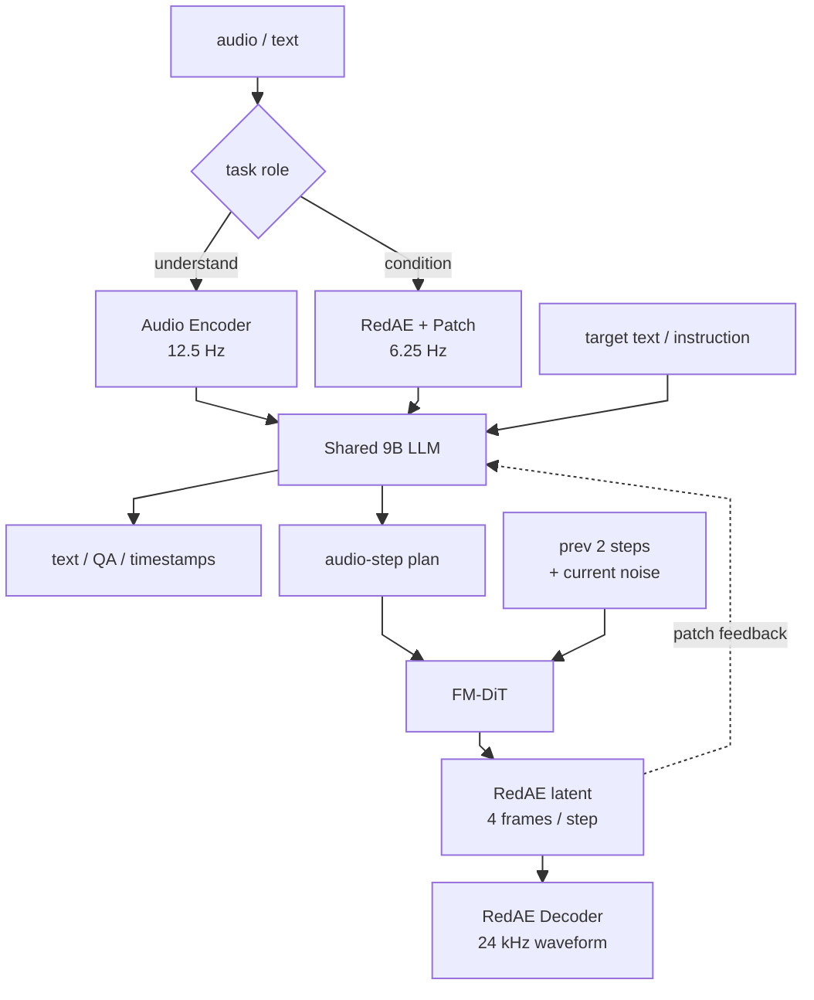

# FireRedAudio

## 0. 背景

- 它不是第一次提出“语义 / 声学信息要拆开”，但把“理解需要紧凑表示”和“生成需要可重建表示”的矛盾，落实成同一个 9B LLM 里的两条**连续输入路径**：Audio Encoder Path 用于 understanding，RedAE-Patch Path 用于 generation condition。
- 相比只做理解的 audio LLM，它把 TTS、声音设计和语音编辑纳入同一 autoregressive LLM + continuous-latent generation 框架。
- 相比专用 TTS / ASR 系统，它的观察价值在共享上下文、长音频证据定位、语音编辑指令和统一交互接口。

## 1. 身份

FireRedAudio 是 FireRedTeam 发布的通用音频语言模型：用一个共享 9B LLM 覆盖 ASR、音频理解、zero-shot TTS、Instruct TTS、语义/声学语音编辑，以及最长约一小时录音的时间定位理解。

核心定位不是单纯 TTS 或 ASR，而是“理解 + 生成”统一模型；它的关键设计是把理解侧和生成侧的连续表示解耦：Audio Encoder 负责识别/理解输入，RedAE / RedAE-Patch 路径负责可重建的语音生成表示。

## 2. 核心信息

- **共享骨干**：一个 9B 参数 LLM，官方致谢中说明语言底座来自 [[方向/大模型/LLM/模型/Qwen3.5|Qwen3.5]]。
- **理解侧表示**：Audio Encoder 用于 ASR、音频 QA、长音频理解；输入 16 kHz mono waveform，经 log-mel、Whisper 系 encoder 和 Audio Adapter 得到约 12.5 Hz continuous perceptual representation。
- **生成侧表示**：RedAE / RedAE-Patch 路径保留细粒度声学信息；RedAE latent 约 25 Hz，经 Patch Encoder 降到约 6.25 Hz RedAE-Patch，LLM hidden state 再条件化 [[方向/AI语音/知识/基础概念/Flow Matching（流匹配）|flow-matching]] DiT 生成连续 acoustic latent，最终由 RedAE Decoder 输出 24 kHz waveform。
- **RedAE 原文定义**：论文 2.2.2 将 RedAE 定义为 “a deterministic audio autoencoder that maps waveforms directly to continuous latents without variational posterior modeling or Kullback–Leibler (KL) regularization”。也就是：RedAE 是确定性音频自编码器，直接把 waveform 映射到连续潜在表示；它不是 VAE，不建模 $q(z\mid x)$ 这类变分后验，也没有 KL 正则项。
- **任务面**：ASR、audio understanding、zero-shot TTS、Instruct TTS、voice design、semantic speech editing、acoustic editing。
- **长音频能力**：支持约一小时录音的结构化摘要、按时间检索内容、按内容定位时间，并声称可做到秒级 time-content alignment。
- **开放状态**：论文、GitHub 代码、Hugging Face / ModelScope 权重均已公开；仓库标注 Apache-2.0。

## 3. 核心机制

FireRedAudio 的关键不是“一个音频表示吃遍所有任务”，而是按任务角色走两条连续表示路径，再在生成侧由 LLM 和 DiT 分工。

### 3.1. 总体结构图



### 3.2. 理解 / ASR 路径

音频输入 -> 文本输出。

```text
audio waveform (16 kHz)
  -> log-mel features
  -> Audio Encoder (Whisper-large-v3 init)
  -> Audio Adapter
  -> 12.5 Hz continuous perceptual representation
  -> Shared 9B LLM
  -> transcription / answer / timestamped structure
```

### 3.3. 生成条件路径

参考/源音频 -> 可重建声学上下文。

```text
reference or source speech (24 kHz)
  -> RedAE Encoder
  -> 25 Hz, 64-d RedAE latent
  -> Patch Encoder (4 RedAE frames per patch)
  -> 6.25 Hz RedAE-Patch
  -> Shared 9B LLM context
```

### 3.4. TTS / editing 路径

文本与音频条件 -> 新 waveform。

```text
text instruction + optional RedAE-Patch audio condition
  -> Shared 9B LLM
  -> audio-start + audio-step* + audio-end
  -> hidden state at each audio-step
  -> Flow-Matching DiT (current + previous 2 audio-step states)
  -> 4 RedAE latent frames per audio-step (~160 ms)
  -> Patch Encoder feedback to LLM for next audio-step
  -> full RedAE latent sequence
  -> RedAE Decoder
  -> 24 kHz waveform
```

### 3.5. 任务读法

- **ASR / audio understanding**：音频是待识别/分析对象，走 Audio Encoder 路径，LLM 直接生成文本、答案或带时间戳结构。
- **zero-shot TTS**：参考音频先压成 RedAE-Patch 作为 audio prefix，目标文本驱动后续 audio-step 生成。
- **Instruct TTS**：主要靠文本 instruction 约束说话风格，不一定需要参考音频。
- **speech editing**：source audio 和 editing instruction 共同作为条件，但输出是重新合成的完整目标 waveform，不是只对源 latent 做局部 inpainting。
- **局部声学连续性**：每个 audio-step 生成 4 帧 RedAE latent；DiT 的声学输入还看前两个 audio-step 的 8 帧历史 latent，加上当前 4 帧 noised latent，形成 12-frame acoustic input。LLM 条件也取当前和前两个 audio-step 的 hidden states。

### 3.6. DiT 条件窗口

LLM 控制信号 + RedAE 声音状态。

```text
生成第 j 个 audio-step：

声学条件：
  RedAE latent[j-2] 的 4 帧
  + RedAE latent[j-1] 的 4 帧
  + RedAE latent[j] 的 4 帧 noised latent
  = 12-frame acoustic input

LLM 条件：
  h[j-2] 重复 4 次
  + h[j-1] 重复 4 次
  + h[j] 重复 4 次
  = 与 12 帧 RedAE latent 对齐的 control sequence

DiT 输入：
  acoustic input + aligned LLM condition + flow time embedding
  -> 预测当前 j 步 4 帧 RedAE latent 的 velocity
```

- **LLM hidden state 的作用**：它不是可还原的声音 latent，而是 LLM 读完文本指令、参考音频摘要和历史 audio-step 后，在当前位置产生的控制向量；它告诉 DiT 当前约 160 ms 应该满足什么语义、风格和因果上下文。
- **为什么不算泄露目标**：当前 $h_j$ 是 LLM 在读入当前真实 RedAE block 之前的因果 hidden state；它能看历史和指令，但看不到当前 4 帧 ground-truth RedAE latent。
- **为什么和 RedAE 有重叠仍有用**：RedAE 历史 latent 也含语义/韵律，但主要承担“声音状态”和局部连续性；LLM hidden state 承担“意图/文本/上下文控制”。重复的是高层线索，互补的是粒度和用途。

## 4. RedAE 机制

RedAE 是 FireRedAudio 生成侧的连续语音 autoencoder，论文 2.2.2 对它的强调点是：既要能重建 waveform，又要让 latent 不只停留在低层声学纹理，方便后续 LLM / DiT 建模。

```text
24 kHz waveform
  -> non-overlapping 480-sample blocks
  -> 50 Hz frame sequence
  -> causal RedAE Encoder
  -> Qwen3 Transformer: contextual encoding
  -> Qwen3 Transformer: aggregate every 2 frames
  -> output projection
  -> 25 Hz, 64-d RedAE latent
  -> RedAE Decoder: projection + channel-to-time rearrangement
  -> causal Qwen3 Transformer
  -> iSTFT head
  -> reconstructed waveform
```

- **确定性 autoencoder**：RedAE 直接做 $z=E_R(x)$、$\hat{x}=D_R(z)$；没有 VAE 式 $q_\phi(z\mid x)$ 变分后验，也没有 KL regularization。
- **为什么不只做重建**：纯 reconstruction training 容易让 latent 被低层声学变化主导，后续自回归建模更难，也更容易累积误差。
- **语义蒸馏**：训练时引入冻结的 teacher Audio Encoder，把 RedAE latent 用 MSE distillation 对齐到高层 audio features；这样 latent 仍可重建 waveform，但带有更可建模的高层结构。teacher 训练后丢弃，不增加运行时分支。
- **预训练数据混合**：RedAE 预训练使用 50% clean speech、25% noisy speech、10% sound effects、15% music，让 latent 不只覆盖干净语音，也覆盖噪声、音效和音乐。
- **目标函数**：沿用 X-Codec 风格的 hybrid GAN objective，包含 reconstruction、adversarial、discriminator feature-matching 和 semantic distillation；因为 RedAE 不参数化 latent posterior，所以目标里没有 KL 项。
- **和 Patch Encoder 的边界**：RedAE Encoder 输出原生 25 Hz latent；Patch Encoder 只在 LLM interface 使用，把每 4 帧 RedAE latent 聚合为 1 个 6.25 Hz RedAE-Patch，且维度对齐 LLM input embeddings。waveform reconstruction 和 DiT speech generation 仍发生在原生 RedAE latent space。
- **主模型训练 / 推理**：FireRedAudio 训练时冻结 RedAE Encoder，RedAE Decoder 不加载；推理结束后才用 RedAE Decoder 把完整 RedAE latent sequence 渲染成 24 kHz waveform。

## 5. 核心公式

以下是笔记化符号，便于理解路径；论文原式主要是 RedAE 预训练目标、DiT flow loss 和联合训练目标。

### 5.1. 双连续路径

理解侧把音频压成 LLM 可消费的紧凑表示：

$$
H^{u}=A_{u}(E_{u}(x)),\qquad f_{u}=12.5\,\mathrm{Hz}
$$

生成条件侧先得到可重建 latent，再按 4 帧聚合成 LLM 输入 patch：

$$
Z=E_{R}(x),\qquad Z\in\mathbb{R}^{T_R\times 64},\qquad f_R=25\,\mathrm{Hz}
$$

$$
R_j=P(Z_{4j:4j+3}),\qquad f_{patch}=25/4=6.25\,\mathrm{Hz}
$$

这里 $E_u/A_u$ 是 Audio Encoder / Adapter，$E_R$ 是 RedAE Encoder，$P$ 是 Patch Encoder。核心是 $H^u$ 和 $R_j$ 都能进入同一个 LLM，但两者不是相加或融合后的同一表示。

### 5.2. RedAE 预训练目标

先把 RedAE 定义成确定性 autoencoder，而不是 VAE：

$$
z=E_R(x),\qquad \hat{x}=D_R(z),\qquad \text{no }q_\phi(z\mid x),\ \text{no KL term}
$$

论文给出的 RedAE generator objective 是：

$$
\mathcal{L}_{G}=\lambda_{\mathrm{rec}}\mathcal{L}_{\mathrm{rec}}+\lambda_{\mathrm{adv}}\mathcal{L}_{\mathrm{adv}}+\lambda_{\mathrm{fm}}\mathcal{L}_{\mathrm{fm}}+\lambda_{\mathrm{distill}}\mathcal{L}_{\mathrm{distill}}
$$

- $\mathcal{L}_{\mathrm{rec}}$：重建损失。
- $\mathcal{L}_{\mathrm{adv}}$：对抗损失。
- $\mathcal{L}_{\mathrm{fm}}$：这里是 discriminator feature-matching loss，不是 [[方向/AI语音/知识/基础概念/Flow Matching（流匹配）|Flow Matching]]。
- $\mathcal{L}_{\mathrm{distill}}$：MSE semantic distillation，把 RedAE latent 对齐到冻结 teacher Audio Encoder 的高层特征，使 latent 不只保留低层声学纹理，也有更可建模的高层结构。

这个目标只用于 standalone RedAE pretraining；主模型训练时 RedAE Encoder 冻结，RedAE Decoder 不加载，Decoder 只在推理合成 waveform 时使用。

### 5.3. DiT flow-matching 目标

对每个有效目标 audio-step $j\in\mathcal{P}$，冻结 RedAE Encoder 提供 ground-truth RedAE latent；训练时采样高斯噪声和 flow time $t$，在噪声与目标 4 帧 latent 之间插值，DiT 预测 velocity。论文原式为：

$$
\mathcal{L}_{\mathrm{flow}}=\frac{1}{|\mathcal{P}|}\sum_{j\in\mathcal{P}}\operatorname{MSE}\left(\widehat{V}_{j},V_{j}^{\star}\right)
$$

其中 $\widehat{V}_{j}$ 是 DiT 预测速度，$V_{j}^{\star}$ 是对应概率路径的目标速度。只有当前 step 的最后 4 个位置计入 loss；前 8 帧历史位置只提供 acoustic context。

### 5.4. 主模型联合目标

FireRedAudio 主训练同时优化文本/控制 token 的自回归 CE 和连续声学 latent 的 flow loss：

$$
\mathcal{L}=\lambda_{\mathrm{text}}\mathcal{L}_{\mathrm{text}}+\lambda_{\mathrm{flow}}\mathcal{L}_{\mathrm{flow}},\qquad \lambda_{\mathrm{text}}=\lambda_{\mathrm{flow}}=1
$$

文本项对普通文本、reasoning tokens、audio-start/audio-end 用单位权重；audio-step token 很多，只控制输出结构，不直接承载连续声学内容，所以降权：

$$
\ell_i=-\log p(y_i\mid y_{<i},\mathrm{context})
$$

$$
\mathcal{L}_{\mathrm{text}}=\frac{\sum_{i\in\mathcal{T}}\ell_i+w_a\sum_{i\in\mathcal{A}}\ell_i}{|\mathcal{T}|+w_a|\mathcal{A}|},\qquad w_a=0.01
$$

这里 $\mathcal{T}$ 是单位权重 token 位置，$\mathcal{A}$ 是 audio-step 位置。直觉上：LLM 学会“什么时候开始/继续/结束说话”和高层上下文，DiT 学会“这 160 ms 应该具体长成什么声音”。

## 6. 和 global / semantic token 拆分的区别

你说的 global token / semantic token 更接近 [[方向/AI语音/模型/BiCodec|BiCodec]]、[[方向/AI语音/模型/Spark-TTS|Spark-TTS]] 或 [[方向/AI语音/模型/UniSE（Unified Speech Enhancement）|UniSE]] 里的 codec token 拆分：global tokens 承载说话人、音色、风格等全局属性，semantic tokens 承载“说了什么”的局部内容。严格说，[[方向/AI语音/模型/WavLM|WavLM]] 本身不是这种 global/semantic tokenizer；它主要输出逐帧 SSL hidden states，常被下游系统拿来当条件特征。

FireRedAudio 的拆法不同：它拆的是**音频在当前任务里的角色**，不是把同一个 codec token 空间拆成全局/语义两类。拿来理解的音频走 Audio Encoder，追求紧凑、长上下文友好的 perceptual representation；拿来生成/编辑条件的语音走 RedAE-Patch，追求可重建、保留细声学信息的 continuous latent。两者都进同一个 LLM，但 input representation 不融合。

这里的“同长”要理解成**随音频时长展开的时间序列**，不是和 waveform sample 一一等长：RedAE latent 约 25 Hz，RedAE-Patch 约 6.25 Hz，帧数会随语音秒数增长。相比 [[方向/AI语音/模型/BiCodec|BiCodec]] 的 32 个固定 global tokens，这类连续时序 latent 更适合保留一段语音内部随时间变化的音色、情绪、语速、能量和韵律线索；代价是序列更长，对 LLM/DiT 的上下文和对齐能力要求更高。

这种“非定长 / 随时间展开的声学条件”并不是 FireRedAudio 才有：[[方向/AI语音/模型/AudioLM|AudioLM]] 的 acoustic tokens、VALL-E 类 acoustic prompt、NaturalSpeech 2 的 speech prompt latent、Voicebox 的 audio context 都是在用一段参考音频的时序声学信息做条件。FireRedAudio 更值得单独记的是：它把这类可重建的时序生成条件做成 RedAE-Patch continuous path，并和 Audio Encoder understanding path 一起接到同一个共享 9B LLM。

## 7. 训练策略

FireRedAudio 采用 progressive multitask training，而不是一开始端到端全量联合训练。原因是 Audio Encoder、LLM、RedAE 都已有预训练基础，但 Audio Adapter、Patch Encoder、DiT 是新模块；直接联合训练容易让随机初始化模块扰动已训好的骨干。

- **Adapter Alignment**：冻结 Audio Encoder 和 LLM，只训练 Audio Adapter，把 Whisper 系特征接到 LLM embedding space。
- **Audio Encoder Adaptation**：解冻 Audio Encoder / Adapter，加入 ASR、speech/audio/music understanding，让前端从转写 encoder 变成 general audio perception module。
- **Unified Mid-training**：第一次联合训练 Audio Encoder、Adapter、LLM、Patch Encoder、DiT，引入 ASR、audio understanding、text-only、zero-shot TTS 和 audio-text interleaved 数据。
- **Multitask Post-training**：强化 instruction following，引入 Instruct TTS、speech editing 和部分显式 CoT supervision，同时保留 ASR/TTS/understanding 防止遗忘。
- **Long-context Extension**：把 unified text-audio sequence length 扩到约 200k，加入长音频摘要、时间定位、内容定位、跨片段分析和复杂 QA。

数据混合上采用两级 sampling：先采 task family，再在 family 内采 dataset，避免 Text-only、ASR、zero-shot TTS 等大数据任务淹没 Instruct TTS、editing、细粒度 audio understanding 等小数据任务。训练目标中 RedAE Encoder 在 main model training 阶段保持冻结；文本 CE loss 与 flow loss 的权重口径为 $\lambda_{text}=\lambda_{flow}=1$。

## 8. 测试基准与性能

官方报告/仓库给出的主口径包括：

- **音频理解**：[[方向/AI语音/评估/MMAU（大规模多任务音频理解与推理基准）|MMAU]] test-mini / test、[[方向/AI语音/评估/MMSU（口语理解推理基准）|MMSU]]。
- **ASR**：多语种 ASR 与中英文转写指标，报告声称达到 competitive / leading performance。
- **TTS**：Seed-TTS-Eval，用内容准确率与 speaker preservation 一起看。
- **Instruct TTS / 编辑**：InstructTTSEval、Ming-Freeform-Audio-Edit。
- **长音频时间定位**：公众号解读提到论文用 50 段 5/10/20/30/50 分钟语音为主录音评估 timestamp alignment，并用 Qwen3.5-Omni-Plus 作为 audio judge 判断预测时间段是否覆盖对应 speech content；strict@0、strict@0.5、strict@1.0 分别代表不同边界宽松度。

注意：这些数字仍是官方自报口径，尤其是长音频理解、自由形式编辑和声音设计，后续需要第三方复测。

## 9. 边界

- 除 ASR 外，音频理解、TTS、编辑和 voice design 目前主要限制在中文/英文。
- Zero-shot TTS 默认不是确定性的：flow-matching decoder 会采样随机噪声；需要固定 seed 才能复现实验。
- 长音频官方测试边界约一小时，超过后 time-content alignment 未充分验证。
- 具备 zero-shot voice cloning，因此只能作为研究/授权场景工具；不应直接用于冒充、欺诈或未经授权的声音克隆。

## 10. 相关对象

- [[方向/AI语音/MOC - 音频大模型]]：FireRedAudio 属于统一音频语言模型路线。
- [[方向/AI语音/选型/Omni vs ASR TTS 专用模型选型]]：用于比较统一模型和专用 ASR/TTS 组件的取舍。
- [[方向/AI语音/模型/Kimi-Audio]]：同属通用 audio foundation model，对比点是离散/连续表示和生成侧能力。
- [[方向/AI语音/模型/StepAudio 2.5]]：统一 ASR/TTS/Realtime 语音模型路线的近邻。
- [[方向/AI语音/模型/Qwen3-Omni]]：统一多模态/全模态模型的对照样例。
- [[方向/AI语音/知识/基础概念/Flow Matching（流匹配）]]：FireRedAudio 生成侧 acoustic latent 的采样路线。
- [[方向/大模型/模型结构/DiT（Diffusion Transformer）]]：生成侧使用 flow-matching DiT。
- [[方向/AI语音/知识/基础概念/Vocoder（声码器）]]：连续 acoustic latent 最终仍需解码到波形。

## 11. 关键来源

- [FireRedAudio: A General-Purpose Audio Language Model with Decoupled Continuous Representations for Understanding and Generation](https://arxiv.org/abs/2608.24168)
  - 内容定位：技术报告，定义 9B 共享 LLM、解耦连续表示、任务覆盖和实验结论。
  - 用途：判断模型架构、能力边界与发表时间。
  - 发表日期：2026-08-25（arXiv v1）；2026-08-27（v2，技术内容不变）
  - 核验日期：2026-08-31
- [FireRedTeam/FireRedAudio（GitHub）](https://github.com/FireRedTeam/FireRedAudio)
  - 内容定位：官方代码、README、安装/推理示例、限制说明和 license。
  - 用途：确认开放状态、任务接口、运行依赖、限制与安全声明。
  - 发布日期：2026-08-21（仓库 News）
  - 核验日期：2026-08-31
- [FireRedTeam/FireRedAudio（Hugging Face）](https://huggingface.co/FireRedTeam/FireRedAudio)
  - 内容定位：官方权重页与模型卡。
  - 用途：确认权重公开、Apache-2.0 标注和下载入口。
  - 核验日期：2026-08-31
- [小红书开源 FireRedAudio：语音理解与生成基座模型SOTA](https://mp.weixin.qq.com/s/zhE7psT-psD2jB6_vEmtmA)
  - 内容定位：语音之家 / Nova Speech 对 FireRedAudio 的中文技术解读，梳理解耦连续表示、五阶段训练、长音频时间戳评测和与 FireRedTTS3 的关系。
  - 用途：作为中文阅读入口与论文结构导航；关键事实仍以 arXiv / GitHub / Hugging Face 为准。
  - 发表日期：2026-08-31
  - 核验日期：2026-09-01
- [VALL-E](https://arxiv.org/abs/2301.02111) / [NaturalSpeech 2](https://arxiv.org/abs/2304.09116) / [Voicebox](https://arxiv.org/abs/2306.15687)
  - 内容定位：FireRedAudio 之前已有 acoustic prompt、speech prompt latent、audio context 等随参考音频时长变化的声学条件路线。
  - 用途：约束“RedAE-Patch 非定长声学条件”的新颖性表述，避免误写成首次使用时序音色/声学条件。
  - 发表日期：2023-01-05 / 2023-04-18 / 2023-06-27（arXiv v1）
  - 核验日期：2026-09-01

## 12. 待验证

- 第三方复测 MMAU/MMSU、Seed-TTS-Eval、InstructTTSEval 与 Ming-Freeform-Audio-Edit 的一致性。
- RedAE 表示相对 codec token / mel latent 的稳定性、可编辑性和说话人保持优势。
- 一小时长音频 time-content alignment 在真实会议、播客、电话录音中的漂移程度。
