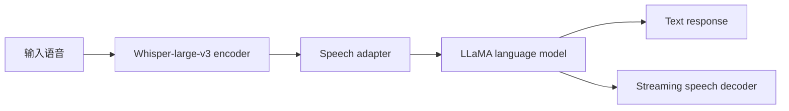

# LLaMA-Omni

## 0. 背景

**问题现场**：让现成文本 LLM 获得低延迟的语音指令交互能力，避免 ASR/TTS 级联带来的延迟与结构开销。

**LLaMA-Omni 的切入点**：「强 LLM + 轻量语音头」极简路线——Whisper 编码 + speech adapter 接入 LLaMA-3.1-8B，NAR 流式语音解码器由 LLM 隐状态直接预测语音单元，文本与语音同步输出。

## 1. 内容定位

LLaMA-Omni 是中科院计算所 ICTNLPLab 2024 年发布的低延迟语音指令交互模型：在 LLaMA-3.1-8B-Instruct 上直接接语音输入与流式语音输出，省掉 ASR/TTS 级联。它是「LLM + 轻量语音头」极简路线的代表，适合研究如何用最小改动让现成 LLM 获得语音对话能力。

## 2. 核心信息

- **四件套架构**：语音编码器（Whisper-large-v3）→ speech adapter → LLM（LLaMA-3.1-8B-Instruct，直接由语音指令生成文本回复）→ 流式语音解码器。
- **NAR 流式语音解码**：非自回归地由 LLM 隐状态直接预测离散语音单元（unit），再用 unit HiFi-GAN vocoder 合成波形，因此语音生成不拖慢文本生成，延迟低。
- **文本+语音同步输出**：文本回复与语音回复同时产生，文本可作为语音内容的对齐信号。
- **数据**：基于文本指令数据重构的 InstructS2S-200K 语音指令数据集（合成语音），已随论文公开。
- **开源**：模型权重、代码与数据开放。

### 2.1. 架构示意（概念级）

> [!note] 架构示意（概念级）
> 按本页已有输入—中间表示—输出链路整理，不替代论文结构图。

## 3. 发展脉络

与 [[方向/AI语音/模型/Mini-Omni|Mini-Omni]]（0.5B 并行生成）、[[方向/AI语音/模型/Moshi|Moshi]]（全双工多流）并列为 2024 年开源语音对话三条不同工程取舍：LLaMA-Omni 选择「强 LLM + NAR 语音头」换低延迟与语言能力。后续 LLaMA-Omni2 等延续该路线。

## 4. 边界

- 语音合成质量受 unit + HiFi-GAN 限制，自然度弱于 codec LM 与现代 TTS。
- 只建模「用户说→模型答」单轮节奏，无全双工/打断机制。
- 语音理解依赖 Whisper 编码器，副语言信息（情绪、语气）传递有限。

## 5. 相关对象

- [[方向/AI语音/模型/Whisper|Whisper]]：语音编码器来源。
- [[方向/AI语音/模型/Moshi|Moshi]]：全双工路线的对照。
- [[方向/AI语音/模型/Mini-Omni|Mini-Omni]]：同期小规模开源对照。
- [[方向/AI语音/知识/基础概念/Vocoder（声码器）|Vocoder（声码器）]]：HiFi-GAN 所属概念。
- [[方向/AI语音/MOC - 音频大模型|MOC - 音频大模型]]：方向地图。

## 6. 来源

- [LLaMA-Omni: Seamless Speech Interaction with Large Language Models（arXiv:2409.06666）](https://arxiv.org/abs/2409.06666)
  - 内容定位：论文，覆盖四件套架构、NAR 流式语音解码器与 InstructS2S-200K 数据构造。
  - 用途：架构与延迟机制判断依据。
  - 核验日期：2026-08-07

## 7. 待验证

- 论文报告延迟数字的复测口径；LLaMA-Omni2 的相对改进。
