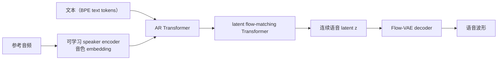

# MiniMax-Speech

## 0. 背景

**问题现场**：零样本 TTS 需要不依赖参考音频转录即可完成声音克隆，并支持跨语言克隆与 in-the-wild 参考音频。

**MiniMax-Speech 的切入点**：可学习 speaker encoder 从参考音频直接提取解耦音色特征作条件（免转录），AR Transformer + latent flow matching 两段生成，Flow-VAE 连续 latent 解码避开离散 codec 量化损失。

## 1. 身份

MiniMax-Speech 是 MiniMax 团队的自回归 Transformer 零样本 TTS 系统（arXiv:2505.07916）。核心创新是可学习的 speaker encoder：直接从参考音频提取音色特征，不要求参考音频带转录，因此支持免转录的零样本/单样本声音克隆。本笔记用于索引其架构组成、克隆能力和评测口径。

## 2. 核心信息

- 组件：text tokenizer（BPE）、audio tokenizer（Encoder-VQ-Decoder）、自回归 Transformer、latent flow matching 模型（flow matching 模块 + Flow-VAE 模块）。
- 能力：零样本声音克隆（参考音频无需转录）、one-shot 克隆、32 种语言。
- 可扩展性：得益于 speaker encoder 的解耦表示，不改基座即可扩展——LoRA 情绪控制、T2V（text to voice，从文本描述直接合成音色）、PVC（professional voice cloning，用额外数据微调音色特征）。
- 音质：通过 [[方向/AI语音/知识/基础概念/Flow-VAE（流增强变分自编码器）|Flow-VAE]] 增强合成音频质量，连续 latent 路线避开离散 codec 的量化损失。

### 2.1. 架构示意（概念级）

> [!note] 架构示意（概念级）
> 按论文与 Flow-VAE 笔记的输入—中间表示—输出链路整理，不替代论文结构图。

## 3. 核心机制

### 3.1. 生成链路公式

先把模型的三段机制写成最小公式。设 $x$ 为文本 token 序列，$c$ 为参考音频经过 speaker encoder 得到的说话人 / 音色条件，$y$ 为自回归 Transformer 生成的中间语音 token 序列，$T$ 为序列长度，$\theta$ 为生成模型参数：

$$
p_\theta(y\mid x,c)=\prod_{t=1}^{T}p_\theta(y_t\mid y_{<t},x,c)
$$

这里的 $y$ 是 AR Transformer 生成的离散语音 token 序列；它与文本 token $x$、连续的说话人 / 音色向量 $c$ 一起作为条件，输入连续 latent 的 flow-matching 模块。Flow matching 真正生成的是连续语音 latent $z$，不是 token。设 $z_0$ 为初始噪声 latent，$z_1$ 为目标语音 latent，$z_t$ 为时间 $t\in[0,1]$ 的插值状态，$v_\theta$ 为条件速度场：

$$
z_t=(1-t)z_0+t z_1,
\qquad
\mathcal{L}_{\mathrm{FM}}=
\mathbb{E}\left[\left\|v_\theta(z_t,t,x,c,y)-(z_1-z_0)\right\|^2\right]
$$

最后由 Flow-VAE 完成连续 latent 到波形的解码。设 $E$ 为音频编码器，$F$ 为训练阶段的可逆 flow 变换，$D$ 为波形解码器，$a$ 为输入音频，$z$ 为连续 latent，$\hat{a}$ 为重建波形：

$$
a\xrightarrow{E}z\xrightarrow{F}z_p,
\qquad
\hat{a}=D(z)
$$

这里 $F$ 用于训练时的 latent 分布约束，推理时的声学条件和波形重建使用原始 $z$；因此不能把它误读成推理阶段的额外生成步骤。

- **可学习 speaker encoder**：从参考音频提取解耦的音色特征，作为 AR Transformer 的条件；免转录使跨语言克隆和 in-the-wild 参考音频可用。情绪控制（LoRA）、T2V、PVC 都建立在这个音色表示上。
- **AR + latent flow matching 两段生成**：AR Transformer 生成离散语音 token 序列 `y`；flow-matching Transformer 以 `x`、`c`、`y` 为条件，在连续 latent `z` 上生成目标表示。
- **Flow-VAE**：waveform -> encoder -> 连续 latent `z`，可逆 flow 变换后验后施加 KL；decoder 直接重建 waveform，避开 mel 瓶颈。细节见 [[方向/AI语音/知识/基础概念/Flow-VAE（流增强变分自编码器）|Flow-VAE]]。

## 4. 测试基准与性能

- 论文口径：在声音克隆客观指标（WER、Speaker Similarity）上达到 SOTA，并曾居 TTS Arena 公开榜单首位（arXiv 摘要）。
- 第三方同口径对比（[[方向/AI语音/模型/Qwen3-TTS|Qwen3-TTS]] 官方评测，Seed-TTS 测试集零样本克隆 WER%）：test-zh 0.83 / test-en 1.65；同表 Qwen3-TTS-12Hz-1.7B-Base 为 0.77 / 1.24。
- 各语言分项 WER、SIM 具体数值和 TTS Arena 当前排名：待核。

## 5. 相关对象

- [[方向/AI语音/知识/基础概念/Flow-VAE（流增强变分自编码器）|Flow-VAE]]：MiniMax-Speech 提出的音频表示与重建模块，本笔记机制部分的细节入口。
- [[方向/AI语音/模型/AuK|AuK]]：采用 MiniMax-Speech 式 flow-augmented VAE 路线。
- [[方向/AI语音/模型/Qwen3-TTS|Qwen3-TTS]]：零样本克隆 WER 的同口径对比对象。
- [[方向/AI语音/MOC - TTS|MOC - TTS]]：TTS 方向入口。
- [[方向/AI语音/评估/可控 TTS 与声音克隆评估框架|可控 TTS 与声音克隆评估框架]]：声音克隆与音色控制能力的评估入口。

## 6. 关键来源

- [MiniMax-Speech: Intrinsic Zero-Shot Text-to-Speech with a Learnable Speaker Encoder（arXiv:2505.07916）](https://arxiv.org/abs/2505.07916)
  - 内容定位：技术报告，记录可学习 speaker encoder、AR Transformer + latent flow matching + Flow-VAE 架构、32 语言支持和克隆评测。
  - 用途：引用模型架构、能力和评测结论的论文依据。
  - 核验日期：2026-11-21
- [MiniMax-Speech Tech Report 项目页](https://minimax-ai.github.io/tts_tech_report/)
  - 内容定位：官方项目页与听感对照示例（含 Flow-VAE/VAE 对比）。
  - 用途：听感样例和官方演示口径。
  - 核验日期：2026-11-21

## 7. 待验证

- 与 MiniMax 商用语音产品（Speech-01/02 系列、API）的对应关系；是否开源权重或仅论文+API。
- audio tokenizer 的帧率、码本规模与 latent `z` 的维度、采样率等完整配置。
- speaker encoder 的结构与训练目标（对比学习还是重构辅助），以及与 WavLM 类预训练 speaker 模型的差异。
- 各语言分项 WER/SIM 数值与 TTS Arena 当前排名。
