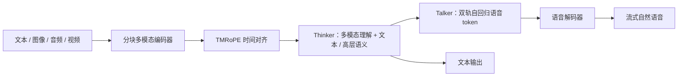

# Qwen2.5-Omni

## 0. 背景

**问题现场**：Qwen 语音线此前只有音频理解（Qwen-Audio / Qwen2-Audio），需要能统一理解文本、图像、音频、视频并以流式方式同时生成文本与自然语音的全模态助手底座。

**Qwen2.5-Omni 的切入点**：Thinker-Talker 架构（理解 + 流式语音生成，端到端联合训练）配 TMRoPE 时间对齐的多模态位置编码，分块处理支持流式输入输出。

## 1. 内容定位

Qwen2.5-Omni 是阿里 Qwen 团队 2025 年 3 月发布的端到端全模态模型：文本、图像、音频、视频统一理解，并以流式方式同时生成文本与自然语音。它是 Qwen 语音线从「音频理解」（Qwen-Audio / Qwen2-Audio）走向「全模态助手底座」的转折点，也是 [[方向/AI语音/选型/Qwen 语音模型技术路线图|Qwen 语音模型技术路线图]] 中 Omni 路线的开源起点。

## 2. 核心信息

- **Thinker-Talker 架构**：Thinker 为「大脑」，接收多模态输入、生成文本与高层语义表示；Talker 为「嘴巴」，以双轨自回归方式流式接收 Thinker 的表示与文本，生成语音 token。二者端到端联合训练。
- **TMRoPE（Time-aligned Multimodal RoPE）**：把音频/视频帧按时间轴交错组织并做三维位置编码，对齐多模态时间信息。
- **流式设计**：音频与视觉编码器采用分块（block-wise）处理，支持流式输入；Talker 流式输出语音，官方称鲁棒性与自然度超过多数已有流式/非流式方案。
- **开源规模**：首发 7B（Apache 2.0），后续放出 3B；配套 Qwen2.5-Omni-7B / 3B 权重与推理代码。
- **能力面**：语音理解（ASR/音频问答）、语音生成、图像与视频理解、文本任务；语音对话进入「可用」区间。

### 2.1. 架构示意（概念级）

> [!note] 架构示意（概念级）
> 按本页已有 Thinker-Talker、TMRoPE 与流式设计整理，不替代论文结构图。

## 3. 发展脉络

上游是 Qwen-Audio / Qwen2-Audio 的音频理解线与 [[方向/大模型/LLM/模型/Qwen3|Qwen]] LLM 底座；下游演进为 [[方向/AI语音/模型/Qwen3-Omni|Qwen3-Omni]]（MoE 化、更多语言、更低延迟），并进一步拆出 [[方向/AI语音/模型/Qwen3-ASR|Qwen3-ASR]] / [[方向/AI语音/模型/Qwen3-TTS|Qwen3-TTS]] 专用线。完整时间线见 [[方向/AI语音/选型/Qwen 语音模型发展脉络|Qwen 语音模型发展脉络]]。

## 4. 边界

- 与专用 ASR/TTS 的分工：Omni 适合跨模态上下文与端到端交互，稳定窄任务（批量转写、低成本 TTS）仍看专用模型，见 [[方向/AI语音/选型/Omni vs ASR TTS 专用模型选型|Omni vs ASR TTS 专用模型选型]]。
- 首包延迟与自然度弱于后续的 Qwen3-Omni；固定音色、声音设计能力有限。

## 5. 相关对象

- [[方向/AI语音/模型/Qwen3-Omni|Qwen3-Omni]]：下一代 Omni，MoE 化与延迟优化。
- [[方向/AI语音/模型/Qwen3-ASR|Qwen3-ASR]] / [[方向/AI语音/模型/Qwen3-TTS|Qwen3-TTS]]：从 Omni 线拆出的专用模型。
- [[方向/AI语音/知识/技术路线/语音生成 tokenizer codec 技术路线|语音生成 tokenizer codec 技术路线]]：Talker 语音 token 的表示背景。
- [[方向/AI语音/选型/Qwen 语音模型技术路线图|Qwen 语音模型技术路线图]]：Qwen 语音线技术分工。
- [[方向/AI语音/MOC - 音频大模型|MOC - 音频大模型]]：方向地图。

## 6. 来源

- [Qwen2.5-Omni Technical Report（arXiv:2503.20215）](https://arxiv.org/abs/2503.20215)
  - 内容定位：技术报告，覆盖 Thinker-Talker 架构、TMRoPE、流式训练与全模态评测。
  - 用途：架构与能力判断的论文依据。
  - 核验日期：2026-08-07

## 7. 待验证

- 3B 版本的确切发布日期与能力差异；与 Qwen3-Omni 在中文语音对话上的实测对比。
