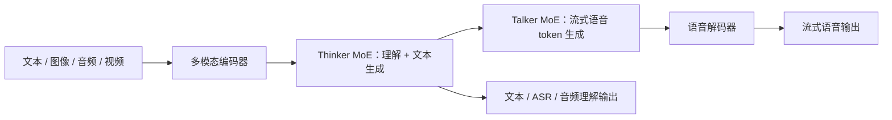

# Qwen3-Omni

## 0. 背景

**问题现场**：全模态模型需要在文本、图像、音频、视频上相对同尺寸单模态模型"无性能退化"地保持 SOTA，并支持实时流式语音交互。

**Qwen3-Omni 的切入点**：Thinker-Talker 架构 MoE 化（开源 30B-A3B），原生流式输入输出，冷启动首包延迟 234ms（音频输入）。

## 1. 内容定位

Qwen3-Omni 是阿里 Qwen 团队 2025 年 9 月发布的全模态模型，官方称首次在文本、图像、音频、视频上相对同尺寸单模态模型「无性能退化」地保持 SOTA。它是 [[Qwen2.5-Omni|Qwen2.5-Omni]] 的 MoE 化后继，也是从 Omni 拆出 [[方向/AI语音/模型/Qwen3-ASR|Qwen3-ASR]] / [[方向/AI语音/模型/Qwen3-TTS|Qwen3-TTS]] 专用线的母模型；后续云端升级见 [[方向/AI语音/模型/Qwen3.5-Omni|Qwen3.5-Omni]]。

## 2. 核心信息

- **Thinker-Talker MoE 架构**：延续 Thinker（理解+文本生成）/ Talker（流式语音生成）分工，基座换为 MoE（开源版本 Qwen3-Omni-30B-A3B）。
- **语言覆盖**：文本交互 119 种语言，语音理解 19 种，语音生成 10 种。
- **音频能力**：36 个音频与音视频基准上 32 个达开源 SOTA、22 个达总体 SOTA，报告口径超过 Gemini-2.5-Pro、[[方向/AI语音/模型/Seed-ASR|Seed-ASR]]、[[方向/AI语音/模型/GPT-4o Transcribe|GPT-4o Transcribe]] 等闭源模型。
- **首包延迟**：冷启动（无上下文）、并发 1 时理论端到端首包延迟 234ms（音频输入）/ 547ms（视频输入）。
- **实时交互**：原生流式输入输出，面向语音助手与全模态 Agent 场景。

### 2.1. 架构示意（概念级）

> [!note] 架构示意（概念级）
> 按本页已有 Thinker-Talker MoE、流式输入输出与多模态能力整理，不替代论文结构图。

## 3. 发展脉络

属 Qwen 语音线「Omni 全模态底座」阶段：Qwen-Audio → Qwen2-Audio → [[Qwen2.5-Omni|Qwen2.5-Omni]] → Qwen3-Omni → [[方向/AI语音/模型/Qwen3.5-Omni|Qwen3.5-Omni]] / 专用化拆分（Qwen3-ASR / Qwen3-TTS）。见 [[方向/AI语音/选型/Qwen 语音模型发展脉络|Qwen 语音模型发展脉络]] 与 [[方向/AI语音/选型/Qwen 语音模型技术路线图|Qwen 语音模型技术路线图]]。

## 4. 边界

- 与 [[方向/AI语音/模型/Moshi|Moshi]] 的单模型全双工机制不同，Qwen3-Omni 以首包延迟与流式生成为主优化目标，打断/全双工体验依赖系统侧工程（见 [[工程/语音 Agent 实时链路|语音 Agent 实时链路]]）。
- 报告中的基准数字为官方自测口径，跨模型对比需注意评测设置（见 [[方向/AI语音/MOC - 音频大模型|MOC - 音频大模型]] 的评估碎片化问题）。
- 严格时间戳、说话人分离、会议级转写等窄任务仍应选专用 ASR 线，见 [[方向/AI语音/选型/Omni vs ASR TTS 专用模型选型|Omni vs ASR TTS 专用模型选型]]。

## 5. 相关对象

- [[Qwen2.5-Omni|Qwen2.5-Omni]]：上一代 Omni。
- [[方向/AI语音/模型/Qwen3.5-Omni|Qwen3.5-Omni]]：后续 API 化升级，理解侧 AuT 降到 6.25 Hz，并用 ARIA 改善流式 text/speech 同步。
- [[方向/AI语音/模型/Qwen3-ASR|Qwen3-ASR]] / [[方向/AI语音/模型/Qwen3-TTS|Qwen3-TTS]]：从本模型拆出的专用 ASR/TTS 线。
- [[方向/AI语音/模型/Qwen-Audio-VAE|Qwen-Audio-VAE]]：Qwen 系通用音频底层表示。
- [[方向/大模型/LLM/模型/Qwen3|Qwen3]]：Qwen 模型家族入口。
- [[方向/AI语音/选型/ASR 模型选型矩阵|ASR 模型选型矩阵]]：Omni 与专用 ASR 的工程对比。

## 6. 来源

- [Qwen3-Omni Technical Report（arXiv:2509.17765）](https://arxiv.org/abs/2509.17765)
  - 内容定位：技术报告，覆盖 Thinker-Talker MoE、36 项音频/音视频基准、234ms 首包延迟与多语言能力。
  - 用途：架构、能力与延迟判断的论文依据。
  - 核验日期：2026-08-07

## 7. 待验证

- 云端 Qwen3-Omni-Flash 与开源 30B-A3B 的能力差；第三方复测的首包延迟与全双工体验。
