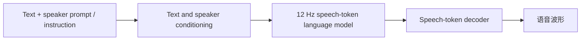

# Qwen3-TTS

## 0. 背景

**问题现场**：需要开源、可控（声音克隆、自然语言声音设计、语速/情绪/韵律控制）且支持低延迟流式生成的 TTS 模型线。

**Qwen3-TTS 的切入点**：12Hz 低帧率 speech-token 语言模型（约 1 秒音频 12 个 token），以参考音频或音色描述为条件自回归生成，流式首包 97 ms。

## 1. 身份

Qwen3-TTS 是 Qwen 团队的文本转语音模型线。本笔记用于索引开源权重、云端 TTS/API、声音克隆/声音设计能力和最新 Qwen-Audio-3.0-TTS 方向。

## 2. 核心信息

- 开源模型：`Qwen3-TTS-12Hz-1.7B/0.6B`，包含 `Base`、`CustomVoice`、`VoiceDesign` 版本和 `Qwen3-TTS-Tokenizer-12Hz`。
- 能力：流式生成、3 秒参考音频克隆、自然语言声音设计、instruction control、语速/情绪/韵律控制。
- 语言：开源 Qwen3-TTS 覆盖 10 种主要语言；云端 Qwen-Audio-3.0-TTS 扩展到 16 种语言方向。
- 云端模型：`qwen-audio-3.0-tts-plus` 偏高质量，`qwen-audio-3.0-tts-flash` 偏实时低延迟；`qwen3-tts-*` 仍可用于 Qwen3-TTS 系列场景。
- 输出形态：非实时 HTTP 可返回 24 小时有效音频 URL；流式模式返回分块音频数据。

### 2.1. 架构示意（概念级）

> [!note] 架构示意（概念级）
> 按本页已有输入—中间表示—输出链路整理，不替代论文结构图。

## 3. 核心公式

设 $\mathbf{x}$ 为文本 token 序列，$\mathbf{c}$ 为说话人或风格条件，$\mathbf{y}=(y_1,\ldots,y_T)$ 为语音 token 序列，$y_{<t}$ 为前 $t-1$ 个已生成 token，$T$ 为输出长度，$\theta$ 为模型参数：

$$p_\theta(\mathbf{y}|\mathbf{x},\mathbf{c}) = \prod_{t=1}^{T} p_\theta(y_t | y_{<t}, \mathbf{x}, \mathbf{c})$$

- 自回归生成式：$\mathbf{y}$ 为 12Hz 语音 token 序列（约 1 秒音频对应 12 个 token），$\mathbf{x}$ 为文本 token，$\mathbf{c}$ 为条件（参考音频提取的说话人条件，或 VoiceDesign 的自然语言音色描述）。

$$\mathcal{L}_{\mathrm{CE}} = -\mathbb{E}_{(\mathbf{x},\mathbf{c},\mathbf{y})\sim\mathcal{D}}\left[\sum_{t=1}^{T} \log p_\theta(y_t | y_{<t}, \mathbf{x}, \mathbf{c})\right]$$

- 训练目标：对文本、条件、语音 token 三元组求交叉熵期望，等价于最大化教师强制下的条件生成概率；instruction control 与语速/情绪控制同样经由条件 $\mathbf{c}$ 注入。

$$N_{\mathrm{tok}} = 12 \times T_{\mathrm{audio}}$$

- 帧率换算：$N_{\mathrm{tok}}$ 为 token 数，$T_{\mathrm{audio}}$ 为音频时长（秒）；12Hz 低帧率决定 LLM 每秒解码步数，是流式低延迟的关键参数。

## 4. 测试基准与性能

**测试基准**：官方评测用 Seed-TTS 测试集（零样本克隆，test-zh / test-en）、10 语言多语测试集、InstructTTSEval、长语音测试集；指标为 WER（ASR 回测）与说话人相似度 SIM。第三方复测常用 SeedTTS-Eval（ClipCannon 榜 / RTX 5090 实测）。

**性能指标**（零样本克隆，WER 越低越好）：

| 模型 | test-zh WER(%) | test-en WER(%) |
|---|---|---|
| Qwen3-TTS-12Hz-1.7B-Base | 0.77 | 1.24 |
| Qwen3-TTS-12Hz-0.6B-Base | 0.92 | 1.32 |
| Qwen3-TTS-25Hz-1.7B-Base | 1.10 | 1.49 |
| Qwen3-TTS-25Hz-0.6B-Base | 1.18 | 1.64 |

- 同口径对比：Seed-TTS 1.12/2.25，CosyVoice 3 0.71/1.45，MiniMax-Speech 0.83/1.65，F5-TTS 1.56/1.83（官方评测）。
- 10 语言测试集（12Hz-1.7B，WER%）：中文 0.93 / 英语 0.93 / 意大利语 0.95 / 德语 1.24 / 西班牙语 1.13 / 葡萄牙语 1.53 / 韩语 1.76 / 法语 2.86 / 俄语 3.21 / 日语 3.82（官方评测）。
- 延迟：流式首包 97 ms（arXiv 摘要）。
- 第三方复测（口径与官方不同）：SeedTTS-Eval SIM 0.789 / WER 1.24%（ClipCannon 榜）；RTX 5090 实测 SIM-o 0.699、回环 WER 0.6%；SIM-o 0.708、UTMOS 4.16。
- 官方 MOS / SIM 具体数值：待核（技术报告正文表格未抓到）。

## 5. 发展脉络

Qwen3-TTS 是 Qwen 语音线从 `Qwen2.5-Omni` 的 Thinker-Talker 自然语音输出能力中拆出的专用 TTS 分支，后续云端生产形态继续演进到 `Qwen-Audio-3.0-TTS`。完整时间线见 [[方向/AI语音/选型/Qwen 语音模型发展脉络|Qwen 语音模型发展脉络]]。

技术分工和后续深挖问题见 [[方向/AI语音/选型/Qwen 语音模型技术路线图|Qwen 语音模型技术路线图]]。

底层 tokenizer/codec 路线见 [[方向/AI语音/知识/技术路线/语音生成 tokenizer codec 技术路线|语音生成 tokenizer codec 技术路线]]；声音克隆和控制能力评估见 [[方向/AI语音/评估/可控 TTS 与声音克隆评估框架|可控 TTS 与声音克隆评估框架]]。

语音 tokenizer 与 LLM 文本 tokenizer 的基础差异见 [[方向/AI语音/知识/技术路线/语音模型 tokenizer 与 LLM tokenizer 对比|语音模型 tokenizer 与 LLM tokenizer 对比]]。

## 6. 选型

- 本地声音克隆/微调：`Qwen3-TTS-12Hz-1.7B-Base`。
- 本地固定高质量音色：`Qwen3-TTS-12Hz-1.7B-CustomVoice`。
- 无参考音频的品牌声音设计：`Qwen3-TTS-12Hz-1.7B-VoiceDesign`。
- 云端高质量多语言生成：`qwen-audio-3.0-tts-plus`。
- 云端实时交互：`qwen-audio-3.0-tts-flash` 或 `qwen3-tts-flash-realtime`。

## 7. 相关对象

- [[方向/AI语音/选型/Qwen 语音模型技术路线图|Qwen 语音模型技术路线图]]：Qwen 语音模型的技术分工、选型边界和深挖入口。
- [[方向/AI语音/知识/技术路线/语音生成 tokenizer codec 技术路线|语音生成 tokenizer codec 技术路线]]：Qwen3-TTS 的 12Hz tokenizer 与 Qwen-Audio-VAE 路线对比。
- [[方向/AI语音/知识/技术路线/语音模型 tokenizer 与 LLM tokenizer 对比|语音模型 tokenizer 与 LLM tokenizer 对比]]：文本 tokenizer 与语音 tokenizer 的基础差异。
- [[方向/AI语音/评估/可控 TTS 与声音克隆评估框架|可控 TTS 与声音克隆评估框架]]：Qwen3-TTS 的声音克隆、VoiceDesign 和控制能力评估。
- [[方向/AI语音/模型/Qwen-Audio-VAE|Qwen-Audio-VAE]]：Qwen 后续通用音频生成底层表示路线。
- [[方向/AI语音/选型/Qwen 语音模型发展脉络|Qwen 语音模型发展脉络]]：Qwen-ASR / Qwen-TTS 的共同上游和分支时间线。
- [[方向/AI语音/模型/Qwen3-ASR|Qwen3-ASR]]：同属 Qwen 语音模型线，常和 TTS 组成语音交互链路。
- [[方向/大模型/LLM/模型/Qwen3|Qwen3]]：Qwen 模型家族入口。
- [[知识wiki/商业/DashScope 阿里云MaaS平台|DashScope 阿里云 MaaS 平台]]：QwenCloud / DashScope API 的平台上下文。

## 8. 关键来源

- [Qwen3-TTS README](https://github.com/QwenLM/Qwen3-TTS)
  - 内容定位：官方开源仓库，记录模型家族、安装、推理、vLLM、微调、评测和 Citation。
  - 用途：本地部署、开源模型选择和能力边界。
  - 核验日期：2026-07-23
- [Qwen3-TTS Technical Report](https://arxiv.org/abs/2601.15621)
  - 内容定位：技术报告，记录 10 语言 TTS、3 秒声音克隆、12Hz tokenizer、低延迟流式架构和训练规模。
  - 用途：引用模型能力、架构和评测结论时的论文依据。
  - 核验日期：2026-07-23
- [Text-to-speech models - QwenCloud](https://docs.qwencloud.com/developer-guides/speech/tts-models)
  - 内容定位：QwenCloud TTS 模型选择页，比较 Qwen-Audio-TTS、CosyVoice、Qwen3-TTS、声音克隆、声音设计和 instruction control。
  - 用途：云 API 选型和模型 ID 查询。
  - 核验日期：2026-07-23
- [Non-real-time speech synthesis - QwenCloud](https://docs.qwencloud.com/developer-guides/speech/tts)
  - 内容定位：Qwen3-TTS 非实时 HTTP 合成文档，记录非流式 URL、流式 PCM、声音克隆、声音设计和 instruction control 示例。
  - 用途：API 调用实现入口。
  - 核验日期：2026-07-23
- [Qwen-Audio-3.0-TTS: More Multilingual, Easier to Direct](https://www.alibabacloud.com/blog/qwen-audio-3-0-tts-more-multilingual-easier-to-direct_603379)
  - 内容定位：Alibaba Cloud 官方发布说明，记录 Flash/Plus 定位、16 语言覆盖、自然语言风格控制、细粒度标签和带噪参考音频克隆鲁棒性。
  - 用途：跟踪 Qwen TTS 云端产品的最新发布方向。
  - 核验日期：2026-07-23

## 9. 待验证

- 官方评测的 MOS / SIM 具体数值（技术报告正文表格）；InstructTTSEval 与长语音测试集的结果。
