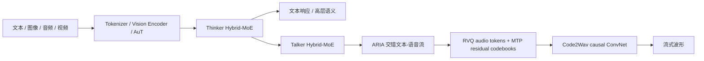

# Qwen3.5-Omni

## 0. 背景

**问题现场**：Qwen-Omni 线走向云端生产，需要升级长上下文、音视频理解、流式语音稳定性和并发延迟。

**前序路线的缺口**：Qwen3-Omni 的双通道 text/speech 生成存在跳词、错读数字和跨语言发音不稳定。

**Qwen3.5-Omni 的切入点**：ARIA 把双通道生成改成自适应交错单流降低输出不稳定，同时 AuT 压到 6.25 Hz、Talker 用 RVQ tokens + MTP、Code2Wav 逐帧渲染波形。

## 1. 内容定位

Qwen3.5-Omni 是阿里 Qwen 团队 2026 年 4 月发布的 Qwen-Omni 后续升级：继续采用 Thinker-Talker 端到端全模态架构，输入覆盖文本、图像、音频、视频，输出文本或语音。它比 [[方向/AI语音/模型/Qwen3-Omni|Qwen3-Omni]] 更偏云端生产路线，重点升级长上下文、音视频理解、流式语音稳定性和并发延迟。

## 2. 核心信息

- **模型族**：Plus / Flash 两档；API 文档列出 HTTP 和 realtime WebSocket 版本。
- **上下文**：256k token context；技术报告称可处理超过 10 小时音频、400 秒 720P 视频（1 FPS）。
- **理解侧音频表示**：16 kHz waveform -> 128-channel mel -> AuT，输出约 6.25 Hz audio tokens，每帧约 160 ms。
- **生成侧语音表示**：Talker 直接生成 Qwen3.5-Omni-Audio-Tokenizer 的 RVQ tokens，并用 MTP 建模 residual codebooks。
- **波形解码**：Code2Wav 是 causal streaming ConvNet，支持 frame-by-frame waveform rendering。
- **关键新增机制**：ARIA 把 Qwen3-Omni 的双通道 text/speech 生成改成自适应交错单流，降低跳词、错读数字和跨语言发音不稳定。

## 3. 核心机制

### 3.1. 输入到输出链路

```text
multimodal understanding:
text/image/video/audio -> tokenizer / vision encoder / AuT -> Thinker Hybrid-MoE -> text response / ASR / audio-visual reasoning

streaming speech generation:
Thinker hidden states + text stream + dialogue history -> Talker Hybrid-MoE -> ARIA interleaved text/speech stream -> RVQ audio tokens + MTP residual codebooks -> Code2Wav -> waveform

streaming interaction:
incoming audio/video chunks -> chunked prefill -> Thinker TTFT -> Talker TTFC -> causal ConvNet decoding -> first playable audio packet
```

### 3.2. 关键公式

音频输入压缩：

$$
z_{1:T}=\mathrm{AuT}(\mathrm{Mel}_{128}(x_{16k})),\quad R_z=6.25\ \mathrm{Hz},\quad \Delta t=\frac{1}{R_z}\approx160\ \mathrm{ms}
$$

自回归生成：

$$
p(y_{1:T}\mid x)=\prod_{t=1}^{T}p(y_t\mid y_{<t},x;\theta)
$$

RVQ residual codebook 建模：

$$
r_0=z,\quad q_l=\mathrm{VQ}_l(r_{l-1}),\quad r_l=r_{l-1}-q_l,\quad \hat z=\sum_{l=1}^{L}q_l
$$

ARIA 的单流约束可以粗略看成：任意前缀内 speech token 不能跑得比该 item 的全局 speech/text 比例更快。

$$
\frac{N_s(\pi_{1:k})}{\max(1,N_t(\pi_{1:k}))}\leq\rho_{item},\quad \pi=(t_1,s_1,t_2,s_2,\ldots)
$$

Code2Wav 渲染：

$$
\hat x_{1:n}=D_{\mathrm{Code2Wav}}(q_{1:t}),\quad t\ \text{随流式解码逐帧增长}
$$

### 3.3. 机制要点

- **Thinker/Talker 仍分工**：Thinker 管多模态理解和文本输出；Talker 管低延迟 speech token 生成。
- **AuT 更压缩**：Qwen3-Omni 是 12.5 Hz 理解侧 audio representation；Qwen3.5-Omni 降到 6.25 Hz，长音频和 KV cache 压力更低。
- **ARIA 是输出调度机制**：它不是新的 codec，而是让 text token 和 speech token 在一个受约束的单流里同步前进。
- **MTP + Code2Wav 负责首包**：Talker 预测当前帧和 residual codebooks，Code2Wav 逐帧渲染，避免块式扩散 decoder 的等待。

### 3.4. 架构示意（概念级）

> [!note] 架构示意（概念级）
> 按本页已有 AuT、Thinker/Talker、ARIA、RVQ、MTP 与 Code2Wav 链路整理，不替代论文结构图。



## 4. 使用判断

- 需要把语音、画面、视频上下文一起推理，并直接语音回答：优先看 Qwen3.5-Omni。
- 需要字幕、时间戳、说话人分离、批量转写：仍优先 [[方向/AI语音/模型/Qwen3-ASR|Qwen3-ASR]] 或完整 ASR 工程链路。
- 需要本地开源可控部署：优先看 [[方向/AI语音/模型/Qwen3-Omni|Qwen3-Omni]]、[[方向/AI语音/模型/Qwen3-ASR|Qwen3-ASR]]、[[方向/AI语音/模型/Qwen3-TTS|Qwen3-TTS]]；Qwen3.5-Omni 当前按 API/demo 记录，不按开源权重记录。
- 需要理解 Qwen 语音线分叉：它是 Omni 助手路线升级，不是专用 ASR/TTS 的替代。

## 5. 相关对象

- [[方向/AI语音/MOC - 音频大模型|MOC - 音频大模型]]：音频大模型总入口。
- [[方向/AI语音/模型/Qwen3-Omni|Qwen3-Omni]]：直接前代，提供 Thinker-Talker MoE、MTP、Code2Wav 低延迟路线。
- [[Qwen2.5-Omni|Qwen2.5-Omni]]：Qwen Omni 开源起点，首次把全模态理解和自然语音输出接成一体。
- [[方向/AI语音/模型/Qwen3-ASR|Qwen3-ASR]] / [[方向/AI语音/模型/Qwen3-TTS|Qwen3-TTS]]：从 Omni 能力拆出的专用语音组件。
- [[方向/AI语音/模型/Qwen-Audio-VAE|Qwen-Audio-VAE]]：Qwen 系连续音频表示路线，对照 Qwen3.5-Omni 的 RVQ token 输出。
- [[方向/大模型/LLM/模型/Qwen3.5|Qwen3.5]]：同代 Qwen 文本/视觉底座与 Hybrid MoE 背景。
- [[方向/AI语音/模型/Ming-Flash-Omni|Ming-Flash-Omni]] / [[方向/AI语音/模型/LongCat-Next|LongCat-Next]] / [[方向/AI语音/模型/MiniCPM-o|MiniCPM-o]]：其他 Omni 路线对照。
- [[方向/AI语音/选型/Qwen 语音模型发展脉络|Qwen 语音模型发展脉络]]：Qwen 语音线时间线。
- [[方向/AI语音/选型/Qwen 语音模型技术路线图|Qwen 语音模型技术路线图]]：Qwen 系 Omni / ASR / TTS 分工。
- [[方向/AI语音/选型/Omni vs ASR TTS 专用模型选型|Omni vs ASR TTS 专用模型选型]]：架构选型边界。
- [[方向/AI语音/知识/技术路线/语音生成 tokenizer codec 技术路线|语音生成 tokenizer codec 技术路线]]：音频 token / codec 路线对照。

## 6. 来源

- [Qwen3.5-Omni Technical Report](https://arxiv.org/abs/2604.15804)
  - 内容定位：Qwen3.5-Omni 技术报告，记录 Plus/Flash、256k context、Hybrid Attention MoE、AuT、ARIA、RVQ Talker、MTP、Code2Wav、长音频/视频能力与评测。
  - 用途：模型身份、发布时间、核心机制与能力边界。
  - 发表日期：2026-04-17（arXiv v1；v2 于 2026-04-21 更新）
  - 核验日期：2026-09-02
- [Qwen3.5-Omni Technical Report HTML](https://arxiv.org/html/2604.15804)
  - 内容定位：技术报告 HTML，便于定位 AuT、ARIA、Speech Generation、Streaming and Concurrency 章节。
  - 用途：公式化输入输出链路和 streaming latency 记录。
  - 核验日期：2026-09-02
- [Qwen-Omni - Alibaba Cloud Model Studio](https://www.alibabacloud.com/help/en/model-studio/qwen-omni)
  - 内容定位：Model Studio API 文档，记录 qwen3.5-omni-plus / flash 调用样例、音频/视频输入限制和 text/audio 输出。
  - 用途：确认开放状态是 API 可用，而不是本地权重发布。
  - 核验日期：2026-09-02
- [QwenCloud vision / omni model list](https://docs.qwencloud.com/developer-guides/getting-started/vision-models)
  - 内容定位：QwenCloud 模型列表，记录 qwen3.5-omni-plus / flash 与 realtime 版本的输入、输出、256k context 和 function calling。
  - 用途：确认 Plus/Flash API SKU 与输入输出形态。
  - 核验日期：2026-09-02

## 7. 待验证

- 是否会发布本地可下载权重、推理代码或 Light 版本；当前笔记只记录 paper/API/demo。
- Plus / Flash / realtime 版本在中文长音频、噪声、打断、音色克隆上的第三方复测差异。
- Qwen3.5-Omni-Audio-Tokenizer 与 Qwen3-Omni / Qwen3-TTS tokenizer 的具体参数、codebook 数和训练差异。
- 6.25 Hz AuT 在强时间戳、说话人分离、会议转写场景中的信息损失边界。
