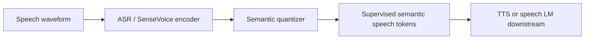

# S3 Tokenizer

## 0. 背景

**问题现场**：TTS 的 text-to-token LLM 需要 speech token 贴近文本语义和副语言信息才易预测。

**前序路线的缺口**：无监督 codec token 不强调文本语义关系，且依赖纯干净语音数据。

**S3 Tokenizer 的切入点**：用有监督语音理解/ASR 目标约束 speech token，得到带时间结构的"神经音素"式语义 token。

## 1. 身份

`S3 Tokenizer` 指 CosyVoice 提出的 **Supervised Semantic Speech Tokenizer**：用有监督语音理解/ASR 目标约束 speech token，使 token 更贴近文本语义和副语言信息，再供 TTS 的 text-to-token LLM 预测。

边界：S3 Tokenizer 不是完整 codec，也不是 vocoder。它主要负责 speech-to-semantic-token；CosyVoice 还需要 text-to-token LLM、token-to-speech flow matching / acoustic model，以及 vocoder / HIFT 这类输出模块才能生成波形。

## 2. 用途

- 给 CosyVoice / speech LLM 提供离散 semantic speech tokens。
- 支撑 zero-shot TTS、跨语言声音克隆、情绪/韵律控制等需要语义对齐的生成任务。
- 作为 [[方向/AI语音/模型/X-Codec2|X-Codec2]]、[[方向/AI语音/模型/BiCodec|BiCodec]]、Qwen3-TTS tokenizer 的对照：S3 更偏 supervised semantic token，不是单纯压缩重建。

## 3. 核心信息

- CosyVoice v1：论文图示为 S3 tokenizer + text-to-token LLM + token-to-speech conditional flow matching。
- token 目标：比无监督 codec token 更强调文本语义关系和副语言信息，降低对纯干净语音数据的依赖。
- semantic 口径：这里的 semantic 不是 LLM sentence meaning，而是 speech content / phonetic-linguistic semantic；更接近带时间结构的“神经拼音/神经音素”，用于锚定发音内容。
- V2 词表口径：本地/社区实现中 S3Tokenizer V2 25Hz 使用 FSQ，8 个标量维度、每维 3 levels，等效 codebook size 为 $3^8=6,561$；token id 理论范围为 0--6560。
- 上游关系：常和 SenseVoice / supervised ASR-style encoder 相关；训练阶段的监督模块不一定在推理时保留。
- 工程形态：官方 CosyVoice 仓库使用 speech tokenizer ONNX 参与 speech token 提取；第三方 `s3tokenizer` 包提供 PyTorch 反向工程实现和批量提取能力。
- 版本线索：第三方 `s3tokenizer` 包列出 V1 50Hz、V1 25Hz、V2 25Hz、V3 25Hz，但这不是官方权威命名入口。

### 3.1. 架构示意（概念级）

> [!note] 架构示意（概念级）
> 按本页已有输入—中间表示—输出链路整理，不替代论文结构图。



## 4. semantic token 到底是什么

S3 的 semantic 是相对 acoustic codec 而言的“语音内容语义”，不是文本 LLM 里已经消歧、抽象后的句义。它主要保留发音内容、音素/音节序列、词序和时间结构，同时弱化音色、房间、麦克风、相位、背景噪声等完整声学细节。

```text
waveform -> acoustic features -> ASR-style encoder -> supervised tokenizer -> semantic speech tokens -> text-to-token LLM / acoustic model
```

| 表示 | 主要保留 | 主要弱化 |
|---|---|---|
| text token | 已书写化、上下文消歧后的词/字/子词 | 真实发音、时长、停顿、口音、韵律 |
| S3 semantic speech token | 发音内容、音素/音节线索、时间对齐、部分副语言残留 | 高保真音色、空间、相位、噪声、完整 prosody |
| codec token | 可重建 waveform / mel 的声学细节 | 文本级可解释性和语义瓶颈 |
| speaker embedding | 说话人身份 / 音色条件 | 逐帧内容和文本语义 |
| acoustic latent | 连续声学状态、韵律、清晰度、局部细节 | 离散可预测性和文本级可读性 |

因此，S3 token 和文本 token 理论上存在类似“拼音到汉字”的转换关系，但更准确地说是概率映射，而不是字典映射：

$$
p(w_{1:N} \mid s_{1:T}, \mathrm{context})
$$

$$
p(s_{1:T} \mid w_{1:N}, c)
$$

其中 $s_{1:T}$ 是 semantic speech tokens，$w_{1:N}$ 是 text tokens，$c$ 是 speaker / style / prosody 条件。speech token -> text 类似 ASR，需要上下文处理同音词、声调、连读、口音和省略；text -> speech token 类似 TTS，需要额外条件补回说话人、语速、停顿和韵律。

对 LLM-SE 来说，S3 token 更适合做“干净语音内容锚点”，不要直接替代声学 latent：text token 会丢时间和发音细节，S3 token 又不足以单独恢复音色、情绪、噪声与高保真 waveform。

## 5. 为什么词表比 Qwen / codec 小

S3 的 6,561 不是文本 tokenizer 词表，也不是全音频 codec 词表，而是一个内容瓶颈。V2 的 FSQ 形式可写成：

$$
K = 3^8 = 6,561
$$

$$
\log_2 K \approx 12.7\ \mathrm{bits/token}
$$

若按 25Hz 估算，比特率约为：

$$
25 \times \log_2(6,561) \approx 317\ \mathrm{bits/s}
$$

- 相比 Qwen 这类文本词表：文本 tokenizer 要覆盖多语言文字、数字、标点、代码、特殊 token 和长尾字符串；S3 只覆盖语音内容状态，类别空间天然小很多。
- 相比 [[方向/AI语音/模型/X-Codec2|X-Codec2]] 这类 codec：codec token 需要承载声学重建信息，词表/帧率/多 codebook 往往更大；S3 更强调让 LLM 易预测、少泄漏声学细节。
- 相比 [[方向/AI语音/模型/UniAudio-Token|UniAudio-Token]]：两者都偏 single-codebook / LLM-friendly audio token；S3 V2 本地口径约 6,561 vocab at 25Hz，UniAudio-Token 论文口径是 8,192 vocab at 25Hz，量级接近。
- 代价：小词表有利于内容抽象和训练稳定，但不能单独表达 speaker identity、emotion、noise、room response、phase 或完整 prosody。

## 6. 核心公式

$$\mathcal{L}_{\mathrm{S3}} = \mathcal{L}_{\mathrm{codec}}(x, \hat{x}) + \lambda\, \mathcal{L}_{\mathrm{sup}}(\mathbf{s}, \mathbf{w})$$

- 有监督语义 token 训练目标：$\mathcal{L}_{\mathrm{codec}}$ 为重建/量化损失，$\mathcal{L}_{\mathrm{sup}}$ 为以文本转写 $\mathbf{w}$ 为监督的语义对齐项（语音理解/ASR 目标），$\lambda$ 平衡两项，使 token 更贴近文本语义与副语言信息（具体形式待核，见待验证）。

$$\mathcal{L}_{\mathrm{CE}} = -\sum_{t} \log p_\theta(s_t | s_{<t}, \mathbf{t}, \mathbf{c})$$

- text-to-token LLM：$\mathbf{t}$ 为文本 token，$\mathbf{c}$ 为参考音频条件（zero-shot 克隆/韵律控制），逐个预测 S3 semantic token $s_t$。

$$\mathcal{L}_{\mathrm{CFM}} = \mathbb{E}_{t}\left[\|v_\theta(x_t, t, s) - u_t\|^2\right]$$

- token-to-speech conditional flow matching：以 S3 token 序列 $s$ 为条件预测速度场 $v_\theta$，把语义 token 转为声学特征，再交 vocoder（HIFT 等）输出波形。

## 7. 测试基准与性能

**测试基准**：作为 CosyVoice v1 的 speech tokenizer，评测跟随 CosyVoice 端到端系统：零样本克隆的自然度 MOS、说话人相似度 SIM、内容一致性（ASR 回测 WER/CER），数据集为 LibriTTS / AISHELL 等（具体列表与分数待核）。

**性能指标**：

- 论文摘要仅定性：supervised semantic tokens 在内容一致性与说话人相似度上显著优于无监督 token（arXiv 摘要，无数字）。
- 具体 MOS / SIM / WER / 帧率数字：待核（CosyVoice v1 论文正文表格未抓到）。
- 端到端参照：CosyVoice 家族 SEED 对比表（FunAudioLLM 官方）见 [[方向/AI语音/模型/Spark-TTS|Spark-TTS]]「测试基准与性能」。

## 8. 使用注意

- 不要把 S3 Tokenizer 当作可以直接还原高保真音频的 neural codec；它偏 semantic token，声学细节仍依赖后续 flow/vocoder。
- 不要把 S3 token 等同于文本 token：speech token -> text 是带上下文消歧的 ASR 问题，text -> speech token 是带说话人/风格/韵律条件的 TTS 问题。
- 如果目标是训练 CosyVoice 类模型，token 提取吞吐会成为工程瓶颈；第三方 PyTorch 实现可以参考，但要和官方 ONNX/权重口径核对。
- 如果用于语音增强 / LLM-SE，S3 更适合作为 content anchor；声学恢复仍需要 acoustic latent、speaker embedding 或 codec/vocoder 路线承接。
- 如果目标是可控 TTS，要同时评估 token 语义稳定性、prompt 音色保持、长文本一致性和 vocoder 输出质量。

## 9. 相关对象

- [[方向/AI语音/MOC - TTS|TTS]]：S3 Tokenizer 是 CosyVoice 类 TTS 的底层 speech token 表示。
- [[方向/AI语音/模型/CosyVoice|CosyVoice]]：S3 Tokenizer 的原始模型家族和主要应用场景。
- [[方向/AI语音/知识/技术路线/语音生成 tokenizer codec 技术路线|语音生成 tokenizer codec 技术路线]]：S3 属于 supervised semantic speech tokenizer 路线。
- [[方向/AI语音/知识/技术路线/语音模型 tokenizer 与 LLM tokenizer 对比|语音模型 tokenizer 与 LLM tokenizer 对比]]：区分文本 tokenizer 和 speech tokenizer。
- [[方向/AI语音/模型/SenSE|SenSE]]：SenSE 笔记提到 CosyVoice / SenseVoice 相关 supervised semantic token 路线。
- [[方向/AI语音/模型/X-Codec2|X-Codec2]]：同属 LLM-friendly speech tokenizer，但更偏 low-bitrate speech codec。
- [[方向/AI语音/模型/UniAudio-Token|UniAudio-Token]]：同属 LLM-friendly single-codebook audio token，可和 S3 对比 vocab、帧率和监督方式。
- [[方向/AI语音/模型/BiCodec|BiCodec]]：同属 speech token codec/tokenizer，对比语义/说话人属性解耦。
- [[方向/AI语音/知识/基础概念/Vocoder（声码器）|Vocoder（声码器）]]：S3 token 之后仍需要 flow/vocoder 类模块输出 waveform。

## 10. 关键来源

- [CosyVoice v1 paper](https://arxiv.org/abs/2407.05407)
  - 内容定位：提出基于 supervised semantic tokens 的 CosyVoice；包含 S3 tokenizer、text-to-token LLM 和 conditional flow matching 链路。
  - 用途：确认 S3 Tokenizer 的原始论文身份。
  - 核验日期：2026-08-03
- [CosyVoice v1 PDF](https://funaudiollm.github.io/pdf/CosyVoice_v1.pdf)
  - 内容定位：论文 Figure 1 展示 S3 tokenizer，并说明 CosyVoice 由 text-to-token LLM 与 token-to-speech flow matching model 组成。
  - 用途：确认架构拆分和模块边界。
  - 核验日期：2026-08-03
- [FunAudioLLM/CosyVoice](https://github.com/FunAudioLLM/CosyVoice)
  - 内容定位：官方 CosyVoice 仓库，提供多语言语音生成模型的 inference、training 和 deployment 入口。
  - 用途：工程实现和版本入口。
  - 核验日期：2026-08-03
- [s3tokenizer - PyPI](https://pypi.org/project/s3tokenizer/)
  - 内容定位：第三方 S3Tokenizer 反向工程包，说明其基于 SenseVoice-Large，支持 V1/V2/V3 tokenizer 形态，并提供 PyTorch / batch inference。
  - 用途：非官方工程参考；不能替代官方论文/仓库。V2 6,561 词表口径来自本地 `s3tokenizer` PyTorch 实现中的 `3**8` FSQ codebook 设置。
  - 核验日期：2026-08-03
- [CosyVoice 3 paper](https://arxiv.org/abs/2505.17589)
  - 内容定位：CosyVoice 3 提出新的 supervised multi-task speech tokenizer，覆盖 ASR、emotion、language ID、audio event 和 speaker analysis。
  - 用途：跟踪 S3 / supervised speech tokenizer 路线在 CosyVoice 3 的演进。
  - 核验日期：2026-08-03

## 11. 待验证

- S3 Tokenizer 训练目标的确切形式（监督语义项与重建/量化项的构成与系数，CosyVoice v1 论文细节）——「核心公式」中仅给标准形式。
- CosyVoice v1 / v2 / v3 tokenizer 的帧率、codebook、监督任务和权重是否能形成统一版本表。
- S3 V2 / V3 的 6,561 FSQ 词表是否与官方 ONNX/论文描述完全一致；当前数值来自本地社区 PyTorch 实现与 ONNX 反解口径。
- 官方 ONNX tokenizer、第三方 PyTorch `s3tokenizer` 和 CosyVoice 训练脚本的输出 token 是否完全一致。
- S3 token 与文本 token 的可逆性/消歧：在中文同音词、声调、儿化、口音下，speech token -> text 的错误模式。
- S3 Tokenizer 与 X-Codec2、BiCodec、Qwen3-TTS tokenizer 在中文长文本、跨语言克隆、情绪控制上的差异。
- CosyVoice v1 论文正文的 MOS / SIM / WER 数字与所用测试集列表（LibriTTS 等）；S3 tokenizer 帧率的官方口径（第三方 s3tokenizer 包称 V1 50Hz / V1 25Hz / V2 25Hz / V3 25Hz）。
