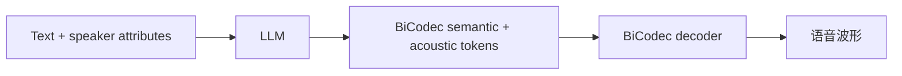

# Spark-TTS

## 0. 背景

**问题现场**：需要高效的 LLM-based TTS，支持 zero-shot 声音克隆与可控语音生成。

**Spark-TTS 的切入点**：用 BiCodec 把语音拆成单流解耦 token（semantic token 承载语言内容、global token 承载说话人属性），由 Qwen2.5 LLM 自回归预测后再重建波形。

## 1. 身份

Spark-TTS 是 SparkAudio 等团队提出的 LLM-based 文本转语音模型，论文全名是 *Spark-TTS: An Efficient LLM-Based Text-to-Speech Model with Single-Stream Decoupled Speech Tokens*。它把 TTS 建模成由 Qwen2.5 LLM 预测单流解耦语音 token，再由 [[方向/AI语音/模型/BiCodec|BiCodec]] 重建语音的路线。

## 2. 用途

- 做中英双语 TTS、zero-shot voice cloning、跨语言/代码切换语音克隆实验。
- 研究 single-stream decoupled speech tokens：用语义 token 表示语言内容，用全局 token 表示说话人属性。
- 评估可控语音生成：gender、pitch、speaking rate 等粗粒度/细粒度控制。
- 作为 [[方向/AI语音/知识/技术路线/语音生成 tokenizer codec 技术路线|语音生成 tokenizer codec 技术路线]] 中“单流离散 token + LLM”路线的案例。

## 3. 核心信息

- 开源推理仓库：`SparkAudio/Spark-TTS`，代码许可证为 Apache-2.0。
- 权重：`SparkAudio/Spark-TTS-0.5B`，Hugging Face 模型卡标注许可证为 `cc-by-nc-sa-4.0`。
- 底层：[[方向/AI语音/模型/BiCodec|BiCodec]]，把语音拆成 low-bitrate semantic tokens 和 fixed-length global tokens。
- 主干：Qwen2.5 LLM。
- 训练数据：论文提出 [[方向/AI语音/数据集/VoxBox|VoxBox]]，描述为带属性标注的约 100,000 小时中英 TTS 数据集；独立仓库记录约 102,500 小时、47,706,212 条 utterance。
- 部署：官方仓库提供基础 CLI/Web UI，也有 Nvidia Triton + TensorRT-LLM 参考。

### 3.1. 架构示意（概念级）

> [!note] 架构示意（概念级）
> 按本页已有输入—中间表示—输出链路整理，不替代论文结构图。

## 4. 核心公式

$$(S, G) = \mathcal{E}(x), \qquad \hat{x} = \mathcal{D}(S, G)$$

- BiCodec 编解码：$x$ 为输入语音波形，$S=\{s_1,\dots,s_n\}$ 为低码率 semantic tokens（承载语言内容），$G$ 为固定长度 global tokens（承载说话人属性、音色、风格），$\hat{x}$ 为重建波形；LLM 预测 token 后由 decoder $\mathcal{D}$ 还原语音。

$$\mathcal{L}_{\mathrm{CE}} = -\sum_{t} \log p_\theta(s_t | s_{<t}, G_{\mathrm{ref}}, \mathbf{t})$$

- LLM 自回归预测：Qwen2.5 在参考说话人 global tokens $G_{\mathrm{ref}}$（zero-shot 克隆条件）与文本 token $\mathbf{t}$ 条件下逐个预测 semantic token $s_t$。

$$p_\theta(s_t | s_{<t}, G, \mathbf{t}, \mathbf{q})$$

- 可控生成（CoT）：$\mathbf{q}$ 为控制指令 token 序列（gender、pitch、speaking rate 等粗/细粒度属性）；控制信息以 token 前缀形式进入条件分布，无需改动模型结构。

## 5. 测试基准与性能

**测试基准**：官方论文以中英测试集 + 零样本克隆评测（MOS / 说话人相似度 SS / 内容一致性）；社区横向对比常用 SEED 测试集（test-zh / test-en，CER/WER + SS）；服务化性能以官方 Triton + TensorRT-LLM 部署基准为准。

**性能指标**：

| 项 | 数值 | 来源 |
|---|---|---|
| SEED test-zh CER / SS | 1.2% / 66.0% | FunAudioLLM 官方对比表 |
| SEED test-en WER / SS | 1.98% / 57.3% | FunAudioLLM 官方对比表 |
| Triton 平均延迟（L20，单卡） | 876 ms（并发1）/ 921 ms（并发2）/ 1611 ms（并发4） | 官方 GitHub 仓库 |
| Triton RTF（L20，单卡） | 0.136（并发1）/ 0.074（并发2）/ 0.070（并发4） | 官方 GitHub 仓库 |

- 同表对比 CosyVoice2 0.5B：test-zh CER 1.45% / SS 75.7%，test-en WER 2.57% / SS 65.9% —— Spark-TTS 内容一致性更好，但说话人相似度明显更低（FunAudioLLM 官方对比表；Spark-TTS 未报 test-hard）。
- 论文正文的 MOS / 相似度评测表数字：待核（arXiv 摘要页无具体分数）。

## 6. 关键资源

- [Spark-TTS Project Page](https://sparkaudio.github.io/spark-tts/)
  - 内容定位：官方项目页，说明 BiCodec、Qwen2.5、CoT generation、zero-shot voice cloning 和 controlled generation。
  - 用途：建立模型身份和技术路线。
  - 核验日期：2026-07-28
- [SparkAudio/Spark-TTS](https://github.com/SparkAudio/Spark-TTS)
  - 内容定位：官方 PyTorch 推理代码仓库，包含安装、模型下载、CLI/Web UI、Triton 部署参考和使用声明。
  - 用途：本地运行、部署和源码入口。
  - 核验日期：2026-07-28
- [Spark-TTS paper](https://arxiv.org/abs/2503.01710)
  - 内容定位：论文摘要说明单流解耦语音 token、BiCodec、Qwen2.5、CoT 控制和 VoxBox 数据集。
  - 用途：引用架构、数据和评测结论。
  - 核验日期：2026-07-28
- [SparkAudio/voxbox](https://huggingface.co/datasets/SparkAudio/voxbox)
  - 内容定位：VoxBox 数据集页，记录 metadata 字段、下载入口、体积和许可证提示。
  - 用途：确认 Spark-TTS 训练数据入口。
  - 核验日期：2026-08-03
- [SparkAudio/VoxBox](https://github.com/SparkAudio/VoxBox)
  - 内容定位：VoxBox 官方 GitHub 仓库，记录子语料统计、metadata 示例和下载脚本。
  - 用途：确认 VoxBox 规模、组成和许可口径。
  - 核验日期：2026-08-03
- [SparkAudio/Spark-TTS-0.5B](https://huggingface.co/SparkAudio/Spark-TTS-0.5B)
  - 内容定位：官方 Hugging Face 权重页，标注任务、语言、arXiv 链接和 `cc-by-nc-sa-4.0` 许可证。
  - 用途：权重下载和许可证核对。
  - 核验日期：2026-07-28

## 7. 相关对象

- [[方向/AI语音/MOC - TTS|TTS]]：Spark-TTS 属于可控 TTS / voice cloning 模型。
- [[方向/AI语音/数据集/VoxBox|VoxBox]]：Spark-TTS 论文提出的大规模可控 TTS 训练语料集合。
- [[方向/AI语音/模型/Qwen3-TTS|Qwen3-TTS]]：同属 LLM-based TTS，可对比 Qwen 专用 TTS 与 Spark-TTS 的 tokenizer/codec 路线。
- [[方向/AI语音/知识/技术路线/语音生成 tokenizer codec 技术路线|语音生成 tokenizer codec 技术路线]]：Spark-TTS 的 [[方向/AI语音/模型/BiCodec|BiCodec]] 是单流解耦语音 token 案例。
- [[方向/AI语音/评估/可控 TTS 与声音克隆评估框架|可控 TTS 与声音克隆评估框架]]：用于评估 Spark-TTS 的 voice cloning、语速/音高/性别控制和长文本稳定性。

## 8. 待验证

- 权重的非商业许可证是否满足目标项目用途；商业场景不要只看 GitHub 代码许可证。
- 官方训练代码是否已经发布；VoxBox 已有独立数据集入口，但 Spark-TTS 仓库 To-Do 仍保留“Release the training dataset, VoxBox”，需以 VoxBox 专仓和 Hugging Face 数据集页为准。
- 本地推理在目标 GPU 上的 RTF、首包延迟、显存占用和长文本稳定性。
- 与 Qwen3-TTS、CosyVoice、F5-TTS、IndexTTS 的中文克隆质量和授权约束差异。
- 论文正文的 MOS / 相似度评测表数字（arXiv 摘要页不含具体分数）。
- 社区实测报告 RTF > 1（慢于 CosyVoice2），与官方 Triton 部署 RTF 0.07–0.14 差异较大（推理后端、GPU、文本长度不同所致？）。
