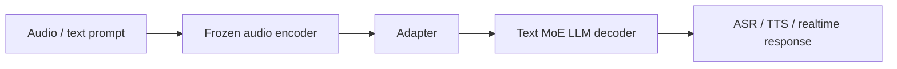

# StepAudio 2.5

## 0. 背景

**问题现场**：ASR、TTS 与实时语音交互通常由级联或专用模型分别承担，无法共享上下文与副语言信息。

**StepAudio 2.5 的切入点**：把文本 token 和音频 token 放进统一序列空间，用同一共享骨干建模三种运行方向，任务差异从模型架构转移到数据构造、优化目标、解码约束和 RLHF 后训练。

## 1. 身份

StepAudio 2.5 是阶跃星辰（StepFun）的统一音频-语言基础**模型**，目标是在同一共享骨干上覆盖 ASR、TTS 和实时语音交互。它不是简单的 ASR -> LLM -> TTS 级联系统，而是把文本 token 和音频 token 放进统一序列空间中建模。

层级定位：StepAudio 2.5 是统一语音模型路线的对象笔记，适合放在 [[方向/AI语音/选型/Omni vs ASR TTS 专用模型选型|Omni vs ASR TTS 专用模型选型]] 旁边，用来比较“统一模型”和“专用 ASR/TTS 组件”的边界。

## 2. 用途

- 作为统一音频-语言模型的前沿样例。
- 对比专用 [[方向/AI语音/MOC - ASR|ASR]]、[[方向/AI语音/MOC - TTS|TTS]] 和端到端实时语音 Agent 架构。
- 观察任务差异如何从模型架构转移到数据构造、优化目标、解码约束和 RLHF 后训练。
- 研究 ASR 准确率、TTS 表现力、实时低延迟和多轮人格一致性之间的取舍。

## 3. 核心信息

- 共享骨干：冻结音频编码器 -> 适配器 -> 文本 MoE LLM 初始化的大语言模型解码器。
- 统一序列：解码器同时处理文本 token 和音频 token。
- 三种运行方向：
  - ASR：音频嵌入输入，文本 token 输出。
  - TTS：文本和控制指令输入，音频 token 输出。
  - Realtime：音频和对话历史输入，文本或音频 token 输出。
- 后训练核心：通过面向任务的 SFT、[[方向/大模型/基础知识/MTP（Multi-Token Prediction）|MTP]] 和 RLHF，让同一骨干模型在不同模式下专门化。

### 3.1. 架构示意（概念级）

> [!note] 架构示意（概念级）
> 按本页已有输入—中间表示—输出链路整理，不替代论文结构图。

## 4. 核心公式

$$p_\theta(\mathbf{u}) = \prod_{i=1}^{L} p_\theta(u_i | u_{<i})$$

- 统一序列建模：$\mathbf{u}=(u_1,\dots,u_L)$ 为文本 token 与音频 token 混合的统一序列；ASR 时序列以音频嵌入开头、输出文本 token，TTS 时以文本/控制指令开头、输出音频 token，Realtime 时两者均可能输出。

$$\mathcal{L}_{\mathrm{CE}} = -\sum_{i=1}^{L} \log p_\theta(u_i | u_{<i})$$

- 训练目标：对统一序列中每个 token 求交叉熵；同一骨干通过数据构造、优化目标和解码约束的差异（而非模型分叉）完成 ASR / TTS / Realtime 专门化。

$$\mathcal{L}_{\mathrm{MTP}} = \sum_{k=1}^{K} -\log p_\theta(u_{i+k} | u_{\le i}, h_i)$$

- MTP 多头预测（ASR 分支，$K=5$）：$h_i$ 为位置 $i$ 的骨干隐状态，额外 $K$ 个分支同时预测后续 $K$ 个 token，推理时用验证机制接受/拒绝候选，提高解码效率。

$$J(\theta) = \mathbb{E}_{\pi_\theta}\left[r(x, \mathbf{u})\right] - \beta\, D_{\mathrm{KL}}\big(\pi_\theta \,\|\, \pi_{\mathrm{ref}}\big)$$

- RLHF 后训练（标准 PPO 目标）：$r$ 为任务相关奖励（转写准确率、自然度、人格一致性等），$\pi_{\mathrm{ref}}$ 为 SFT 参考策略，$\beta$ 控制与参考策略的偏离（KL 惩罚）。

## 5. 测试基准与性能

**测试基准**：ASR 用 AISHELL-1 / LibriSpeech 等标准集 + 长语音集；TTS 用 774 条 prompt 的 arena 两两人工对比（技术报告明确弃用 MOS）；Realtime 用五套基准（Step-Dialogue-Human-Eval、Step-SPQA 等，部分为团队自建）。以下数字均出自 StepAudio 2.5 Technical Report（arXiv 2605.23463）。

**TTS 评估口径**：报告 5.3 认为现代 LLM-based TTS 的可控性、表现力和副语言能力很难由单一常规指标覆盖，因此采用 arena-style pairwise human evaluation：模型成对比较，用人工偏好汇总 win rate。

- **CER / ASR-based metrics**：遇到丰富副语言现象时会变得不可靠；停顿、笑声、情绪、语速和表达性变化不一定对应转写错误，但会影响合成质量。
- **Speaker similarity / embedding-based speaker verification**：speaker embedding 往往丢弃高频声学细节，也难以准确捕捉韵律、说话风格和表达性特征的相似度。
- **LLM-as-judge**：仍难以可靠评估韵律质量和复杂情绪表达。
- **MOS**：需要高度训练的标注员，且不同评估者的打分标准容易不一致。
- **Arena 协议**：先做听觉敏感度筛选，固定评估者并在同一评估期连续完成；随机模型音频对和展示顺序，要求给出偏好理由；过程中抽检偏差，结束后复核分歧大的样本；最终用 774 条 prompt、各模型官方推荐 voice preset 统计胜率。

**性能指标**：

| 分支 | 指标 | 数值 |
|---|---|---|
| ASR | 中文 CER 平均 / AISHELL-1 | 2.97% / 0.71% |
| ASR | 英文 WER 平均 / LibriSpeech-clean | 3.68% / 1.38% |
| ASR | 长语音平均错误率 | 3.70% |
| ASR | RTF（MTP-5 解码） | 0.0053（30 秒音频约 0.16 秒转写） |
| TTS | vs MiniMax-2.8-HD / ElevenLabs-v3 / Gemini-3.1-Flash-TTS 胜率 | 63.0% / 80.0% / 59.4% |
| Realtime | Step-Dialogue-Human-Eval | 80.41（第二约 70） |
| Realtime | Step-SPQA / 通用对话 / 车载 / 副语言理解 | 79.80 / 86.36 / 84.80 / 82.18 |

- **MTP 对准确率的影响**：StepAudio 2.5 把 MTP-5 与 SFT 后、未做 MTP training 的 ASR base 对比，报告结论是识别准确率基本不变；中文平均 CER 为 2.97% vs 3.00%，英文平均 WER 为 3.68% vs 3.83%，长语音平均错误率为 3.70% vs 3.63%。因此 MTP 在这里主要不是“提准确率”的模块，而是通过自回归验证保持最终 transcript 由 verified path 决定，避免多 token 草稿直接污染结果。
- **MTP 对耗时的影响**：MTP-5 各位置接受率约 0.95 / 0.88 / 0.80 / 0.71 / 0.64，平均每步接受 5.0/6 个 token，RTF 降到 0.0053；在同一 serving setup 下快于 Qwen3-ASR-1.7B 的 0.0094。报告认为关键收益是 decoder 规模不再线性转化为逐 token 延迟，因为多数 step 能一次发出多个已验证 transcript token。
- **MTP-5 为什么不是 MTP-7**：MTP-3 平均接受 3.6/4，MTP-5 为 5.0/6，MTP-7 为 6.1/8；从 3 到 5 带来约 39% accepted length 增益，但从 5 到 7 增益约 22%，第 6/7 位失败率更高，容易触发 KV cache rollback 并打断解码流，所以 MTP-5 是效率和复杂度折中。
- 对比：Qwen3-ASR-1.7B 中文 CER 3.17% / 英文 WER 3.85%。
- TTS 合计胜率口径：中文报道 69.1%，英文摘要 67.6%，待核。

## 6. 训练脉络

| 阶段 | 内容 | 作用 |
|---|---|---|
| 对齐阶段 | 30B ASR token，仅训练适配器 | 建立音频到文本 LLM 空间的桥 |
| 多模态主阶段 | 800B 文本 + 800B 语音 token，16K 序列 | 联合训练 ASR、TTS、翻译、语音对话等能力 |
| 冷却阶段 | 600B 高质量文本 + 音频 token，32K 序列 | 强化高质量音频、caption 和 instruction TTS |

ASR 分支加入 [[方向/大模型/基础知识/MTP（Multi-Token Prediction）|MTP-5（Multi-Token Prediction）]] 头，用多个预测分支提出后续 token，并在推理时通过验证机制接受或拒绝，用于提高解码效率。

## 7. 边界

- 统一模型并不自动替代专用 ASR/TTS 系统；它的价值在共享上下文、副语言信息和实时交互。
- 如果任务只需要稳定转写或低成本批量 TTS，专用模型仍可能更简单。
- 真正需要关注的是三种模式的评测是否在同一产品约束下可比：延迟、准确率、自然度、可控性和安全边界。

## 8. 关键资源

- [StepAudio 2.5 Technical Report](https://arxiv.org/abs/2605.23463)
  - 内容定位：技术报告，覆盖统一架构、训练流程、ASR/TTS/Realtime 专项和评测。
  - 用途：判断统一语音模型和专用 ASR/TTS 系统的边界。
  - 发表日期：2026-05-22（arXiv v1）
  - 核验日期：2026-08-25
  - 来源：`papers-summary/StepAudio 2.5.md`

## 9. 待验证

- TTS arena 合计胜率口径（69.1% vs 67.6%）与分项数字的核对。
- Realtime 五套基准中部分为团队自建（Step-Dialogue-Human-Eval、Step-SPQA 等），独立第三方复测待确认。
