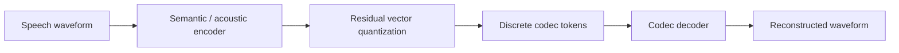

# X-Codec2

## 0. 背景

**问题现场**：decoder-only LLM 做 TTS / speech generation 需要一个易于接入的低码率离散语音 token 序列。

**前序路线的缺口**：X-Codec、DAC、EnCodec、Mimi 等多层 RVQ codec 的 token 序列对 LLM 接入不如单层低帧率方案友好。

**X-Codec2 的切入点**：single-stage FSQ 单层量化、约 50 tokens/s、65,536 级离散空间（0.8 kbps），为 LLaSA 提供 speech-to-token / token-to-waveform 的底层 codec。

## 1. 身份

`X-Codec2` 是 LLaSA 路线使用的 low-bitrate speech codec / speech tokenizer，用来把语音压成离散 token，再从 token 重建 16 kHz 语音。Hugging Face 的 `HKUSTAudio/xcodec2` 模型卡称它使用 Single Vector Quantization、约 50 tokens/s，服务 speech generation / LLaSA；Transformers 文档进一步把实现口径描述为 single-stage [[方向/AI语音/知识/基础概念/FSQ（有限标量量化）|Feature Scalar Quantization（FSQ）]]，区别于 [[方向/AI语音/模型/X-Codec]]、DAC、EnCodec、Mimi 等多层 [[方向/AI语音/知识/基础概念/RVQ（残差向量量化）|residual VQ]]。

边界：X-Codec2 不是文本 tokenizer，也不是通用 ASR encoder。它是 speech-to-token / token-to-waveform 的神经语音 codec；上层 LLaSA 这类 LLM 负责生成 token，X-Codec2 负责把 token 和波形互转。

## 2. 用途

- 为 LLaSA / speech language model 提供短的离散 speech token 序列。
- 作为 decoder-only LLM 做 TTS / speech generation 时的底层 codec。
- 和 [[方向/AI语音/模型/BiCodec|BiCodec]]、Qwen3-TTS tokenizer、EnCodec / SoundStream 类 codec 对比 token 率、码本设计和重建质量。

## 3. 核心信息

- 表示：LLaSA 论文称其为 single-layer vector quantizer codec；Transformers 文档称其实现为 single-stage [[方向/AI语音/知识/基础概念/FSQ（有限标量量化）|Feature Scalar Quantization（FSQ）]]。
- 离散空间：原始模型卡/配置使用 65,536 级别的离散表示；具体实现口径需区分 VQ 表述和 FSQ 配置。
- 帧率：约 50 tokens/s；比 12Hz tokenizer 长，但比多层高帧率 codec 更容易接入 LLM。
- 音频：16 kHz speech codec；官方 Transformers 版本要求 16 kHz 输入。
- 许可证：Hugging Face 模型卡标注为 CC-BY-NC-4.0，商用前要单独确认授权。

### 3.1. 架构示意（概念级）

> [!note] 架构示意（概念级）
> 按本页已有输入—中间表示—输出链路整理，不替代论文结构图。

## 4. 核心公式

$$q_i = \mathrm{round}\big(\mathrm{clamp}(z_i, -1, 1)\big), \qquad c = \sum_{i=0}^{d-1} q_i \cdot L^{i}$$

- Feature Scalar Quantization（Transformers 实现口径，single-stage FSQ）：$z \in \mathbb{R}^d$ 为连续 latent，逐维量化到 $L$ 级后按 $L$ 进制编码为单一码本索引 $c$，一次量化完成，区别于 [[方向/AI语音/模型/X-Codec]]、DAC、EnCodec、Mimi 的多层 [[方向/AI语音/知识/基础概念/RVQ（残差向量量化）|residual VQ]]（具体维度 $d$ 与级数 $L$ 待核，见待验证）。

$$c \in \{0, 1, \dots, 2^{16}-1\}$$

- 离散空间：原始模型卡/配置口径为 65,536 级离散表示，即 16 bit 码本索引；VQ 表述与 FSQ 配置的对应关系需区分口径。

$$R_{\mathrm{tok}} = 50\ \mathrm{tokens/s}$$

- token 帧率：约 50 tokens/s（16 kHz 输入），比 12Hz 类 tokenizer 长、比多层高帧率 codec 短，更易接入 decoder-only LLM 自回归生成。

$$\mathcal{L}_{\mathrm{codec}} = \mathcal{L}_{\mathrm{rec}}(x, \hat{x}) + \lambda_a\,\mathcal{L}_{\mathrm{adv}} + \lambda_v\,\mathcal{L}_{\mathrm{quant}}$$

- codec 训练目标（神经编解码器标准形式）：重建 + 对抗 + 量化损失，具体构成与系数待核，见待验证。

## 5. 测试基准与性能

**测试基准**：LibriSpeech test-clean 语音重建（WER 用 HuBERT-large 等 ASR 回测 + 客观指标）、下游 ASR WER、token 率与码率。

**性能指标**（LLaSA 论文 (arXiv 2502.04128) / 社区对比表口径）：

| 指标 | 数值 |
|---|---|
| 码率 | 0.8 kbps（50 tokens/s × 16 bit 单码本） |
| LibriSpeech test-clean WER | 2.47%（GT 音频 1.96%） |
| STOI | 0.92 |
| PESQ-WB / PESQ-NB | 2.43 / 3.04 |
| 说话人相似度 SPK-SIM（WavLM） | 0.82 |
| UTMOS | 4.13 |

- 流式变体 XCodec2-S（因果解码器）：WER 3.24%、STOI 0.913、PESQ-WB 2.34、UTMOS 4.03（约保留原始 95% 质量）。
- 不同 ASR / 测试切分下 WER 有 2.47%–2.61% 波动（社区对比表口径差异，待核）。
- 帧率 50 tokens/s、65,536 级（16 bit）离散空间见「核心信息」；官方模型卡未提供质量指标。

## 6. 使用注意

- `X-Codec2` 和 `LLaSA` 要分开看：前者是 codec/tokenizer，后者是基于 Llama 的 speech LLM。
- 如果目标是低延迟实时 TTS，要实测 token 率、decoder RTF、首包和 chunk 边界伪影；50 tokens/s 不自动等于实时友好。
- 如果目标是声音克隆或多说话人控制，X-Codec2 本身不等于完整的风格/说话人控制框架，上层 prompt、speaker conditioning 和训练数据同样关键。

## 7. 相关对象

- [[方向/AI语音/知识/基础概念/NAC（神经音频 Codec）|NAC（神经音频 Codec）]]：X-Codec2 属于低码率离散 speech codec。
- [[方向/AI语音/知识/基础概念/FSQ（有限标量量化）]]：X-Codec2 的 Transformers 实现口径是 single-stage FSQ。
- [[方向/AI语音/知识/技术路线/语音生成 tokenizer codec 技术路线|语音生成 tokenizer codec 技术路线]]：X-Codec2 是 LLaSA 代表的 50 tokens/s 离散 tokenizer 路线。
- [[方向/AI语音/模型/X-Codec]]：同系列/相邻语义增强 codec，对比多层 RVQ 与单层 FSQ 路线。
- [[方向/AI语音/模型/BiCodec|BiCodec]]：同属 LLM-friendly speech token codec，对比解耦 token 设计。
- [[方向/AI语音/模型/Qwen3-TTS|Qwen3-TTS]]：低帧率 12Hz tokenizer 路线对照。
- [[方向/AI语音/知识/基础概念/Vocoder（声码器）|Vocoder（声码器）]]：X-Codec2 的 decoder 侧与 vocoder 同属 token/latent 到 waveform 的输出环节。

## 8. 关键资源

- [HKUSTAudio/xcodec2 - Hugging Face](https://huggingface.co/HKUSTAudio/xcodec2)
  - 内容定位：原始 X-Codec2 模型卡，记录 50 tokens/s、Single Vector Quantization、16 kHz 输入和许可证。
  - 用途：确认模型身份、接口和关键设计参数。
  - 核验日期：2026-08-03
- [HKUSTAudio/xcodec2-hf - Hugging Face](https://huggingface.co/HKUSTAudio/xcodec2-hf)
  - 内容定位：Transformers-native 版本模型卡，说明 `AutoModel.from_pretrained("HKUSTAudio/xcodec2-hf")` 加载和 16 kHz 处理接口。
  - 用途：工程接入入口。
  - 核验日期：2026-08-03
- [X-Codec2 - Hugging Face Transformers docs](https://huggingface.co/docs/transformers/main/model_doc/xcodec2)
  - 内容定位：Transformers 官方模型文档，说明 X-Codec2 使用 single-stage FSQ，区别于 [[方向/AI语音/模型/X-Codec]]、DAC、EnCodec、Mimi 等多层 [[方向/AI语音/知识/基础概念/RVQ（残差向量量化）|residual VQ]]。
  - 用途：确认 Transformers-native 实现口径。
  - 核验日期：2026-08-03
- [LLaSA: Scaling Train-Time and Inference-Time Compute for Llama-based Speech Synthesis](https://arxiv.org/abs/2502.04128)
  - 内容定位：LLaSA 论文，记录其 speech tokenizer 采用 X-Codec2，并把 speech tokens 接入 Llama-style language model。
  - 用途：确认 X-Codec2 在 LLaSA 架构中的位置。
  - 核验日期：2026-08-03
- [HKUSTAudio/Llasa](https://github.com/HKUSTAudio/Llasa)
  - 内容定位：LLaSA 官方代码仓库，提供 X-Codec2 / LLaSA 使用入口。
  - 用途：查实际推理链路和依赖。
  - 核验日期：2026-08-03

## 9. 待验证

- X-Codec2 的 FSQ/VQ 具体量化配置（维度 d、每维级数 L）与 65,536 级离散空间的对应关系，以及训练目标的确切构成——「核心公式」中 FSQ 与 codec 损失均为标准形式。
- X-Codec2 在中文、长文本、多说话人和强情绪 TTS 上的重建失真边界。
- 与 [[方向/AI语音/模型/BiCodec|BiCodec]]、Qwen3-TTS tokenizer、EnCodec / SoundStream 在同一语音样本上的 MOS、音色保持和 token 率对比。
- Transformers-native `xcodec2-hf` 与原始 `xcodec2` 权重/接口是否完全等价。
- 「测试基准与性能」中重建指标（WER 2.47–2.61% 波动、PESQ/STOI/UTMOS）与官方原始评测口径的核对。
