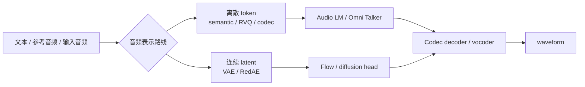

# 语音生成 tokenizer codec 技术路线

## 1. 内容定位

这篇解释 Qwen3-TTS 为什么强调 `12Hz tokenizer`，以及它和 `Qwen-Audio-VAE` 这种连续 audio latent 路线的区别。

如果要先区分语音 tokenizer 和 LLM 文本 tokenizer，见 [[方向/AI语音/知识/技术路线/语音模型 tokenizer 与 LLM tokenizer 对比|语音模型 tokenizer 与 LLM tokenizer 对比]]。

## 2. 核心判断

语音生成的关键瓶颈不是只有大模型参数，而是音频表示：token/latent 越短，生成越快、上下文越长、训练越省；但压缩越强，越容易损失音质、韵律和细节。

- **codec-LM 的隐性坑——[[方向/AI语音/知识/基础概念/DRI（离散表示不一致）|DRI]]**：神经 codec 不是确定性 tokenizer——同一段音频在不同上下文下可能映射到多组分歧的 token 序列（Discrete Representation Inconsistency），会诱发 codec-LM 生成时的漏读 / 重复；在 EnCodec 上有量化分析，缓解方法见来源。
- **离散不等于可纠错——[[方向/AI语音/思考/Error-Correcting Speech Token（可纠错语音 Token）]]**：普通 codec token 可能把噪声、混响和录音伪影也编码成合法状态；面向 SE / SpeechLLM 的 tokenizer 需要区分 robust semantic tokens 与 clean acoustic tokens。

## 3. 三类路线

| 路线 | 表示形态 | 优点 | 代价 | 代表 |
|---|---|---|---|---|
| 高帧率离散 codec | 离散 token，帧率较高 | 细节多，重建稳 | token 长，生成慢 | [[方向/AI语音/知识/基础概念/RVQ（残差向量量化）]]、EnCodec/SpeechTokenizer 类路线 |
| 语义增强多层 codec | 离散 RVQ token，约 50 Hz | 在 codec 量化前注入 SSL 语义特征，降低 TTS 漏词/错词 | 仍是多层 token，压缩/生成效率不如低帧率路线 | [[方向/AI语音/模型/X-Codec]] |
| 通用感知单码本 tokenizer | 离散单码本 token，25 Hz / 8192 vocab | 保留 semantic tokenizer 的 LLM 友好性，同时补 general audio perception | 依赖 SAP 自动标注和 SAE gate，真实跨域稳定性要测 | [[方向/AI语音/模型/UniAudio-Token]] |
| 有监督语义 tokenizer | 离散 semantic speech token | 文本语义对齐强，适合 TTS LLM 预测 | 不是完整 codec，声学重建依赖后续 flow/vocoder | [[方向/AI语音/模型/S3 Tokenizer]] / CosyVoice |
| 单层大码本 codec | 离散 token，约 50 tokens/s | token 流简单，适合 decoder-only LLM | 仍比 12Hz 路线长，音质和延迟要实测 | [[方向/AI语音/模型/X-Codec2]] / LLaSA |
| 感知引导去噪 codec | 离散 token，低至 12.5 tokens/s | 丢弃噪声和录音伪影，保留语义/音色/韵律，生成效率高 | 非 lossless，背景和环境线索可能被抹掉 | [[方向/AI语音/模型/CleanCodec]] |
| 低帧率离散 tokenizer | 离散 token，帧率低 | 低延迟、低码率，适合 AR 生成 | 需要更强模型补韵律和细节 | `Qwen3-TTS-Tokenizer-12Hz` |
| 连续 audio latent / VAE | 连续 latent | 适合扩散/flow/生成模型，可能扩展到 speech/music/sound | 训练和解码链路更复杂 | [[方向/AI语音/模型/Qwen-Audio-VAE]]、[[方向/AI语音/模型/DAC（Descript Audio Codec）]] |

## 4. 统一音频 / Omni 模型音频编解码对照

### 4.1. 架构示意（概念级）



这里的“编解码”要先分清两件事：**理解侧 audio encoder** 不一定能还原 waveform；**生成侧 codec / tokenizer / VAE** 才通常需要 decoder 或 vocoder 把 token / latent 渲染回声音。

| 模型                            | 理解侧音频编码                                                                                  | 生成侧表示                                                                                          | 波形解码                                                                   | 路线判断                                                        |
| ----------------------------- | ---------------------------------------------------------------------------------------- | ---------------------------------------------------------------------------------------------- | ---------------------------------------------------------------------- | ----------------------------------------------------------- |
| [[方向/AI语音/模型/LongCat-Next]]   | Whisper encoder -> 4x downsample -> 8-layer RVQ -> 12.5 Hz discrete audio tokens         | DiNA 自回归预测离散 audio tokens                                                                      | symmetric decoder -> coarse Mel -> flow-matching refiner -> vocoder    | 最彻底的“音频词汇化”：理解和生成都落在离散 token 空间                             |
| [[方向/AI语音/模型/UALM]]           | 16 kHz mono audio -> acoustic encoder 25 Hz -> MLP adapter -> Qwen2.5-7B embedding space | X-Codec 50 Hz RVQ，每帧 8 个 audio tokens；delay pattern 并行预测多层 codebook                            | codec decoder -> 16 kHz mono；enhancement VAE -> 48 kHz stereo          | 输入连续、输出离散：audio generation 放进 decoder-only LLM 词表           |
| [[方向/AI语音/模型/Audex]]          | 16 kHz audio -> AF-Whisper 25 Hz features -> 2-layer MLP adapter -> text embedding space | speech 用 X-Codec2 50 Hz FSQ；general audio 用 X-Codec 50 Hz RVQ                                  | speech codec decoder / vocoder；general audio decoder + enhancement VAE | 单 decoder 统一 audio-text；输出侧按 speech / non-speech 分 codec    |
| [[方向/AI语音/模型/DualSpeechLM]]   | Whisper-medium -> 2x downsampling Encoder + VQ -> USToken -> Adapter -> text LLM         | text LLM 先生成目标 USToken；AcousticGPT 生成 acoustic token                                           | acoustic decoder / WavTokenizer path -> waveform                       | 双 token：理解输入偏语义，生成输出偏声学                                     |
| [[方向/AI语音/模型/UniAudio]]          | 条件模态和目标音频都先 tokenized；侧重生成而非理解                                                           | RVQ neural codec tokens；multi-scale Transformer 缓解长 token 序列                                   | neural codec decoder -> waveform                                       | ICML 2024 早期统一音频生成：source-target 拼成单序列做 next-token prediction         |
| [[方向/AI语音/模型/UniAudio 2.0]]   | ReasoningCodec reasoning tokens：文本对齐、高层分析/规划                                             | reconstruction tokens：semantic-rich acoustic cues；9-stream text-audio AR modeling              | flow decoder / vocoder -> waveform                                     | 因子化离散 codec：reasoning token 管理解/规划，reconstruction token 管重建 |
| [[Qwen2.5-Omni]]   | 16 kHz audio -> 128-channel Mel -> Qwen2-Audio encoder -> 约 40 ms frame representation   | Talker 预测 qwen-tts-tokenizer 的 speech codes                                                    | flow-matching DiT: code -> Mel；modified BigVGAN: Mel -> waveform       | Thinker/Talker 分工：理解编码器和语音 codec 是两套接口                      |
| [[方向/AI语音/模型/Qwen3-Omni]]     | AuT audio encoder，输出 12.5 Hz 音频表示给 Thinker                                               | Talker 直接预测 multi-codebook RVQ speech tokens，并用 MTP 预测后续 residual codebooks                    | lightweight ConvNet Code2Wav decoder                                   | 相比 Qwen2.5，用 causal ConvNet 替代 block-wise diffusion，降低首包延迟  |
| [[方向/AI语音/模型/Qwen3.5-Omni]]   | 16 kHz audio -> 128 Mel -> AuT；压到 6.25 Hz、每帧约 160 ms                                     | Talker 直接在 Qwen3.5-Omni-Audio-Tokenizer 的 RVQ tokens 上生成；ARIA 把 text / speech 交错成单流            | causal streaming ConvNet Code2Wav                                      | Qwen3-Omni 的低延迟路线升级版：输入更压缩，输出仍是 codec-token-to-wave         |
| [[方向/AI语音/模型/FireRedAudio]]   | Audio Encoder -> Audio Adapter -> 12.5 Hz continuous perceptual representation           | RedAE 25 Hz continuous latent；Patch Encoder 降为 6.25 Hz RedAE-Patch 给 LLM；DiT 生成原生 RedAE latent | RedAE Decoder -> 24 kHz waveform                                       | 连续 latent 路线：不是查表 token，而是在连续声学空间做 flow generation          |
| [[方向/AI语音/模型/Ming-UniAudio]]  | MingTok-Audio 连续 $Z_{uni}$ -> pooling compression -> decoder-only MoE LLM                | per-token diffusion / flow-matching head 生成连续 speech representation                            | MingTok-Audio decoder -> complex spectrogram -> iSTFT -> waveform      | 统一连续 tokenizer：同一连续表示同时服务理解、生成和编辑                           |
| [[方向/AI语音/模型/Moshi]]          | Mimi codec 把 24 kHz speech 压到 12.5 Hz、1.1 kbps；语义 token 蒸馏自 SSL 模型                       | delayed-streams modeling 预测语义/声学 codec tokens                                                  | Mimi decoder -> waveform                                               | 低延迟全双工 codec-LM 标杆，核心是流式神经 codec                            |
| [[方向/AI语音/模型/Qwen-Audio-VAE]] | 不做 Omni 理解前端，定位是底层 audio VAE                                                             | 12.5 Hz、128-d continuous latent，覆盖 speech / music / sound                                      | VAE decoder -> audio                                                   | 更像通用音频生成底座，不等同于 Qwen Omni Talker codec                      |

关键链路可以压缩成这几类：

```text
LongCat-Next:
waveform -> Whisper features -> RVQ discrete audio tokens -> DiNA LLM -> audio tokens -> Mel/refiner/vocoder -> waveform

UALM / Audex:
input waveform -> audio encoder + adapter -> text embedding space -> LLM
text/context -> LLM -> X-Codec/X-Codec2 tokens -> codec decoder/vocoder -> waveform

DualSpeechLM / UniAudio 2.0:
speech -> semantic/reasoning tokens -> LLM planning -> acoustic/reconstruction tokens -> decoder -> waveform

Qwen Omni:
input waveform -> AuT/audio encoder -> Thinker hidden states
text/context -> Talker -> RVQ speech tokens -> Code2Wav or DiT+vocoder -> waveform

FireRedAudio:
input waveform -> Audio Encoder -> LLM understanding
reference/source waveform -> RedAE latent -> RedAE-Patch -> LLM -> DiT -> RedAE latent -> RedAE Decoder -> waveform

Ming-UniAudio:
waveform -> MingTok-Audio continuous Z_uni -> LLM -> per-token flow/diffusion head -> continuous speech representation -> decoder/iSTFT -> waveform

Moshi:
waveform -> Mimi codec tokens -> speech-text LM -> Mimi codec tokens -> waveform
```

选型上可以记成一句话：**LongCat / UniAudio 走离散 token 统一；DualSpeechLM / UniAudio 2.0 把理解 token 和重建 token 拆开；Qwen Omni 把理解 encoder 和 Talker codec 拆开；UALM / Audex 把音频输出 token 接进通用 decoder-only LLM；FireRedAudio / Ming-UniAudio 转向连续 latent + flow/diffusion 头；Moshi 把低延迟流式 codec 做到全双工对话里。**

## 5. Qwen3-TTS 的 tokenizer 分工

- `Qwen-TTS-Tokenizer-25Hz`：偏语义内容，和 Qwen-Audio 系列衔接更自然。
- `Qwen-TTS-Tokenizer-12Hz`：极低帧率、多 codebook、低码率，目标是流式低延迟和更长依赖建模。
- 12Hz 路线的工程意义：TTS 模型每秒要生成的 token 更少，首包更快，更适合实时语音 Agent。

## 6. Qwen-Audio-VAE 的位置

`Qwen-Audio-VAE` 不是普通 TTS tokenizer，而是更底层的通用音频表示：它面向 speech/music/sound 的高压缩、高保真、快速编码 latent，后续可能服务 text-to-audio、音乐、音效和语音编辑。

## 7. 选型判断

- 做低延迟 TTS：优先看低帧率离散 tokenizer。
- 做自然度、韵律、长文本稳定性：同时看 tokenizer 压缩率和语言模型建模能力。
- 做通用音频生成：优先关注连续 latent / VAE 路线。
- 做本地部署：低帧率 token 减少生成成本，但 vocoder/decoder 仍要单独测。

## 8. 评估指标

- **表示效率**：Hz、codebook 数、bitrate、每秒 token 数。
- **生成延迟**：首包、RTF、流式稳定性、分块边界伪影。
- **重建质量**：MOS、音色保持、韵律、噪声、音乐/非语音泛化。
- **可建模性**：长文本稳定性、重复/漏读、情绪控制、跨语言。
- **工程成本**：编码/解码速度、显存、批处理吞吐、部署复杂度。

## 9. 相关对象

- [[方向/AI语音/知识/基础概念/NAC（神经音频 Codec）|神经音频 Codec]]：codec / audio tokenizer 的基础概念入口。
- [[方向/AI语音/知识/基础概念/RVQ（残差向量量化）]]：多层离散 codec token 的常见量化方式。
- [[方向/AI语音/模型/DAC（Descript Audio Codec）]]：高保真通用 neural audio codec，常作为 EnCodec / SoundStream 类 acoustic codec 对照。
- [[方向/AI语音/知识/技术路线/语音模型 tokenizer 与 LLM tokenizer 对比|语音模型 tokenizer 与 LLM tokenizer 对比]]：文本 tokenizer 与语音 tokenizer 的基础差异。
- [[方向/AI语音/思考/Error-Correcting Speech Token（可纠错语音 Token）]]：补充 tokenizer 的纠错判据，解释为什么“离散化”不足以保证可纠错。
- [[方向/AI语音/模型/S3 Tokenizer|S3 Tokenizer]]：CosyVoice 的 supervised semantic speech tokenizer。
- [[方向/AI语音/模型/X-Codec]]：语义增强多层 RVQ codec，用于缓解普通 acoustic codec 在 audio LLM 中的语义短板。
- [[方向/AI语音/模型/X-Codec2|X-Codec2]]：LLaSA 使用的 50 tokens/s 单层大码本 speech codec。
- [[方向/AI语音/模型/UniAudio-Token]]：25 Hz / 8192 vocab 单码本 semantic audio tokenizer，用 SAP / SAE 补 general audio perception。
- [[方向/AI语音/模型/UniAudio]]：ICML 2024 统一音频生成模型，用 source-target 序列和 RVQ codec tokens 覆盖 speech / sound / music 生成。
- [[方向/AI语音/模型/CleanCodec]]：12.5 tokens/s 感知引导去噪 speech tokenizer，强调下游 TTS / VC 效率。
- [[方向/AI语音/模型/BiCodec|BiCodec]]：Spark-TTS 的单流解耦 speech token / codec 案例。
- [[方向/AI语音/模型/Qwen3-TTS|Qwen3-TTS]]：使用 12Hz tokenizer 的专用 TTS。
- [[方向/AI语音/模型/Qwen-Audio-VAE|Qwen-Audio-VAE]]：连续 audio latent 路线。
- [[方向/AI语音/评估/可控 TTS 与声音克隆评估框架|可控 TTS 与声音克隆评估框架]]：上层产品评估。
- [[方向/AI语音/选型/Qwen 语音模型技术路线图|Qwen 语音模型技术路线图]]：总路线图。

## 10. 来源

- [Qwen3-TTS Technical Report](https://arxiv.org/abs/2601.15621)
  - 内容定位：Qwen3-TTS 技术报告，记录 25Hz tokenizer、12Hz tokenizer、低延迟流式和 97ms 首包。
  - 用途：判断 Qwen3-TTS 的 tokenizer 技术路线。
  - 核验日期：2026-07-24
- [Qwen3-TTS README](https://github.com/QwenLM/Qwen3-TTS/blob/main/README.md)
  - 内容定位：Qwen3-TTS 官方仓库，记录 12Hz tokenizer、Base、CustomVoice、VoiceDesign 和使用方式。
  - 用途：确认开源模型家族和工程接口。
  - 核验日期：2026-07-24
- [Qwen-Audio-VAE Technical Report](https://arxiv.org/abs/2607.11738)
  - 内容定位：Qwen-Audio-VAE 技术报告，记录低码率连续 audio latent 和通用音频生成表示目标。
  - 用途：判断离散 tokenizer 与连续 VAE 路线差异。
  - 核验日期：2026-07-24
- [UALM: Unified Audio Language Model for Understanding, Generation and Reasoning](https://arxiv.org/abs/2510.12000)
  - 内容定位：UALM 技术论文，记录 acoustic encoder 输入、X-Codec 输出 token、delay pattern 和统一 audio/text 训练目标。
  - 用途：判断“输入连续、输出离散”的 decoder-only audio LLM 路线。
  - 发表日期：2025-10-13（arXiv v1）
  - 核验日期：2026-09-02
- [Unified Audio Intelligence Without Regressing on Text Intelligence](https://arxiv.org/abs/2607.05196)
  - 内容定位：Audex 技术论文，记录 AF-Whisper 输入、MLP adapter、X-Codec2 speech tokens、X-Codec non-speech tokens 和 unified decoder。
  - 用途：判断 Audex 的音频输入编码与输出 codec dispatch。
  - 发表日期：2026-07-06（arXiv v1）
  - 核验日期：2026-09-02
- [DualSpeechLM: Towards Unified Speech Understanding and Generation via Dual Speech Token Modeling with Large Language Models](https://arxiv.org/abs/2508.08961)
  - 内容定位：DualSpeechLM 技术论文，记录 USTokenizer、USToken、acoustic token、AcousticGPT 和 Chain-of-Condition。
  - 用途：判断 dual-token modeling 的理解/生成分工。
  - 发表日期：2025-08-12（arXiv v1）
  - 核验日期：2026-09-02
- [UniAudio: Towards Universal Audio Generation with Large Language Models](https://proceedings.mlr.press/v235/yang24x.html)
  - 内容定位：UniAudio 早期论文，记录 universal audio generation、RVQ neural codec token、multi-scale Transformer 和 source-target next-token prediction。
  - 用途：作为统一音频生成离散 token 路线前身。
  - 发表日期：2024-07-21（ICML 2024 proceedings）
  - 核验日期：2026-09-02
- [UniAudio 2.0: A Unified Audio Language Model with Text-Aligned Factorized Audio Tokenization](https://arxiv.org/abs/2602.04683)
  - 内容定位：UniAudio 2.0 技术论文，记录 ReasoningCodec、reasoning/reconstruction token、9-stream text-audio modeling 和 flow decoder。
  - 用途：判断 factorized audio tokenization 的理解/重建分工。
  - 发表日期：2026-02-04（arXiv v1）
  - 核验日期：2026-09-02
- [Ming-UniAudio: Speech LLM for Joint Understanding, Generation and Editing with Unified Representation](https://arxiv.org/abs/2511.05516)
  - 内容定位：Ming-UniAudio 技术报告，记录 MingTok-Audio、连续 $Z_{uni}$、per-token diffusion / flow-matching head 和 free-form speech editing。
  - 用途：作为统一连续 speech representation 路线对照。
  - 发表日期：2025-10-26（arXiv v1；官方项目页另有 2025-09-30 发布口径）
  - 核验日期：2026-09-02
- [LongCat-Next: Lexicalizing Modalities as Discrete Tokens](https://arxiv.org/abs/2603.27538)
  - 内容定位：LongCat-Next 技术报告，记录 DiNA、音频 RVQ tokenizer、audio detokenizer 和原生离散多模态路线。
  - 用途：判断 LongCat-Next 的音频 tokenization / detokenization 方式。
  - 发表日期：2026-03-29（arXiv v1）
  - 核验日期：2026-09-02
- [Qwen2.5-Omni Technical Report](https://arxiv.org/abs/2503.20215)
  - 内容定位：Qwen2.5-Omni 技术报告，记录 Thinker-Talker、audio encoder、qwen-tts-tokenizer、flow-matching DiT 和 BigVGAN 解码链路。
  - 用途：判断 Qwen Omni 早期语音输入/输出接口。
  - 发表日期：2025-03-26（arXiv v1）
  - 核验日期：2026-09-02
- [Qwen3-Omni Technical Report](https://arxiv.org/abs/2509.17765)
  - 内容定位：Qwen3-Omni 技术报告，记录 AuT、Talker、multi-codebook RVQ、MTP 和 lightweight ConvNet Code2Wav。
  - 用途：判断 Qwen3-Omni 从 block-wise diffusion decoder 转向低延迟 codec-to-wave decoder 的变化。
  - 发表日期：2025-09-22（arXiv v1）
  - 核验日期：2026-09-02
- [Qwen3.5-Omni Technical Report](https://arxiv.org/abs/2604.15804)
  - 内容定位：Qwen3.5-Omni 技术报告，记录 6.25 Hz audio tokens、ARIA、RVQ token Talker 和 Code2Wav。
  - 用途：判断 Qwen3.5-Omni 的输入压缩与流式语音生成接口。
  - 发表日期：2026-04-17（arXiv v1；v2 于 2026-04-21 更新）
  - 核验日期：2026-09-02
- [FireRedAudio: A General-Purpose Audio Language Model with Decoupled Continuous Representations for Understanding and Generation](https://arxiv.org/abs/2608.24168)
  - 内容定位：FireRedAudio 技术报告，记录 Audio Encoder Path、RedAE / RedAE-Patch、DiT flow loss 和 RedAE Decoder。
  - 用途：作为连续 latent 生成路线对照。
  - 发表日期：2026-08-25（arXiv v1；v2 于 2026-08-27 更新且技术内容不变）
  - 核验日期：2026-09-02
- [Moshi: a speech-text foundation model for real-time dialogue](https://arxiv.org/abs/2410.00037)
  - 内容定位：Moshi 技术报告，记录 Mimi codec、12.5 Hz / 1.1 kbps 低码率语音 token 和实时全双工建模。
  - 用途：作为低延迟 codec-LM 路线对照。
  - 发表日期：2024-09-17（arXiv v1；v2 于 2024-10-02 更新）
  - 核验日期：2026-09-02
- [Analyzing and Mitigating Inconsistency in Discrete Audio Tokens for Neural Codec Language Models](https://arxiv.org/abs/2409.19283)
  - 内容定位：分析 EnCodec 类 codec 的 DRI（同一音频映射多组 token）及其对 codec-LM 漏读/重复的影响，提出缓解方法；LibriTTS 与 44k 小时 MLS 验证。
  - 用途：理解高帧率离散 codec 路线的 token 一致性问题（对应"可建模性"评估维度）。
  - 核验日期：2026-08-11
- [Codec Does Matter: Exploring the Semantic Shortcoming of Codec for Audio Language Model](https://arxiv.org/abs/2408.17175)
  - 内容定位：X-Codec 论文，提出在 RVQ 前融合 SSL semantic feature 并增加 semantic reconstruction loss。
  - 用途：补充语义增强多层 codec 路线和 audio LLM tokenizer 的语义短板问题。
  - 核验日期：2026-09-02
- [UniAudio-Token: Empowering Semantic Speech Tokenizers with General Audio Perception](https://arxiv.org/abs/2605.31521)
  - 内容定位：UniAudio-Token 论文，提出 SAP 结构化监督和 SAE 内容感知浅/深层融合。
  - 用途：补充通用感知单码本 semantic audio tokenizer 路线。
  - 核验日期：2026-09-02
