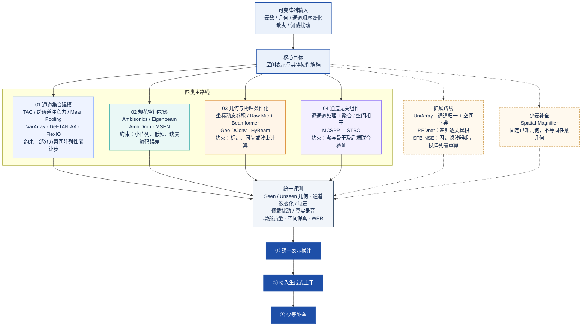

# 阵列可变方案技术路线概览图

> [!note] 读图口径
> 本图依据 [[方向/AI语音/知识/技术路线/Array-Agnostic SE（阵列无关语音增强）|Array-Agnostic SE 路线详页]] 归并。“阵列可变”覆盖麦数、几何、通道顺序与缺失变化；固定已知几何的少麦空间上采样单列为补充路线，不等同于任意几何泛化。
> 术语分层见详页 §2：**阵列可变 = 输入设置层（variable-array）**，**阵列无关 = 模型性质声明（array-agnostic / invariant）**；标题沿用"阵列可变"指前者，本图描述的路线本身是后者。

## 1. 技术路线概览

## 2. 方案索引

- **通道集合建模**：[[方向/AI语音/模型/VarArray|VarArray]]、[[方向/AI语音/模型/DeFTAN-AA|DeFTAN-AA]]、[[方向/AI语音/模型/FlexIO|FlexIO]]、[[方向/AI语音/模型/LABNet|LABNet]]（CCA：Q 取参考通道、K/V 取全通道）。
- **规范空间投影**：[[方向/AI语音/模型/AmbiDrop|AmbiDrop]]、[[方向/AI语音/模型/MSEN（特征束多阶编码器）|MSEN]]。
- **几何与物理条件化**：[[方向/AI语音/模型/Geo-DConv|Geo-DConv]]、[[方向/AI语音/模型/HyBeam|HyBeam]]。
- **通道无关组件**：MCSPP、LSTSC。
- **扩展与补充**：[[方向/AI语音/模型/UniArray|UniArray]]、[[方向/AI语音/模型/REDnet|REDnet]]、[[方向/AI语音/模型/SFB-NSE|SFB-NSE]]、[[方向/AI语音/模型/Spatial-Magnifier|Spatial-Magnifier]]。

## 3. 导出图件

- [[方向/AI语音/知识/技术路线/阵列可变方案技术路线概览图.svg|SVG 矢量图]]：适合插入幻灯片与继续编辑。
- [[方向/AI语音/知识/技术路线/阵列可变方案技术路线概览图.png|PNG 位图]]：适合直接预览与分享。
